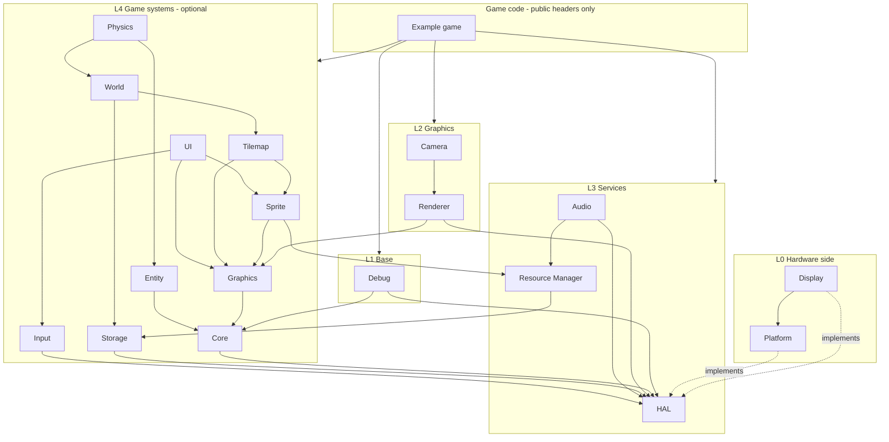

# 01 Architecture overview (session S2.1, 2026-11-15)
API spec / design only. No implementation. Tags: [verified] source named; [calculated] formula shown; [assumed] design judgement or budget; UNKNOWN. Budgets are allocation limits, not measurements (K12).

## Summary for later sessions
- 18 spec modules grouped in 6 layers; dependencies point downward only; `core/` includes no platform header (rule R-1 to R-6, section 3).
- Hardware is reached only through 6 C-compatible HAL headers (display, input, time, audio, storage, debug); one implementation is linked per platform (K7).
- Render path: one band renderer (K2); band buffer RGB565 (K3); game render callback runs once per band under a clip rectangle.
- Memory: no heap after init (K5). Three allocators: init arena (never freed), frame arena (reset each tick), fixed pools. Placement macros PGE_RAM_FAST, PGE_RAM_DMA, PGE_RAM_EXT, PGE_ROM are defined per platform.
- Three profiles: SMALL (about 64 KB RAM class, 160x128), MEDIUM (256-512 KB, 320x240), LARGE (external RAM, 320x240). Engine RAM budgets [calculated sums of assumed per-module budgets]: SMALL 16,512 B; MEDIUM 77,696 B; LARGE 90,496 B internal + 284,672 B external (scale staging at s > 1 not included, section 5.3).
- Profile mapping [assumed]: host = LARGE (can emulate MEDIUM/SMALL), F429I-DISCO = LARGE, ESP32-S3 N16R8 = LARGE with band buffers in internal RAM, ESP32 classic and RP2350 = MEDIUM, RP2040 and small STM32F4 = SMALL or MEDIUM.
- Capability profile = compile-time header `pge_profile.h` per board plus optional `pge_user_config.h`; fields from 02 section 5; derived switches in section 6.
- Naming: namespace `pge`, C symbols `pge_<module>_<verb>`, headers `pge/<module>.h`, macros `PGE_*`.
- Directory tree is final in section 8; Tier B boards get skeleton folders in S7.2a, not now.
- Proposals still open for S2.2: R10 portrait panel handling on DISCO; band-skip; windowed flush; async double band buffer. For S2.3: R13 split (health, AI, crafting) pending user answer at G1.
- Flash: no estimate possible before code. Design caps only (section 5.4); S5.4 linker report checks them.

## 1 Scope
Defines module map, dependency rules, memory strategy, capability profile, portability and naming rules, directory tree. Interfaces: S2.2 (HAL, renderer, game API) and S2.3 (world, entity, storage, resource, audio, UI). Key decisions K1-K15 are inputs; none changes here.

## 2 Module map (all 18 spec modules)
Layer: L0 hardware, L1 base, L2 graphics, L3 services, L4 game systems. "Opt" = switched by the capability profile (K14).

| # | Module | Layer | Purpose | Depends on | Core/Opt | Owns memory |
|---|---|---|---|---|---|---|
| 1 | HAL | L0 | C headers declaring display, input, time, audio, storage, debug | none | core | none |
| 2 | Platform | L0 | board implementation of the HAL, startup, buffer placement | HAL, vendor SDK | core (per board) | band buffers, DMA descriptors |
| 3 | Display | L0 | controller drivers (ILI9341, LTDC glue) behind HAL display | HAL, Platform bus | core (per board) | controller init tables (ROM) |
| 4 | Core | L1 | lifecycle, fixed-timestep loop (K4), config, arenas, pools | HAL time | core | init arena, frame arena |
| 5 | Debug | L1 | counters (frame/band/flush time, pool high-water), log, overlay data | Core, HAL debug | core (overlay opt) | counter struct |
| 6 | Graphics | L2 | colour, clip, primitives, bitmap text | Core | core | none (draws into band) |
| 7 | Renderer | L2 | band lifecycle, layers, flush, integer scale (K15) | Graphics, HAL display | core | band buffer(s) |
| 8 | Sprite | L2 | sheets, flip, transparency, frame animation | Graphics, Resource | core | none |
| 9 | Tilemap | L2 | multi-layer tile draw from a tile source | Graphics, Sprite | core | none |
| 10 | Camera | L2 | position, world clamp, parallax factor, scale | Renderer | core | camera struct |
| 11 | Input | L3 | unified buttons, axes, touch point, mapping table | HAL input | core | state arrays |
| 12 | Audio | L3 | mixer, PCM effects, pattern music | HAL audio, Resource | opt | channel states, mix buffer |
| 13 | Storage | L3 | file-like interface, save format, config file | HAL storage | opt | I/O buffer |
| 14 | Resource Manager | L3 | assets from flash or storage through one interface | Storage | core (storage part opt) | asset table |
| 15 | World | L4 | chunk store (K8), LRU cache, generation hook, change lists | Tilemap, Storage | opt | chunk cache |
| 16 | Entity | L4 | fixed pools, parallel arrays (K9), spawn/despawn | Core | opt | entity pools |
| 17 | Physics | L4 | tile sweep collision, gravity step, overlap queries | World or Tilemap, Entity | opt | none (works on pools) |
| 18 | UI | L4 | label, bar, icon grid, list menu | Graphics, Sprite, Input | opt | none beyond widget state in game |

Game code sits above L4 and uses public headers only (checked by grep in S6.1).
Tradeoff: grouping Display with L0 keeps panel quirks (byte order, window commands) out of the renderer, at the cost of one more HAL-side layer.

## 3 Dependency rules
- R-1 `core/` and `hal/` include no vendor or platform header. A grep check, added in S3.0, enforces it.
- R-2 Dependencies point to a lower or equal layer only. No cycles. L4 may use L2 and L3, never the reverse.
- R-3 Hardware code lives only under `platform/` and `drivers/`. Engine code reaches hardware through `pge/hal/*.h`.
- R-4 One platform per binary; link-time binding, no runtime backend switch, no virtual calls in hot paths (K7).
- R-5 An optional module may be compiled out. Core modules must not reference an optional one; a core module needing optional behaviour exposes a hook (function pointer set at init).
- R-6 No dynamic allocation after `pge_init` returns (K5). No exceptions, no RTTI, no allocating STL, no iostream (K6).
Tradeoff: link-time binding gives zero-cost calls but one display and one platform per binary.

## 4 Module diagram

Note: Camera is drawn under L2 but is used by the game for the world view; Resource Manager is listed in L3 and used by Sprite and Audio, which breaks pure layering for Sprite (L2 to L3). Resolution: Sprite and Tilemap read asset data through a plain pointer plus size that the Resource Manager hands out, so the build dependency is on the data type header only (`pge/asset.h`), not on the Resource Manager implementation. [assumed, checked in S2.2]

## 5 Memory strategy
### 5.1 Allocators
- Init arena: bump allocation during `pge_init`, never freed. Holds pools, caches and buffers sized from the profile.
- Frame arena: bump allocation, reset at the start of each tick. Scratch for the game and for the engine (for example a band-local list).
- Fixed pools: `Pool<T, N>` with index free-list (uint16 indices), O(1) alloc/free, high-water mark exported to Debug. Exhaustion returns an error value, never allocates.
- Static sizing: all counts come from `pge_profile.h`. Linker map script (S5.4) reports RAM and flash per module.
Tradeoff: fixed sizes waste RAM when a game uses less, but give predictable timing and no fragmentation.

### 5.2 Placement macros (defined by the platform)
PGE_RAM_FAST (CPU-fast internal RAM), PGE_RAM_DMA (internal RAM the DMA engine reaches, aligned per profile), PGE_RAM_EXT (SDRAM or PSRAM), PGE_ROM (flash/XIP). Core code only applies the macros; the platform maps them to sections or attributes. Unknown DMA reach rules (for example F4 CCM, UNKNOWN in 02) stay in the platform. [assumed]

### 5.3 Per-module RAM budget by profile (bytes)
Assumptions [assumed]: entity record 24 B, particle 8 B, palette 256 x 2 B = 512 B [calculated], chunk 32x32x2 layers x 1 B = 2,048 B [calculated], band = width x lines x 2 B [calculated]. SMALL screen 160x128, MEDIUM and LARGE 320x240.

| Module / item | SMALL | MEDIUM | LARGE (internal) | LARGE (external) |
|---|---|---|---|---|
| Core (loop, arenas bookkeeping) | 512 | 1,024 | 1,024 | - |
| `frame_arena_bytes` (frame arena slab) [assumed] | 2,048 | 8,192 | 16,384 | - |
| Renderer band buffers | 2,560 (160x8, 1 buffer) | 20,480 (320x16, 2 buffers) | 20,480 (320x16, 2 buffers) | - |
| Full framebuffer (optional) | - | - | - | 153,600 (320x240) |
| Palettes (count x 512) | 512 (1) | 1,024 (2) | 2,048 (4) | - |
| World chunk cache (count x 2,048) | 8,192 (4) | 32,768 (16) | - | 131,072 (64) |
| Entity pools (count x 24) | 1,536 (64) | 6,144 (256) | 24,576 (1,024) | - |
| Particle pool (count x 8) | 256 (32) | 1,024 (128) | 4,096 (512) | - |
| Input | 128 | 256 | 256 | - |
| Audio (channels, mix buffer) | 0 (off) | 2,176 (4 ch) | 4,224 (8 ch) | - |
| Storage I/O buffer | 512 | 4,096 | 16,384 | - |
| Save staging (streaming, reuses the I/O buffer; 03 section 4.1) | 0 | 0 | 0 | - |
| Debug counters | 256 | 512 | 1,024 | - |
| Total | 16,512 | 77,696 | 90,496 | 284,672 |
| `scale_staging_bytes` at s_max (NOT in total) [calculated] | 0 (s=1) | 20,480 (s=2) | 30,720 (s=3) | - |

Sums [calculated]: SMALL 512+2,048+2,560+512+8,192+1,536+256+128+0+512+0+256 = 16,512. MEDIUM 1,024+8,192+20,480+1,024+32,768+6,144+1,024+256+2,176+4,096+0+512 = 77,696. LARGE internal 1,024+16,384+20,480+2,048+24,576+4,096+256+4,224+16,384+0+1,024 = 90,496. LARGE external 153,600+131,072 = 284,672. The earlier "UI widget state" row (512 / 1,024 / 2,048) is deleted: widgets are stateless (D18), so earlier totals 14,976 / 70,528 / 76,160 are superseded.
Scale staging [calculated] = (N x s) x (W x s) x 2 B = band_lines x s x display_w x 2 B (02 example: N = 8, s = 2, W = 160 -> 10,240 B): MEDIUM 16 x 2 x 320 x 2 = 20,480; LARGE 16 x 3 x 320 x 2 = 30,720; SMALL 0 since s_max = 1. Totals still exclude scale staging at s > 1: formula (N*s)*(W*s)*2. With staging at s_max: MEDIUM 77,696 + 20,480 = 98,176; LARGE internal 90,496 + 30,720 = 121,216 [calculated]. Staging sits in DMA-reachable internal RAM (PGE_RAM_DMA) [assumed].
LARGE full-height band mode needs 153,600 B in external or DMA-capable RAM (PGE_RAM_EXT or PGE_RAM_DMA); it is the "Full framebuffer" row, already counted in the external column, not an extra.
Not included: world data of a whole non-chunked map, game state, stacks, vendor SDK buffers, LTDC framebuffers (DISCO: 2 x 153,600 B in SDRAM, counted by the platform). These two LTDC buffers are the two present buffers of PGE_DISP_VSYNC: flush writes the back one, `frame_end` swaps (02 section 2.2).
Reading: SMALL leaves most of a 64 KB class device to the game; MEDIUM fits 256-512 KB parts (engine total 101,744 B per 03 section 8; 122,224 B with scale staging at 2x); LARGE puts bulk data in external RAM and keeps only band buffers and hot pools in internal RAM.

### 5.4 Flash
No estimate before code exists (UNKNOWN). Design caps for engine code with all modules on [assumed]: SMALL 64 KB, MEDIUM 128 KB, LARGE 256 KB. S5.4 linker report checks them; a missed cap is logged in `STATUS.md`, not hidden. Assets (fonts, sprites, tile sets) are counted separately.

### 5.5 Frame and band flow
Tick (fixed timestep) updates game state. Render: for each band top to bottom, set clip, run the game render callback, flush the band. The callback must not change game state; randomness it uses is seeded per frame, not per band (rule from PLAN-S2, fixed in S2.2). Band-skip, windowed flush and async double band buffer are proposals for S2.2 [assumed].

## 6 Capability profile definition
Compile-time. File `platform/<board>/pge_profile.h` sets fields; `pge_user_config.h` (optional, in the game project) may lower limits. Fields (from 02 section 5): cpu_mhz, has_fpu, ram_budget_bytes, band_lines, band_buffer_in_dma_memory, external_ram, display_bus and max_bus_hz, has_2d_dma, dma_alignment_bytes, max_dma_transfer_bytes, cache_coherency_required, byte_swap_on_flush, audio_out, storage, input_adc_bits, tick_source_hz, scale_staging_bytes, frame_arena_bytes.

Derived switches by named profile [assumed]:

| Switch | SMALL | MEDIUM | LARGE |
|---|---|---|---|
| Logical screen | 160x128 | 320x240 | 320x240 (portrait 240x320 on DISCO, R10) |
| band_lines | 8 | 16 | 16 (full height allowed: 153,600 B external/DMA RAM, section 5.3) |
| integer_scale_max (K15) | 1 | 2 | 3 |
| parallax_layers | 1 | 2 | 4 |
| chunk_cache_count | 4 | 16 | 64 |
| audio_channels | 0 | 4 | 8 |
| lighting_enabled | off | off | optional (enabled only after a measurement in S5.6) |
| particle_count | 32 | 128 | 512 |

Profile mapping [assumed]: host = LARGE and can be built as MEDIUM or SMALL to exercise the low-RAM path (K1); F429I-DISCO = LARGE; ESP32-S3 N16R8 = LARGE with band buffers in internal RAM (R3); Tier B: ESP32 classic and RP2350 = MEDIUM, RP2040 and F401/F411/F446 = SMALL or MEDIUM. Tier B mapping stays untested.
Storage backend per Tier A board [assumed]: host = plain files. STM32F429I-DISCO has no SD slot and no QSPI flash, so its backend = USB-host mass storage with FatFs (as in the reference repo's DOOM port, not re-checked here); fallback when no medium is attached: mount returns NotSupported and the world is RAM-only (no save). ESP32-S3 = SPI SD card (FatFs) or LittleFS on a flash partition.
A feature switch off removes its code and its memory from the link; core modules never depend on it (R-5).
Tradeoff: compile-time profiles need one build per board but cost no RAM for unused features and keep timing predictable.

## 7 Portability and naming rules
- P-1 Integer and fixed-point maths in the core (K4); no `float` in the core API; a float convenience layer may live outside `core/`.
- P-2 Fixed-width types (`uint8_t`, `int32_t`) for all data layouts; stored formats are little-endian with explicit field sizes; no struct dumped to storage without a fixed layout and version field.
- P-3 No platform ifdefs in `core/`; variation comes from `pge_profile.h` constants and HAL calls.
- P-4 No `printf` family or iostream in the core; debug text goes through the HAL debug function.
- P-5 Every public function documents ownership of buffers, blocking behaviour and failure result (full contracts in S2.2).
- P-6 Every performance statement in docs carries a tag and, for bus numbers, the datasheet limit and clock used (K12).
- N-1 C++ namespace `pge`; C symbols `pge_<module>_<verb>`; headers `pge/<module>.h`; HAL headers `pge/hal/<name>.h`.
- N-2 Types PascalCase; functions and methods lowerCamel; constants `kPascalCase`; macros `PGE_UPPER_SNAKE`; files lower_snake_case.
- N-3 Error returns are an `Error` enum value (0 = ok); no exceptions (K6).
Tradeoff: no float in the core is less familiar than the spec's `deltaTime` sample, but behaviour is deterministic and RP2040 has no FPU (K4).

## 8 Directory tree (final)
```
PIXEL_ENGINE/
  CMakeLists.txt  LICENSE  README.md  PLAN.md  STATUS.md
  cmake/                   toolchain files, options
  core/include/pge/        public headers (one per module, plus asset.h, config.h)
  core/src/                base/  gfx/  world/  entity/  physics/  input/  audio/  storage/  resource/  ui/  debug/
  hal/include/pge/hal/     display.h  input.h  time.h  audio.h  storage.h  debug.h
  drivers/                 ili9341/ (SPI, 8080)  ltdc_glue/   no engine logic
  platform/host/           SDL2 display, input, audio, file storage; pge_profile.h
  platform/stm32f429i_disco/
  platform/esp32s3/        (S4.5)
  platform/<tier B>/       skeletons only, S7.2a
  examples/platformer/  examples/sandbox/
  tools/                   asset converters, memory report (Python)
  bench/                   b1/  raw/
  tests/                   host unit tests (CTest)
  docs/                    research/  architecture/  benchmarks/  dev/  user/
  plan/                    session plans
```
Mapping of the 18 modules to folders: HAL = `hal/`; Platform = `platform/`; Display = `drivers/` plus the HAL display contract; the other 15 modules are folders under `core/src/` as listed.
Tradeoff: one `core/` library keeps the build simple; per-module static libraries are possible later if link size demands it.

## 9 Decisions and tradeoffs recorded here
| Id | Decision | Tradeoff |
|---|---|---|
| D1 | 6 HAL headers, C-compatible | more files than one big header; each platform can implement only what it has |
| D2 | Three allocators (init arena, frame arena, pools) | no general malloc; every user states a size |
| D3 | Placement macros instead of platform ifdefs | core stays portable; platform must map four macros |
| D4 | Compile-time profiles with named SMALL/MEDIUM/LARGE | fewer combinations to test than free-form flags; less tuning freedom |
| D5 | Optional modules compile out | more build configurations to keep green; S3.0 adds a host build of all three profiles |
| D6 | Asset data passed as pointer plus size (`asset.h`) | Sprite and Tilemap do not depend on the Resource Manager implementation |
D1-D6 are proposals for G2, not changes to K1-K15. Log them in `STATUS.md` if accepted.

## 10 Open items handed on
- S2.2: HAL contracts, R10 portrait handling, band-skip/windowed/async proposals, render-callback contract, error policy.
- S2.3: R13 engine-versus-game split for inventory, crafting, AI and health (needs user answer at G1); chunk and save formats.
- S2.4: GLM review of the three architecture docs (log: `REVIEW-LOG.md`).
- S3.2 / S5.3b: the DISCO storage backend (USB-host mass storage plus FatFs) is a dependency of save testing on Tier A board 1; until it works, save tests run on the host and ESP32-S3.
- UNKNOWN carried: DMA reach and alignment on F429 (RM not read), TE pin on the user's module, flash sizes.
