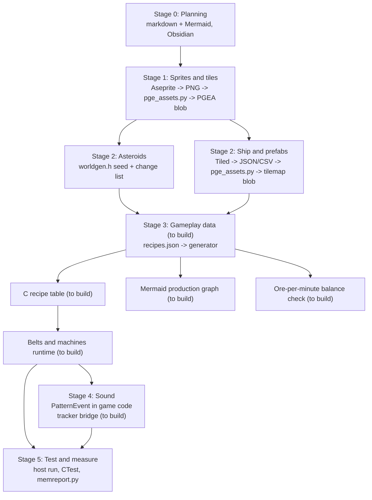

# Tooling and workflow for the space-mining factory game (PGE)

Date: 2026-11-16. Working document for the user and their development partner.

## 1. Context and status legend

The game (user's words):

- Terraria + Factorio inspired. Pixel space with small procedurally generated asteroids (~400 px diameter) with several mineral kinds.
- Mined resources go to the main base ship, where machines run by themselves with belts (Factorio-like but simpler) and make hi-tech equipment, vehicles and tools from ore of several asteroids.
- Screen 320x240. Each asteroid is loaded when the character teleports or flies there. Runs on STM32 and ESP32 microcontrollers.

Status legend:

| Mark | Meaning |
|---|---|
| exists | Verified in the repo or installed on this machine |
| to build | Planned, not built yet |
| [placeholder] | Not decided or not known; do not guess |
| Claude's call, change if wrong | A recommendation, not a fact |

Web facts below were searched on 2026-11-16. Where a fact says "not confirmed", it is.

## 2. Stage 0 - Planning and design notes

| Tool | Reason |
|---|---|
| Markdown in the repo (docs/) - exists | Plain text, diffable, both people can edit it |
| Mermaid - Claude's call, change if wrong | Text diagrams, git-diffable, renders in GitHub, Obsidian and VS Code; weak for free-form layout |
| Obsidian (installed) | Reads the same markdown and renders Mermaid |
| Excalidraw - Claude's call, change if wrong | Only for throwaway sketches; also available in Obsidian via plugin |
| draw.io | Not chosen: XML files, harder diffs |
| Obsidian Canvas | Use with git: not confirmed |
| Graphviz `dot` | Not installed on this machine, so not used |

Claude's call, change if wrong: Mermaid in the repo for the plan graph, Excalidraw only for throwaway sketches.

How output reaches the engine: it does not. Planning notes are documents only. The one exception is the production graph in Stage 3, which is generated from data (to build).

## 3. Stage 1 - Sprites and tiles

| Tool | Reason |
|---|---|
| Aseprite (lead recommendation) | Proprietary EULA paid editor, one-time $19.99 USD on Steam as of June 2026 (sales as low as $12.99 in Jan 2026); latest stable seen v1.3.17 (Feb 2026) on Wikipedia, developer blog mentions 1.3.18; building from source is free |
| LibreSprite (free alternative) | Free fork of the last GPLv2 Aseprite; maintenance status not confirmed |
| Pixelorama (free alternative) | Free open source, built with Godot; sprite-sheet export and activity not confirmed |
| Lospec palette list | Many 32-colour palettes, e.g. Jehkoba32, Cheerful-32, Vitality 32, Ae-32, Watt32; pick one = [placeholder] |
| tools/pge_assets.py (exists) | Python 3.14 + Pillow 12.2 are installed; converts PNG to engine blobs |

Shared fixed palette as art convention - Claude's call, change if wrong. It is only a convention in the editor and is not enforced: the converter builds the palette per sheet. Each sheet must stay at or below 256 colours anyway.

Tile size of the game: [placeholder]. Integer screen scale: [placeholder]. The engine accepts any tile size (collision.h tile_w/tile_h are uint8, any value >= 1).

Animation: in game code, `struct Animation{first,count,ticks_per_frame,loop}`. The converter output carries no animation tags or durations, so editor frame tags do not carry over automatically. Reading tags from the editor JSON is optional, to build.

How output reaches the engine:

1. Draw PNG (sprite sheet or tileset) in the editor.
2. Run tools/pge_assets.py. Output is a blob with header "PGEA", type (sprite or tileset), version 1; indexed pixels, RGB565 palette per sheet, max 256 colours, alpha < 128 = transparent index 0.
3. Rules: image size must be an exact multiple of the frame size; tileset frames are <= 255 px wide/high and stacked (no atlas).
4. The engine loads the blob as a sprite or tileset resource.

## 4. Stage 2 - Levels (asteroid worldgen, ship layout, prefabs)

| Tool | Reason |
|---|---|
| core/include/pge/worldgen.h (exists) | Seeded procedural generation for asteroids; no map file needed |
| Tiled | Only for ship layout and hand-made prefabs (rooms, structures), not for asteroids |
| tools/pge_assets.py (exists) | Converts Tiled JSON or CSV to a tilemap blob |

World model (exists): 32x32-tile chunks, 2 layers (foreground, wall), 1 byte per tile per layer, seeded procedural generation plus saved change lists; chunk cache 4/16/64 by profile.

Size estimate (calculated, not measured): a 400 px asteroid is about 50x50 tiles at 8 px tiles (about 2x2 chunks) or 25x25 at 16 px (inside one chunk).

Ship = separate small tile grid, size [placeholder] (Claude's call, change if wrong).

Tiled export rules for pge_assets.py:

- JSON export has an "infinite" flag. Use finite maps.
- Layers can use compression zlib/gzip/zstd or none. Use none.
- The converter rejects infinite maps (layer "chunks") and encoded/compressed layer data. Export a plain finite JSON array or CSV.
- A GUI tile editor is out of scope in PLAN.md, so Tiled is the editor.

How output reaches the engine:

- Asteroids: worldgen.h from a seed at load time, plus the saved change list for mined tiles.
- Ship and prefabs: Tiled -> finite JSON/CSV, no compression -> pge_assets.py -> tilemap blob -> engine.

## 5. Stage 3 - Gameplay data (recipes, belts, machines, economy balance)

Current state: plan/PLAN-S6-example-game.md has only a recipe table plus craft menu in game code. Belts/machines automation is NOT in the plan yet.

Claude's call, change if wrong - approach B "data-first":

- One `recipes.json` (to build) holds ores, items, machines, times, belt speeds.
- A small Python generator (to build, about one session) reads it and emits:
  - the C recipe table,
  - a Mermaid production graph (not Graphviz, `dot` is absent),
  - an ore-per-minute balance check.

| Tool | Reason |
|---|---|
| recipes.json - to build | Single source of truth for items, machines, times, belt speeds |
| Python generator - to build | Keeps C table, graph and balance in sync with the data |
| Mermaid - Claude's call, change if wrong | Graph output is text, renders in GitHub and Obsidian |
| factorio-planner (PyPI), FactorioViewer | Inspiration only; they target Factorio data, not this game |

Numbers still open: mineral kinds, items, machines = [placeholder]. Belt simulation model (per-tile slot state vs per-item entities) = [placeholder].

How output reaches the engine: recipes.json -> generator -> generated C recipe table (to build) -> compiled into the game code. Belts and machines runtime: to build, not in the plan.

## 6. Stage 4 - Sound (short)

| Tool | Reason |
|---|---|
| audio.h (exists) | Software mixer and Pattern/PatternEvent music (channel, instrument, note 0..127, volume) |
| Furnace tracker | Free GPLv2+; exports VGM, WAV and some chip formats, but NOT the engine's Pattern struct |
| BeepBox, FamiTracker | Export to the engine: not confirmed |

How output reaches the engine: patterns are written in game code as PatternEvent data. No tracker importer exists. A bridge from any tracker to PatternEvent is [placeholder] / to build.

## 7. Stage 5 - Test and measure (short)

| Tool | Reason |
|---|---|
| Host run (SDL host backend, exists) | Fast play-testing on the PC |
| Host CTest (exists) | Automated tests of the engine and examples |
| tools/memreport.py (exists) | RAM/flash report from the linker map |
| Benchmarks | [placeholder] |
| Save/load round-trip | Save format exists (S5.3); game-level save test [placeholder] |

How output reaches the engine: it does not. These tools read the build and report back; the numbers feed decisions such as tile size and chunk cache profile.

## 8. Full workflow

Each node: tool -> file format -> engine consumer. "(to build)" marks unbuilt nodes.

```text
Game workflow
|
+-- Stage 0 Planning
|   +-- docs/*.md, Obsidian -> markdown -> (none, documents only)
|   +-- Mermaid in repo -> .md text -> (none, documents only)
|   +-- Excalidraw sketches -> throwaway -> (none)
|
+-- Stage 1 Sprites and tiles
|   +-- Aseprite (or LibreSprite/Pixelorama) -> PNG sheet -> tools/pge_assets.py
|   +-- Lospec 32-colour palette (pick = [placeholder]) -> art convention -> (none, not enforced)
|   +-- tools/pge_assets.py -> PGEA blob (sprite/tileset) -> engine sprite/tileset loader
|   +-- Animation tags -> editor JSON -> pge_assets.py import (to build, optional)
|
+-- Stage 2 Levels
|   +-- Asteroids: worldgen.h seed -> chunks 32x32, 2 layers -> engine world + saved change list
|   +-- Ship layout and prefabs: Tiled -> finite JSON/CSV, no compression -> pge_assets.py -> tilemap blob -> engine
|
+-- Stage 3 Gameplay data
|   +-- recipes.json (to build) -> JSON -> Python generator (to build)
|   |   +-- C recipe table (to build) -> .c/.h -> game code
|   |   +-- Mermaid production graph (to build) -> .md -> docs
|   |   +-- ore-per-minute balance check (to build) -> console report -> designer
|   +-- Belts and machines runtime (to build) -> game code -> engine update loop
|
+-- Stage 4 Sound
|   +-- Furnace tracker -> VGM/WAV/chip formats -> NOT consumed by the engine
|   +-- Tracker-to-Pattern bridge (to build) -> PatternEvent data -> audio.h mixer
|
+-- Stage 5 Test and measure
    +-- Host run -> SDL window -> developer
    +-- CTest -> host test binaries -> pass/fail
    +-- tools/memreport.py -> linker map -> RAM/flash report
    +-- Benchmarks -> [placeholder]
    +-- Save round-trip -> [placeholder]
```



## 9. Open design questions for the partner

- [ ] Ship simulation: live while away, or catch-up on return? Claude's lean: catch-up (much cheaper on an MCU).
- [ ] Travel: fly or teleport? Claude's lean: teleport.
- [ ] Radial gravity on round asteroids: not supported by the engine today (entity gravity is a single downward scalar). Needed?
- [ ] Belt simulation model: per-tile slot state vs per-item entities = [placeholder].
- [ ] Number of mineral kinds, items, machines = [placeholder].
- [ ] Tile size and integer screen scale = [placeholder].
- [ ] Ship grid size = [placeholder].
- [ ] Tracker-to-Pattern bridge: which tracker, who builds it = [placeholder].
- [x] Partner uses git, is more artist than technical, can handle some technical steps (user's words, 2026-11-16).
- [ ] Palette: which Lospec 32-colour palette = [placeholder].
- [ ] Sprite editor: Aseprite purchase or a free alternative = [placeholder].

## 9b. Partner workflow (Claude's call, change if wrong)

- Artist side: draws in the sprite editor, commits the editor source file and the exported PNG to git. Binary source files do not diff, so the PNG export is the file the build reads. Folder for art files = [placeholder] (no assets folder exists in the repo yet).
- One-command asset build (to build): a thin script that runs tools/pge_assets.py over all art files, so the artist never types converter flags. Frame sizes and names would live in a small config file (to build).
- Planning docs and the Mermaid graphs can be read on the git host's web page without installing anything (Mermaid renders on GitHub per the sources); editing them is optional for the artist.
- Technical steps stay with the developer: converter, recipes.json and its generator, worldgen, build.
- Which git client the partner uses = [placeholder].

## 10. Gap list

What the current plan and engine do not cover for this game:

| Gap | State |
|---|---|
| Belts/machines automation | NOT in the plan; plan has only a recipe table plus craft menu in game code. To build |
| Radial gravity | Not supported; entity.h has a single downward scalar |
| Recipes tool (recipes.json + generator) | To build |
| Tracker bridge to Pattern/PatternEvent | No importer exists; to build |
| One-command asset build for the artist | To build |
| Animation-tag import from editor JSON | Converter drops tags and durations; optional, to build |
| GUI tile editor | Out of scope in PLAN.md (Tiled is used instead) |
| Graphviz production graph | `dot` not installed; Mermaid instead |

## 11. Sources

- [Aseprite - Wikipedia](https://en.wikipedia.org/wiki/Aseprite)
- [Tiled JSON map format](https://doc.mapeditor.org/en/stable/reference/json-map-format)
- [Furnace tracker](https://tildearrow.org/furnace/)
- [Lospec 32-colour palette list](https://lospec.com/palette-list/tag/32colour)
- [factorio-planner on PyPI](https://pypi.org/project/factorio-planner/)
- [Mermaid vs draw.io](https://marmady.vercel.app/blog/mermaid-vs-drawio)
- [LibreSprite on AlternativeTo](https://alternativeto.net/software/libresprite/)
