[English](en.md) | Deutsch | [Русский](ru.md)

# Pixel Game Engine (PGE): Benutzerhandbuch

Dies ist das Haupthandbuch für die Pixel Game Engine (PGE) in Version 0.1.1. Es erklärt, was die Engine ist, wie Sie sie bauen und starten, wie sie arbeitet und wie Sie Schritt für Schritt ein kleines Spiel schreiben. Die vollständige API-Referenz finden Sie über die Links zu den Dateien in `docs/user/`.

## Inhalt

1. [Was PGE ist](#1-was-pge-ist)
2. [Installieren und bauen](#2-installieren-und-bauen)
3. [Beispiele ausführen](#3-beispiele-ausführen)
4. [Grundkonzepte](#4-grundkonzepte)
5. [API-Überblick](#5-api-überblick)
6. [Schritt für Schritt: ein einfaches Pixelspiel (Coin Catcher)](#6-schritt-für-schritt-ein-einfaches-pixelspiel-coin-catcher)
   - [Schritt 1: Himmel und Boden](#schritt-1-himmel-und-boden)
   - [Schritt 2: eine Spielfigur, die sich bewegt](#schritt-2-eine-spielfigur-die-sich-bewegt)
   - [Schritt 3: eine Münze zum Einsammeln](#schritt-3-eine-münze-zum-einsammeln)
   - [Schritt 4: der Punktestand](#schritt-4-der-punktestand)
   - [Schritt 5: fallende Steine und Game Over](#schritt-5-fallende-steine-und-game-over)
7. [Fehlerbehebung](#7-fehlerbehebung)
8. [FAQ](#8-faq)
9. [Glossar](#9-glossar)
10. [Weitere Dokumentation](#10-weitere-dokumentation)

## 1. Was PGE ist

PGE ist eine kleine 2D-Pixelspiel-Engine für Mikrocontroller und den Desktop. Sie ist in C++17 geschrieben. Sie schreiben eine einzige Spielklasse. Die Engine ruft sie auf, um das Spiel zu aktualisieren und den Bildschirm zu zeichnen.

Derselbe Spielcode läuft auf dem Desktop (dem „Host“) und auf einem Mikrocontroller-Board. Auf dem Host öffnet PGE ein Fenster mit SDL2. Auf dem Board STM32F429I-DISCO zeichnet es auf das Display des Boards.

### Grundideen

- **Portabler Kern.** Die Engine-Bibliothek `pge_core` enthält keinen plattformspezifischen Code. Sie bindet keinen Header eines Herstellers oder Betriebssystems ein.
- **HAL.** Der Kern greift nur über eine dünne Hardware-Abstraktionsschicht (HAL) auf die Hardware zu. Die HAL besteht aus C-Headern in `hal/include/pge/hal/`: `display.h`, `input.h`, `time.h`, `audio.h` und `storage.h`. Jede Plattform implementiert diese Header. In jedes Programm wird genau eine Plattform gelinkt.
- **Band Rendering.** Die Engine hält kein vollständiges Bild im RAM. Sie zeichnet den Bildschirm in kleinen horizontalen Bändern (Bands). Jedes Band wird in einen kleinen Puffer gezeichnet und dann zum Display gesendet (Flush).
- **Kein Heap nach der Initialisierung.** Sobald `pge::init()` zurückkehrt, legt die Engine keine Heap-Allokationen mehr an. Der Speicher stammt aus Arenas und festen Pools. Ihre Größen stehen zur Compile-Zeit fest.
- **Fester Zeitschritt.** Die Spiellogik läuft mit fester Rate: `PGE_TICK_HZ` Ticks pro Sekunde (standardmäßig 60). Das Zeichnen läuft getrennt von der Logik.
- **Profile.** Drei Profile zur Compile-Zeit, SMALL, MEDIUM und LARGE, legen Bildschirmgröße und Puffergrößen fest. Sie bestimmen auch, welche optionalen Module einkompiliert werden.

### Status und Grenzen

PGE 0.1.1 ist eine Vorabversion. Die folgenden Punkte stammen aus `README.md` und dem Feature-Tracker in `STATUS.md`:

- Gemessene Tier-A-Ziele: der Host (SDL2) und das Board STM32F429I-DISCO.
- ESP32-S3 ist zurückgestellt (Sitzung S4.5). Das I2S-Audio ist damit ebenfalls zurückgestellt.
- Andere Boards (RP2040/RP2350, STM32H7, ESP32 classic, generischer STM32F4) sind ungetestete HAL-Skelette, geplant in S7.2a. Sie sind nicht verifiziert.
- Welt-, Entity-, Audio- und Storage-Code läuft größtenteils nur auf dem Host. Das F429-Audio-Backend (SAI) ist nur kompiliert und lief nie auf dem Board.
- Auf dem F429 gibt es kein Speichermedium für Spielstände: Es fehlt noch ein Treiber für SD, USB MSC oder Flash-Blockgerät. SAVE und LOAD melden deshalb, dass kein Speicher vorhanden ist. Die Backends FatFs und LittleFS sind nur gegen Fakes getestet (LittleFS auch mit dem echten `lfs.c` in einem Scratch-Build).
- Gegner und einfache KI, Beleuchtung, Band-Skip und Windowed Flush sind geplant, aber nicht implementiert.
- PWM- und DAC-Audio sind nicht eingeplant.
- Außerhalb des Umfangs: USB-HID-Host-Eingabe, freier Kamerazoom (nur ganzzahlige Skalierung 1x, 2x, 3x), freie Sprite-Rotation (nur 90-Grad-Schritte), 3D und Netzwerk.

Dieses Handbuch nennt keine Leistungswerte. Gemessene Werte mit Board, Build-Flags und Bedingungen stehen in [benchmarks.md](../user/benchmarks.md).

Die Statuswörter in den Projektdokumenten bedeuten:

| Wort | Bedeutung |
|---|---|
| implemented (implementiert) | Das Feature existiert im Code. Daneben steht, wo es getestet wurde. |
| planned (geplant) | Noch nicht implementiert. |
| host only (nur Host) | Auf dem Entwicklungs-PC gebaut und getestet. Auf einem Board lief nichts. |
| board-checked (auf dem Board geprüft) | Der Benutzer hat es auf dem STM32F429I-DISCO bestätigt. |
| compile-only (nur kompiliert) | Es lässt sich bauen. Gelaufen ist nichts. |
| incomplete (unvollständig) | Begonnen, aber es fehlen Teile. |
| out of scope (außerhalb des Umfangs) | Für diese Version nicht geplant. |

## 2. Installieren und bauen

Die vollständige Anleitung steht in [install.md](../user/install.md). Dieser Abschnitt zeigt den kurzen Weg.

### Voraussetzungen

- CMake 3.20 oder neuer.
- Ninja.
- Ein C++17-Compiler.
- Das SDL2-2.x-Entwicklungspaket. Für die Engine ist es optional. Sie brauchen es aber für jedes Programm mit Fenster, auch für das Tutorial. Ohne SDL2 gibt CMake `SDL2 not found: host window demo skipped` aus und überspringt die Fensterbeispiele.
- Optional: Python 3 mit Pillow für die Asset-Werkzeuge in `tools/`.

### Unter Windows mit der CLion-Toolchain bauen

Auf dem Entwicklungsrechner stammen CMake, Ninja und der MinGW-g++ aus der CLion-Installation. Sie stehen nicht im globalen `PATH`. Fügen Sie sie für die aktuelle PowerShell-Sitzung hinzu, konfigurieren Sie dann und bauen Sie. Führen Sie diese Befehle im Repository-Stammverzeichnis aus:

```powershell
$env:PATH = "C:\Program Files\JetBrains\CLion\bin\cmake\win\x64\bin;C:\Program Files\JetBrains\CLion\bin\ninja\win\x64;C:\Program Files\JetBrains\CLion\bin\mingw\bin;$env:PATH"
cmake -S . -B build -G Ninja -DCMAKE_CXX_COMPILER="C:/Program Files/JetBrains/CLion/bin/mingw/bin/g++.exe"
cmake --build build --target pge_tutorial_step1
build\examples\tutorial\pge_tutorial_step1.exe
```

Findet CMake SDL2 nicht, hängen Sie das SDL2-Installationspräfix an den Konfigurationsbefehl an:

```powershell
cmake -S . -B build -G Ninja -DCMAKE_CXX_COMPILER="C:/Program Files/JetBrains/CLion/bin/mingw/bin/g++.exe" "-DCMAKE_PREFIX_PATH=<SDL2 prefix>"
```

Hinweise:

- `mingw\bin` muss beim Start der Programme im `PATH` bleiben, weil sie die MinGW-Laufzeit-DLLs brauchen.
- Nach jedem Build kopiert ein Post-Build-Schritt `SDL2.dll` neben das Programm.
- `cmake --build build` ohne `--target` baut alles, auch die Tests.

So starten Sie die Host-Unit-Tests:

```powershell
ctest --test-dir build --output-on-failure
```

### Auf anderen Systemen bauen

Der allgemeine Host-Build sieht so aus:

```bash
cmake -S . -B build -G Ninja
cmake --build build
ctest --test-dir build --output-on-failure
```

Nutzen Sie `-DCMAKE_CXX_COMPILER=<path>`, wenn CMake den falschen Compiler wählt, und `-DCMAKE_PREFIX_PATH=<SDL2 prefix>`, wenn es SDL2 nicht findet.

### Für das Board STM32F429I-DISCO bauen

Der Board-Build braucht `arm-none-eabi-gcc` (Version 10.3.1 wurde verifiziert), OpenOCD mit einer ST-LINK-Sonde zum Flashen und Ihren eigenen Checkout von STM32CubeF4. STM32CubeF4 liegt diesem Repository nicht bei. Verweisen Sie mit `PGE_CUBE_DIR` darauf.

```powershell
cmake -S . -B build-f429 -G Ninja -DPGE_PLATFORM=stm32f429i_disco "-DCMAKE_TOOLCHAIN_FILE=cmake/arm-none-eabi.cmake" -DCMAKE_BUILD_TYPE=Release -DPGE_CUBE_DIR="<path to STM32CubeF4>"
cmake --build build-f429 --target pge_f429_platformer
cmake --build build-f429 --target flash_f429_platformer
```

Das Flashen ersetzt die Firmware, die auf dem Board liegt. Das Board hat keine serielle Schnittstelle. Debug-Text landet in einem Ringpuffer im RAM, den Sie mit OpenOCD auslesen. Firmware-Targets, Optionen, Verdrahtung und das Debug-Log beschreiben [install.md](../user/install.md) (Abschnitt 2) und [hardware.md](../user/hardware.md). Das Tutorial hat kein Firmware-Target.

## 3. Beispiele ausführen

Alle Host-Programme landen in `build\examples\<name>\`. Details zu jedem Beispiel stehen in [examples.md](../user/examples.md).

| Beispiel | Programm | Was es zeigt |
|---|---|---|
| empty | `build\examples\empty\pge_empty.exe` | Die kleinstmögliche Engine-Schleife. Kein Fenster (headless). |
| proto | `build\examples\proto\pge_proto_demo.exe` | Ein Kasten, den Sie über eine Szene bewegen. Tastenanzeigen. |
| gfxdemo | `build\examples\gfxdemo\pge_gfxdemo.exe` | Zeichenprimitive, Text und ein animierter Sprite. |
| scroller | `build\examples\scroller\pge_scroller.exe` | Zwei Parallax-Tile-Ebenen und eine Kamera. |
| platformer | `build\examples\platformer\pge_platformer.exe` | Tile-Kollision, Springen, HUD und Debug-Overlay. |
| audiodemo | `build\examples\audiodemo\pge_audiodemo.exe` | Pattern-Musik und Soundeffekte. Kein Fenster. |
| sandbox | `build\examples\sandbox\pge_sandbox.exe` | Generierte Welt, Graben, Inventar, Crafting, Speichern und Laden. |
| tutorial | `build\examples\tutorial\pge_tutorial_step1.exe` bis `pge_tutorial_step5.exe` | Das Spiel Coin Catcher aus Abschnitt 6. |

### Tastatursteuerung

Auf dem Host ist die Tastatur auf die Engine-Tasten abgebildet:

| Engine-Taste | Tasten |
|---|---|
| `Up` | Pfeil nach oben oder W |
| `Down` | Pfeil nach unten oder S |
| `Left` | Pfeil nach links oder A |
| `Right` | Pfeil nach rechts oder D |
| `A` | Z oder J |
| `B` | X oder K |
| `Start` | Eingabetaste |
| `Select` | Rücktaste oder rechte Umschalttaste |
| Beenden | Esc oder Fenster schließen |

Das Beispiel sandbox nutzt W, A, S und D zum Zielen, nicht zum Bewegen. Die Tasten jedes Beispiels finden Sie in [examples.md](../user/examples.md).

### Kommandozeilen-Flags

Die Programme scroller, platformer, sandbox und tutorial akzeptieren diese Flags:

- `--ticks N`: nach N Ticks beenden.
- `--shot out.bmp`: den Fensterinhalt nach der Schleife in eine BMP-Datei speichern.
- `--auto`: die Tastatur durch ein festes Eingabeskript ersetzen (platformer und tutorial).

Um ein Fensterprogramm auf einem Rechner ohne Display zu starten, wählen Sie zuerst die SDL-Dummy-Treiber:

```powershell
$env:SDL_VIDEODRIVER='dummy'; $env:SDL_RENDER_DRIVER='software'
build\examples\platformer\pge_platformer.exe --auto --overlay --ticks 120 --shot out.bmp
```

### Galerie

Das Host-Fenster ist doppelt so groß wie der logische Bildschirm: 640 x 480 Pixel für den logischen Bildschirm mit 320 x 240.

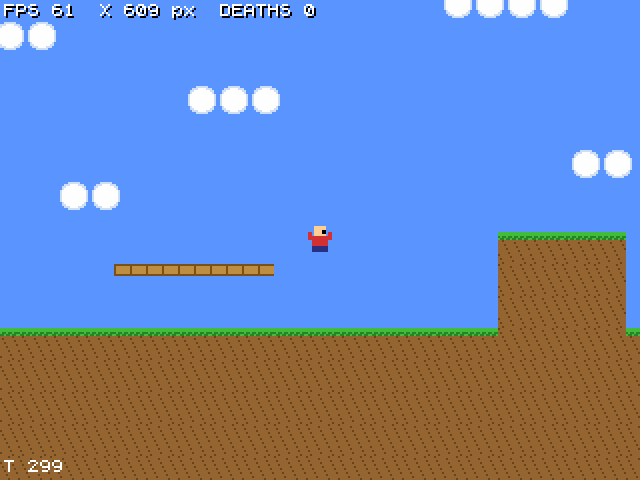

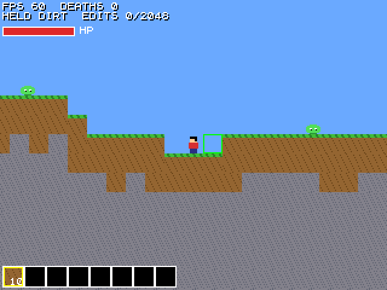

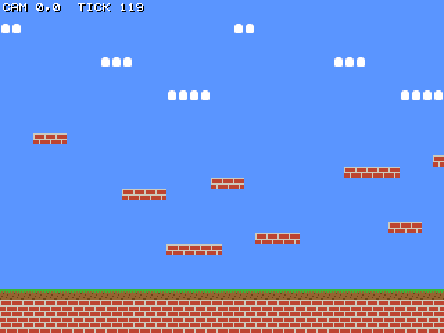

## 4. Grundkonzepte

### Die Spielklasse

Ein PGE-Spiel ist eine Klasse mit drei Methoden. Die Engine ruft sie auf. Die Hauptschleife schreiben Sie nicht selbst.

| Methode | Wann die Engine sie aufruft | Was sie tut |
|---|---|---|
| `pge::Error onCreate(pge::Engine& e)` | Einmal, bevor die Schleife startet | Das Spiel einrichten. Hier Speicher aus `e.initArena()` reservieren. `pge::Ok` zurückgeben oder einen Fehlercode, um abzubrechen. |
| `void onTick(const pge::Input& in)` | `PGE_TICK_HZ` Mal pro Sekunde | Eingaben lesen und den Spielzustand ändern. Die gesamte Spiellogik gehört hierher. |
| `void onRender(pge::Canvas& c)` | Einmal pro Band in jedem Frame | Den aktuellen Zustand zeichnen. Den Zustand hier nicht ändern. |
| `void onDestroy()` | Einmal, nachdem die Schleife endet | Optional. Aufräumen. |

Die `main`-Funktion des Programms startet die Engine und führt das Spiel aus:

```cpp
#include "pge/engine.h"
#include "game.h"

static Game g_game;  // static: the game may keep pointers into itself

int main() {
  if (pge::init() != pge::Ok) return 1;          // display, input, arenas, band buffer
  return pge::run(g_game) == pge::Ok ? 0 : 1;    // onCreate, then the loop, then onDestroy
}
```

`pge::init()` richtet Display, Eingabe, Speicher-Arenas und Band-Puffer ein. `pge::run(game)` ruft `onCreate` auf und lässt die Schleife laufen, bis das Spiel `requestQuit()` an der Engine aufruft (oder die Plattform ein Beenden verlangt). Danach ruft es `onDestroy` auf, falls das Spiel es hat. Die Board-Firmware nutzt dasselbe Muster, siehe `examples/f429/scroller_main.cpp`.

### Die Schleife mit festem Zeitschritt

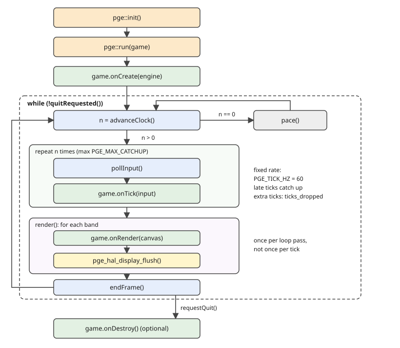

`pge::run` wiederholt diese Schritte, bis ein Beenden angefordert wird:

1. `advanceClock()` liefert die Anzahl der Ticks, die jetzt fällig sind.
2. Ist kein Tick fällig, wartet `pace()` bis zum nächsten. Es wird nichts gezeichnet.
3. Für jeden fälligen Tick: Die Frame-Arena wird zurückgesetzt, die Eingabe wird gelesen (`pollInput()`) und `onTick` wird aufgerufen.
4. Nach den Ticks wird das Bild einmal gezeichnet: `onRender` läuft einmal pro Band, und jedes Band wird zum Display geflusht.
5. `endFrame()` beendet den Frame.

Was das für Ihr Spiel bedeutet:

- Die Tick-Rate ist fest (`PGE_TICK_HZ`, standardmäßig 60). Bewegen Sie Objekte um eine Anzahl Pixel pro Tick. Ein Zeitdelta brauchen Sie nicht.
- Fällt das Programm zurück, führt es die verpassten Ticks nacheinander aus (Catch-up). Pro Schleifendurchlauf laufen höchstens `PGE_MAX_CATCHUP` Ticks (standardmäßig 5). Weitere Ticks verfallen und werden in `Stats::ticks_dropped` gezählt.
- Das Zeichnen ist von den Ticks entkoppelt: Auf mehrere Ticks kann ein einziger Frame folgen.
- `Input` wird einmal pro Tick abgetastet. `held()` liefert den aktuellen Zustand. `pressed()` und `released()` sind Flanken gegenüber dem vorigen Tick.

### Band Rendering

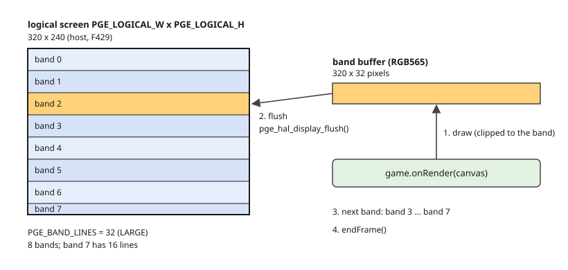

Die Engine hält nie ein ganzes Bild. Sie teilt den logischen Bildschirm in horizontale Bänder zu je `PGE_BAND_LINES` Zeilen. Für jedes Band tut sie Folgendes:

1. Sie leert den kleinen Band-Puffer (RGB565).
2. Sie ruft Ihr `onRender` mit einem `Canvas` für dieses Band auf.
3. Sie flusht das Band über die HAL zum Display (`pge_hal_display_flush`).

Mit dem Profil LARGE (Host und F429) hat ein Band 32 Zeilen. Ein Bildschirm mit 320 x 240 hat also 8 Bänder, das letzte mit 16 Zeilen. Ein volles RGB565-Bild mit 320 x 240 braucht 153.600 Bytes. Ein Band mit 32 Zeilen braucht 20.480 Bytes (berechnet: Breite x Zeilen x 2 Bytes).

Was das für Ihr Spiel bedeutet:

- `onRender` läuft mehrmals pro Frame. Zeichnen Sie immer die ganze Szene mit Koordinaten des vollen Bildschirms. Der Canvas beschneidet jeden Zeichenaufruf auf das aktuelle Band.
- `onRender` darf nur zeichnen. Würde es den Spielzustand ändern, zeigte jedes Band einen anderen Zustand.
- `Canvas::visible(rect)` sagt Ihnen, ob ein Rechteck das aktuelle Band berührt. Damit können Sie Arbeit überspringen.

### Schichten und Module

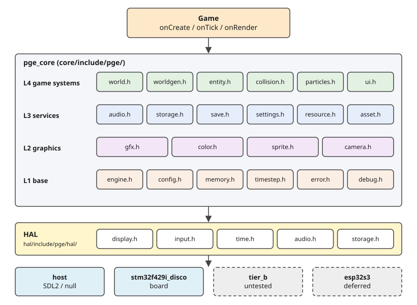

Die Engine ist in Schichten aufgebaut. Ein Modul darf Module der eigenen oder einer niedrigeren Schicht nutzen, nie einer höheren.

| Schicht | Module | Header in `core/include/pge/` |
|---|---|---|
| L4 Spielsysteme (optional) | World, Entity, Physics, UI | `world.h`, `worldgen.h`, `entity.h`, `collision.h`, `particles.h`, `ui.h` |
| L3 Dienste | Input, Audio (optional), Storage (optional), Resource Manager | `audio.h`, `storage.h`, `save.h`, `settings.h`, `resource.h`, `asset.h` |
| L2 Grafik | Graphics, Renderer, Sprite, Tilemap, Camera | `gfx.h`, `color.h`, `sprite.h`, `camera.h` |
| L1 Basis | Core, Debug | `engine.h`, `config.h`, `memory.h`, `timestep.h`, `error.h`, `version.h`, `debug.h` |
| L0 Hardware-Seite | HAL, Platform, Display | `hal/include/pge/hal/*.h`, dazu Code in `platform/` und `drivers/` |

Regeln:

- Die Plattform wird beim Linken gewählt. Jedes Programm hat genau eine Plattform, es gibt keinen Umschalter zur Laufzeit.
- Das Profil kann optionale Module herauskompilieren.
- Spielcode nutzt nur die öffentlichen `pge/*.h`-Header.

Mehr dazu: [modules.md](../user/modules.md) und [01-overview.md](../architecture/01-overview.md).

### Speicher ohne Heap

Die Engine nutzt drei Arten von Speicher. Alle Größen stammen aus dem Profil.

- **Init-Arena.** Speicher, den Sie in `onCreate` mit `e.initArena()` nehmen. Er wird nie freigegeben. Sobald die Schleife startet, ist die Init-Arena gesperrt. Spätere Allokationen schlagen fehl und werden gezählt.
- **Frame-Arena.** Temporärer Speicher aus `e.frameArena()`. Er wird zu Beginn jedes Ticks zurückgesetzt.
- **Feste Pools.** `pge::Pool<T, N>` fasst bis zu N Objekte. Ist er voll, gibt `alloc()` den Wert `kInvalid` zurück. Er reserviert nie mehr.

Spielcode sollte dieselbe Regel befolgen. Nutzen Sie Arrays und Member fester Größe, wie das Tutorial es tut. Verwenden Sie in der Spielschleife kein `new`, kein `malloc` und keine wachsenden Container. Die Engine-Regeln schließen außerdem Exceptions, RTTI, iostream und allokierende STL-Container im Kern aus.

### Profile

Jede Plattform hat eine `pge_profile.h`. Sie setzt genau eines von `PGE_PROFILE_SMALL`, `PGE_PROFILE_MEDIUM` oder `PGE_PROFILE_LARGE` auf 1 und legt die Größe des logischen Bildschirms fest. `config.h` leitet die übrigen Werte ab. Host und F429 nutzen LARGE.

| Einstellung | SMALL | MEDIUM | LARGE |
|---|---|---|---|
| Logischer Bildschirm | 160 x 128 | 320 x 240 | 320 x 240 |
| Bandzeilen (`PGE_BAND_LINES`) | 8 | 16 | 32 |
| Max. ganzzahlige Skalierung | 1 | 2 | 3 |
| Parallax-Ebenen | 1 | 2 | 4 |
| Audiokanäle | 0 (Audio aus) | 4 | 8 |
| Entities | 64 | 256 | 1.024 |
| Partikel | 32 | 128 | 512 |

Jeden Wert können Sie überschreiben, bevor `config.h` eingebunden wird, zum Beispiel in einer optionalen `pge_user_config.h`. Die vollständige Liste steht in [api-core.md](../user/api-core.md).

## 5. API-Überblick

Dieser Abschnitt zeigt jeden Teil der API mit einem kurzen Beispiel. Alle Namen liegen im `namespace pge`. Die vollständige Referenz steht in den `api-*.md`-Dateien.

### Auf den Canvas zeichnen

`Canvas` ist das Objekt, das `onRender` erhält. Es zeichnet Pixel, Linien, Rechtecke, Kreise und Text. Koordinaten sind Koordinaten des logischen Bildschirms. Farben sind RGB565-Werte. `pge::rgb(r, g, b)` erzeugt eine aus 8-Bit-Anteilen. `pge::kPalette16` ist eine eingebaute Palette mit 16 Farben.

```cpp
void onRender(pge::Canvas& c) {
  c.clear(pge::rgb(0, 0, 0));
  c.fillRect({10, 10, 40, 20}, pge::rgb(255, 0, 0));
  c.rect({8, 8, 44, 24}, pge::rgb(255, 255, 255));
  c.line(0, 0, c.width() - 1, c.height() - 1, pge::kPalette16[5]);
  c.fillCircle(160, 120, 30, pge::kPalette16[3]);
}
```

Referenz: [api-gfx.md](../user/api-gfx.md).

### Farben und Sprites

Ein Sprite-Sheet ist ein Array aus 8-Bit-Palettenindizes plus einer Palette (`const pge::Color[]`). Ist `transparent` gesetzt, wird Index 0 nicht gezeichnet. `Canvas::sprite` zeichnet ein Frame. Flags spiegeln den Sprite (`FlipX`, `FlipY`) oder drehen ihn in 90-Grad-Schritten (`Rot90`, `Rot180`, `Rot270`). `pge::Animation` und `pge::animFrame` wählen das Frame anhand der Tick-Zahl.

```cpp
constexpr pge::Animation kWalk{0, 4, 8, true};  // frames 0..3, 8 ticks each, looping

void onRender(pge::Canvas& c) {
  c.sprite(kSheet, pge::animFrame(kWalk, ticks_), x_, y_, pge::FlipX);
}
```

`tools/pge_assets.py` wandelt PNG-Bilder in indizierte Sprite-Sheets mit RGB565-Palette um. Siehe [install.md](../user/install.md), Abschnitt 4.

### Eingabe

`onTick` erhält ein `pge::Input`. Es hat acht Tasten (`Button::Up`, `Down`, `Left`, `Right`, `A`, `B`, `Start`, `Select`), vier analoge Achsen und einen Berührungspunkt. Die Plattform entscheidet, welche Tasten, Pins oder Sticks darauf abgebildet werden.

```cpp
void onTick(const pge::Input& in) {
  if (in.held(pge::Button::Left)) x_ -= 2;       // true while the button is down
  if (in.pressed(pge::Button::A)) jumping_ = true;  // true only in the tick it went down
  if (in.touchPressed()) target_x_ = in.touchX();   // touch or mouse, in logical coordinates
}
```

Referenz: [api-core.md](../user/api-core.md) (`Input`) und [api-hal.md](../user/api-hal.md) (die HAL-Seite).

### Text und UI

`Canvas::text` zeichnet einen String mit einer Bitmap-Schrift. `pge::kFont5x7` ist die eingebaute Schrift (ASCII 32 bis 126). `pge::textWidth` misst einen String. Die Widgets in `pge::ui` (`label`, `bar`, `iconGrid`, `listMenu`) haben keinen Zustand. Sie rufen sie aus `onRender` auf. `ui::MenuNav` bewegt eine Auswahl mit Up und Down. `pge::drawOverlay` zeigt Zeitmessungen und Pool-Zähler. Die UI-Widgets laufen nur auf dem Host.

```cpp
const pge::ui::Style st{&pge::kFont5x7, 0xFFFF, 0x0000, 0xFFE0, 1};  // font, fg, bg, accent, padding
pge::ui::label(c, st, 2, 2, "HP");
pge::ui::bar(c, st, {20, 2, 60, 7}, hp_, 10, pge::rgb(255, 0, 0));
```

Referenz: [api-gfx.md](../user/api-gfx.md) (`ui.h`) und [api-core.md](../user/api-core.md) (`debug.h`).

### Tilemaps und Kamera

Ein `Tileset` hält die Tile-Bilder. Ein `TileLayer` hält ein Raster aus Tile-IDs. `Canvas::tilemap` zeichnet eine Ebene mit einem Kamera-Offset. `pge::Camera` hält die Ansicht innerhalb der Welt. `pge::drawLayers` zeichnet mehrere `MapLayer` mit Parallax-Faktoren. Tilemaps, Ebenen, Kamera und Parallax sind auf dem F429 auf dem Board geprüft.

```cpp
// in onTick: follow the player
cam_.centerOn(player_x_, player_y_);
// in onRender: draw the back layer, then the front layer
pge::drawLayers(c, cam_, layers_, 2);
```

Siehe `examples/scroller/game.h` und `examples/platformer/game.h`. Referenz: [api-gfx.md](../user/api-gfx.md) (`camera.h`).

### Welt und Entities

Für große Welten speichert `pge::World` Tiles in Chunks von 32 x 32 Tiles und hält nur einen Teil der Chunks im Cache. Eine Generatorfunktion wie `pge::terrainGen` erzeugt die Chunks. Änderungen landen in einem Änderungsprotokoll. `pge::Entities` ist ein fester Pool beweglicher Körper mit Schwerkraft, Tile-Kollision, Lebenspunkten und Schadensereignissen. `pge::moveAndCollide` bewegt eine Box durch ein Tile-Raster. Diese Module laufen nur auf dem Host.

```cpp
pge::WorldConfig wc = {};
wc.w_chunks = 32;
wc.h_chunks = 4;
wc.seed = 1234;
wc.gen = pge::terrainGen;
wc.props = props_;  // 256 TileProps entries, one per tile id
wc.tile_px = 16;
pge::Error err = world_.init(wc, e.initArena());   // in onCreate
if (err != pge::Ok) return err;
err = ent_.init(e.initArena(), 32);                // room for 32 entities
```

Siehe `examples/sandbox/game.h`. Referenz: [api-world.md](../user/api-world.md).

### Audio

`pge::Mixer` spielt PCM8- und PCM16-Soundeffekte sowie Pattern-Musik. Der Spiel-Thread sendet Befehle, die Audio-Seite der Plattform mischt. Audio ist auf dem Host getestet. Das F429-SAI-Backend ist nur kompiliert. Das Profil SMALL kompiliert Audio heraus.

```cpp
static pge::Mixer mixer;
mixer.init(22050);
mixer.start();
const pge::Sound blip = {samples, 2000, 22050, pge::Pcm16, 0};  // data, frames, rate, format, loop
mixer.play(blip, 220);                                          // volume 0..255
```

Siehe `examples/audiodemo/main.cpp`. Referenz: [api-audio-storage.md](../user/api-audio-storage.md).

### Storage

`pge::Storage` liest und schreibt kleine Dateien und schreibt Spielstände sicher (zwei Slots mit CRC-32-Prüfung und `.bak`-Fallback). `pge::saveGame` und `pge::loadGame` speichern das Änderungsprotokoll einer Welt plus Ihre eigenen Daten. `pge::Settings` liest eine `key = value`-Datei. Storage läuft nur auf dem Host. Der F429 hat kein Speichermedium für Spielstände.

```cpp
err = storage_.init(e.initArena(), 512);           // in onCreate: I/O buffer of 512 bytes
storage_ok_ = storage_.mount() == pge::Ok;
// later, for example from a menu:
pge::saveGame(storage_, "game.sav", world_, ticks_, blob, sizeof blob);
```

Referenz: [api-audio-storage.md](../user/api-audio-storage.md).

## 6. Schritt für Schritt: ein einfaches Pixelspiel (Coin Catcher)

In diesem Tutorial bauen Sie in fünf Schritten ein kleines Spiel. Sie bewegen eine Figur, sammeln Münzen, zählen den Punktestand und weichen fallenden Steinen aus. Jeder Schritt ist ein vollständiges Programm, das Sie bauen und starten können.

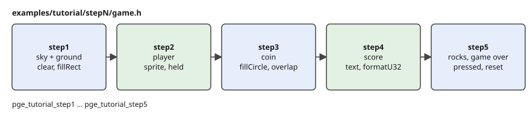

### Voraussetzungen

- Ein funktionierender Host-Build mit SDL2, wie in [Abschnitt 2](#2-installieren-und-bauen).
- Die CLion-Werkzeugpfade im `PATH` Ihrer PowerShell-Sitzung.
- Grundkenntnisse in C++: Klassen, Membervariablen, Arrays.

### Projektaufbau

Das Tutorial liegt in `examples/tutorial/`:

```text
examples/tutorial/
  CMakeLists.txt     one program per step: pge_tutorial_step1 .. pge_tutorial_step5
  main.cpp           shared main for all steps
  step1/game.h       game code of step 1
  step2/game.h
  step3/game.h
  step4/game.h
  step5/game.h
```

Jeder Schritt-Ordner enthält nur eine Datei, `game.h`, mit der Klasse `Game`. Die gemeinsame `main.cpp` bindet `game.h` ein. CMake baut sie einmal pro Schritt, jeweils mit dem Ordner dieses Schritts als Include-Pfad.

`main.cpp` verpackt `Game` in eine kleine Klasse `Runner`, die die Kommandozeilen-Flags ergänzt. Ihre `main`-Funktion startet die Engine:

```cpp
int main(int argc, char** argv) {
  const char* shot = nullptr;
  for (int i = 1; i < argc; i++) {
    if (!std::strcmp(argv[i], "--auto")) g_runner.autoplay = true;
    else if (i + 1 < argc && !std::strcmp(argv[i], "--ticks")) g_runner.quit_after = (uint32_t)std::strtoul(argv[++i], nullptr, 10);
    else if (i + 1 < argc && !std::strcmp(argv[i], "--shot")) shot = argv[++i];
  }
  pge::Error err = pge::init();
  if (err != pge::Ok) { std::printf("init failed: %d\n", err); return 1; }
  err = pge::run(g_runner);
  if (err != pge::Ok) { std::printf("run failed: %d\n", err); return 1; }
  if (shot && pge_host_save_bmp(shot) != 0) { std::printf("save_bmp failed\n"); return 1; }
  return 0;
}
```

Die Flags sind:

- `--auto`: Ein festes Eingabeskript ersetzt die Tastatur. Die Tutorial-Screenshots in diesem Handbuch entstanden damit.
- `--ticks N`: nach N Ticks beenden.
- `--shot out.bmp`: den Fensterinhalt nach der Schleife in eine BMP-Datei speichern. Das nutzt `pge_host_save_bmp`, das nur auf dem Host existiert.

Das Tutorial nutzt nur diese Header: `pge/engine.h`, `pge/color.h` und ab Schritt 4 `pge/ui.h`.

### Schritt 1: Himmel und Boden

**Ziel:** das kleinste Spiel, das etwas zeichnet: ein blauer Himmel und ein Streifen grüner Boden.

**Code** (`examples/tutorial/step1/game.h`, die ganze Datei):

```cpp
// Coin Catcher, step 1: the smallest game. The engine calls onCreate once, onTick 60 times a second and onRender
// to draw a frame. This one only paints the sky and the ground.
#pragma once
#include "pge/color.h"
#include "pge/engine.h"

class Game {
 public:
  pge::Error onCreate(pge::Engine&) { return pge::Ok; }

  void onTick(const pge::Input&) {}

  // The engine draws the screen in horizontal bands and calls onRender once per band, so onRender only draws;
  // all game state changes happen in onTick.
  void onRender(pge::Canvas& c) {
    c.clear(pge::rgb(92, 148, 252));
    c.fillRect({0, kGroundY, c.width(), c.height() - kGroundY}, pge::rgb(60, 160, 60));
  }

 private:
  static constexpr int kGroundY = 220;  // top row of the grass
};
```

**Was neu ist:**

- `class Game` hat die drei Methoden, die die Engine braucht. `onCreate` und `onTick` tun noch nichts.
- `pge::Error` ist der Typ des Fehlercodes. `pge::Ok` bedeutet Erfolg.
- `c.clear(color)` füllt das Band mit einer Farbe.
- `pge::rgb(r, g, b)` erzeugt aus drei Werten von 0 bis 255 eine RGB565-Farbe.
- `c.fillRect({x, y, w, h}, color)` füllt ein Rechteck. `{0, kGroundY, ...}` ist ein `pge::Rect`.
- `c.width()` und `c.height()` liefern die Größe des logischen Bildschirms: 320 x 240 auf dem Host.
- Der Boden beginnt in Zeile `kGroundY = 220` und ist damit 20 Pixel hoch.

**Bauen und starten:**

```powershell
cmake --build build --target pge_tutorial_step1
build\examples\tutorial\pge_tutorial_step1.exe
```

Drücken Sie Esc oder schließen Sie das Fenster, um das Programm zu beenden.


### Schritt 2: eine Spielfigur, die sich bewegt

**Ziel:** eine Figur mit 12 x 12 Pixeln, die Sie mit den Pfeiltasten bewegen. Sie bleibt im Spielfeld und schaut in Bewegungsrichtung.

**Code:** zuerst die Sprite-Daten, am Anfang von `examples/tutorial/step2/game.h`:

```cpp
// 12x12 player, one palette index per pixel; index 0 is transparent. The eyes look right.
constexpr uint8_t kPlayerPx[] = {
    0, 0, 0, 1, 1, 1, 1, 1, 1, 0, 0, 0,
    0, 0, 1, 2, 2, 2, 2, 2, 2, 1, 0, 0,
    0, 1, 2, 2, 2, 2, 2, 2, 2, 2, 1, 0,
    0, 1, 2, 3, 3, 2, 2, 3, 3, 2, 1, 0,
    0, 1, 2, 3, 1, 2, 2, 3, 1, 2, 1, 0,
    0, 1, 2, 2, 2, 2, 2, 2, 2, 2, 1, 0,
    0, 1, 2, 2, 1, 1, 1, 1, 2, 2, 1, 0,
    0, 0, 1, 2, 2, 2, 2, 2, 2, 1, 0, 0,
    0, 0, 0, 1, 1, 1, 1, 1, 1, 0, 0, 0,
    0, 0, 1, 4, 4, 1, 1, 4, 4, 1, 0, 0,
    0, 1, 4, 4, 4, 1, 1, 4, 4, 4, 1, 0,
    0, 1, 1, 1, 1, 0, 0, 1, 1, 1, 1, 0,
};
constexpr pge::Color kPlayerPal[] = {0, pge::rgb(20, 20, 40), pge::rgb(240, 120, 40), pge::rgb(255, 255, 255),
                                     pge::rgb(60, 60, 200)};
constexpr pge::SpriteSheet kPlayer{kPlayerPx, kPlayerPal, 12, 12, 1, true};
```

Danach die neue Klasse `Game`:

```cpp
class Game {
 public:
  pge::Error onCreate(pge::Engine&) {
    x_ = (PGE_LOGICAL_W - kSize) / 2;
    y_ = (kGroundY - kSize) / 2;
    return pge::Ok;
  }

  void onTick(const pge::Input& in) {
    using pge::Button;
    const int dx = in.held(Button::Right) - in.held(Button::Left);
    const int dy = in.held(Button::Down) - in.held(Button::Up);
    if (dx != 0) left_ = dx < 0;
    x_ = std::clamp(x_ + dx * kSpeed, 0, PGE_LOGICAL_W - kSize);
    y_ = std::clamp(y_ + dy * kSpeed, 0, kGroundY - kSize);
  }

  void onRender(pge::Canvas& c) {
    c.clear(pge::rgb(92, 148, 252));
    c.fillRect({0, kGroundY, c.width(), c.height() - kGroundY}, pge::rgb(60, 160, 60));
    c.sprite(kPlayer, 0, x_, y_, left_ ? pge::FlipX : pge::None);
  }

 private:
  static constexpr int kGroundY = 220, kSize = 12, kSpeed = 2;  // kSpeed: pixels per tick
  int x_ = 0, y_ = 0;
  bool left_ = false;  // facing left: draw the sprite mirrored
};
```

**Was neu ist:**

- `kPlayerPx` ist das Bild: ein Palettenindex pro Pixel, 12 x 12 Werte, Zeile für Zeile.
- `kPlayerPal` ist die Palette aus `pge::Color`-Werten. Eintrag 0 bleibt ungenutzt, weil Index 0 transparent ist.
- `pge::SpriteSheet{kPlayerPx, kPlayerPal, 12, 12, 1, true}` beschreibt das Bild: Pixel, Palette, Breite, Höhe, Anzahl der Frames (1) und `true` für „Index 0 ist transparent“.
- `PGE_LOGICAL_W` ist die Breite des logischen Bildschirms aus dem Profil (320 auf dem Host).
- `in.held(Button::Right)` ist `true`, solange die Taste gedrückt ist. `true - false` ergibt 1 und `false - true` ergibt -1. Deshalb sind `dx` und `dy` jeweils -1, 0 oder 1.
- Die Figur bewegt sich um `kSpeed = 2` Pixel pro Tick. Da die Tick-Rate fest ist, ist auch die Geschwindigkeit fest.
- `std::clamp` hält die Figur im Bildschirm und über dem Boden.
- `c.sprite(kPlayer, 0, x_, y_, flags)` zeichnet Frame 0 des Sheets an der Position (x, y). `pge::FlipX` spiegelt das Bild, wenn die Figur nach links schaut. `pge::None` zeichnet es wie gespeichert.
- Der Zustand ändert sich nur in `onTick`. `onRender` liest ihn nur.

**Bauen und starten:**

```powershell
cmake --build build --target pge_tutorial_step2
build\examples\tutorial\pge_tutorial_step2.exe
```

Bewegen Sie die Figur mit den Pfeiltasten oder mit W, A, S, D.

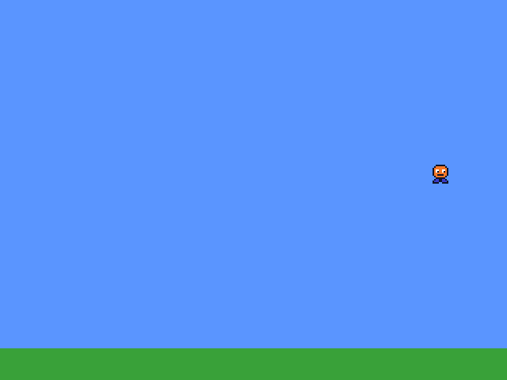

### Schritt 3: eine Münze zum Einsammeln

**Ziel:** eine Münze. Berührt die Figur sie, springt die Münze an eine neue Stelle.

**Code:** eine Hilfsfunktion, die prüft, ob sich zwei Rechtecke überlappen (`examples/tutorial/step3/game.h`):

```cpp
// Axis-aligned boxes overlap when they overlap on both axes; touching edges do not count.
inline bool overlap(pge::Rect a, pge::Rect b) {
  return a.x < b.x + b.w && b.x < a.x + a.w && a.y < b.y + b.h && b.y < a.y + a.h;
}
```

`onCreate` setzt die erste Münze:

```cpp
  pge::Error onCreate(pge::Engine&) {
    x_ = (PGE_LOGICAL_W - kSize) / 2;
    y_ = (kGroundY - kSize) / 2;
    coin_x_ = 240;  // the first coin sits right of the player; later ones are random
    coin_y_ = y_;
    return pge::Ok;
  }
```

`onTick` prüft jetzt auch die Münze:

```cpp
  void onTick(const pge::Input& in) {
    using pge::Button;
    const int dx = in.held(Button::Right) - in.held(Button::Left);
    const int dy = in.held(Button::Down) - in.held(Button::Up);
    if (dx != 0) left_ = dx < 0;
    x_ = std::clamp(x_ + dx * kSpeed, 0, PGE_LOGICAL_W - kSize);
    y_ = std::clamp(y_ + dy * kSpeed, 0, kGroundY - kSize);

    if (overlap({x_, y_, kSize, kSize}, {coin_x_, coin_y_, kCoin, kCoin})) {
      coin_x_ = random(PGE_LOGICAL_W - kCoin);
      coin_y_ = random(kGroundY - kCoin);
    }
  }
```

`onRender` zeichnet die Münze vor der Figur, sodass die Figur obenauf liegt:

```cpp
  void onRender(pge::Canvas& c) {
    using pge::rgb;
    c.clear(rgb(92, 148, 252));
    c.fillRect({0, kGroundY, c.width(), c.height() - kGroundY}, rgb(60, 160, 60));
    const int r = kCoin / 2, cx = coin_x_ + r, cy = coin_y_ + r;
    c.fillCircle(cx, cy, r, rgb(255, 210, 0));
    c.circle(cx, cy, r, rgb(180, 120, 0));
    c.line(cx, cy - 2, cx, cy + 2, rgb(255, 250, 200));
    c.sprite(kPlayer, 0, x_, y_, left_ ? pge::FlipX : pge::None);
  }
```

Der neue private Teil mit dem Zufallszahlengenerator:

```cpp
 private:
  static constexpr int kGroundY = 220, kSize = 12, kSpeed = 2, kCoin = 11;

  // 0 .. n-1 from a linear congruential generator: same sequence every run, which keeps --auto repeatable.
  int random(int n) {
    rng_ = rng_ * 1664525u + 1013904223u;
    return static_cast<int>((rng_ >> 16) % static_cast<uint32_t>(n));
  }

  int x_ = 0, y_ = 0, coin_x_ = 0, coin_y_ = 0;
  bool left_ = false;
  uint32_t rng_ = 12345;
};
```

**Was neu ist:**

- `overlap` ist gewöhnlicher Spielcode. Zwei Boxen überlappen sich, wenn sie sich auf beiden Achsen überlappen.
- `c.fillCircle(cx, cy, r, color)` zeichnet einen gefüllten Kreis. `c.circle` zeichnet seinen Umriss.
- `c.line(x0, y0, x1, y1, color)` zeichnet eine Linie. Hier ist es der Glanzpunkt auf der Münze.
- Was später gezeichnet wird, verdeckt früher Gezeichnetes.
- `random(n)` ist ein kleiner linearer Kongruenzgenerator. Er liefert in jedem Lauf dieselben Zahlen. So bleibt der Lauf mit `--auto` reproduzierbar.

**Bauen und starten:**

```powershell
cmake --build build --target pge_tutorial_step3
build\examples\tutorial\pge_tutorial_step3.exe
```

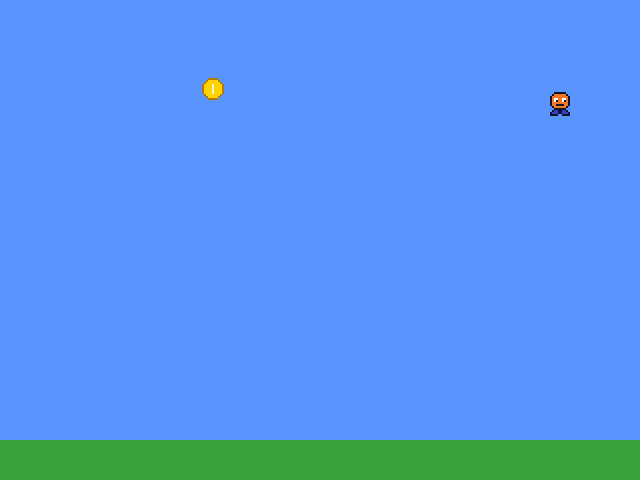

### Schritt 4: der Punktestand

**Ziel:** die eingesammelten Münzen zählen und den Punktestand oben links anzeigen.

**Code:** Schritt 4 bindet einen weiteren Header ein (`examples/tutorial/step4/game.h`):

```cpp
#include "pge/color.h"
#include "pge/engine.h"
#include "pge/ui.h"
```

Eine Hilfsfunktion, die Text mit Schatten zeichnet:

```cpp
// White text with a black shadow, readable on any background.
inline void shadowText(pge::Canvas& c, int x, int y, const char* s) {
  c.text(pge::kFont5x7, x + 1, y + 1, s, pge::rgb(0, 0, 0));
  c.text(pge::kFont5x7, x, y, s, pge::rgb(255, 255, 255));
}
```

`onTick` zählt die Münze:

```cpp
    if (overlap({x_, y_, kSize, kSize}, {coin_x_, coin_y_, kCoin, kCoin})) {
      score_++;
      coin_x_ = random(PGE_LOGICAL_W - kCoin);
      coin_y_ = random(kGroundY - kCoin);
    }
```

Am Ende von `onRender` wird der Punktestand gezeichnet:

```cpp
    char num[11];
    pge::ui::formatU32(num, sizeof num, score_);
    shadowText(c, 4, 4, "SCORE");
    shadowText(c, 4 + pge::textWidth(pge::kFont5x7, "SCORE "), 4, num);
```

**Was neu ist:**

- `pge/ui.h` liefert die UI-Helfer, darunter `pge::ui::formatU32`.
- `c.text(font, x, y, text, color)` zeichnet einen String mit transparentem Hintergrund.
- `pge::kFont5x7` ist die eingebaute Schrift mit 5 x 7 Pixeln.
- Der Text wird zweimal gezeichnet, erst schwarz und um 1 Pixel versetzt, dann weiß. So entsteht ein Schatten, der auf jedem Hintergrund lesbar ist.
- `pge::ui::formatU32(buffer, size, value)` schreibt eine Zahl als Dezimaltext. Es braucht kein `printf`. Ein `uint32_t` hat höchstens 10 Ziffern. Mit der Endemarke reichen 11 Zeichen.
- `pge::textWidth(font, text)` liefert die Breite eines Strings in Pixeln. Hier setzt es die Zahl hinter `"SCORE "`.
- Der Text wird in `onRender` formatiert, einmal pro Band. Sie können ihn auch in `onTick` formatieren und in einem Member halten, wie es `examples/platformer/game.h` tut.

**Bauen und starten:**

```powershell
cmake --build build --target pge_tutorial_step4
build\examples\tutorial\pge_tutorial_step4.exe
```

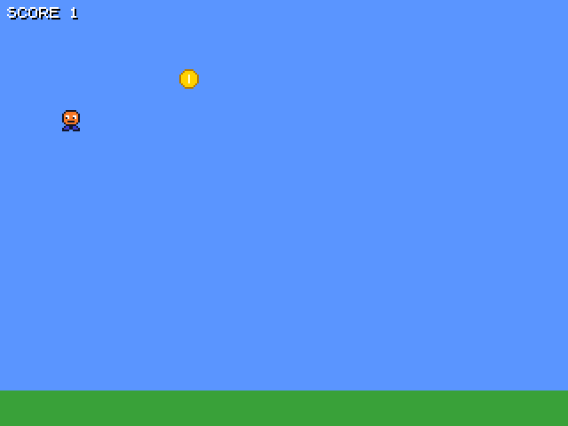

### Schritt 5: fallende Steine und Game Over

**Ziel:** Steine fallen vom Himmel. Je höher der Punktestand, desto schneller fallen sie. Trifft ein Stein die Figur, ist das Spiel vorbei. Mit Start (Eingabetaste) beginnt ein neues Spiel.

**Code:** eine Hilfsfunktion für zentrierten Text (`examples/tutorial/step5/game.h`):

```cpp
inline void centeredText(pge::Canvas& c, int y, const char* s) {
  shadowText(c, (c.width() - pge::textWidth(pge::kFont5x7, s)) / 2, y, s);
}
```

`onCreate` ruft jetzt `reset()` auf:

```cpp
  pge::Error onCreate(pge::Engine&) {
    reset();
    return pge::Ok;
  }
```

Das vollständige `onTick`:

```cpp
  void onTick(const pge::Input& in) {
    using pge::Button;
    if (over_) {
      if (in.pressed(Button::Start)) reset();
      return;
    }
    const int dx = in.held(Button::Right) - in.held(Button::Left);
    const int dy = in.held(Button::Down) - in.held(Button::Up);
    if (dx != 0) left_ = dx < 0;
    x_ = std::clamp(x_ + dx * kSpeed, 0, PGE_LOGICAL_W - kSize);
    y_ = std::clamp(y_ + dy * kSpeed, 0, kGroundY - kSize);

    const pge::Rect player{x_, y_, kSize, kSize};
    if (overlap(player, {coin_x_, coin_y_, kCoin, kCoin})) {
      score_++;
      coin_x_ = random(PGE_LOGICAL_W - kCoin);
      coin_y_ = random(kGroundY - kCoin);
    }

    if (--spawn_in_ == 0) {
      spawn_in_ = kSpawnTicks;
      for (Rock& r : rocks_)
        if (!r.live) {  // take the first free slot; with none free this rock is skipped
          r = Rock{random(PGE_LOGICAL_W - kRock), -kRock, true};
          break;
        }
    }
    const int fall = 2 + static_cast<int>(score_ / 4);
    for (Rock& r : rocks_) {
      if (!r.live) continue;
      r.y += fall;
      if (r.y >= kGroundY) r.live = false;
      else if (overlap(player, {r.x, r.y, kRock, kRock})) over_ = true;
    }
  }
```

In `onRender` werden die Steine vor der Figur gezeichnet:

```cpp
    for (const Rock& k : rocks_)
      if (k.live) {
        c.fillRect({k.x, k.y, kRock, kRock}, rgb(120, 110, 100));
        c.rect({k.x, k.y, kRock, kRock}, rgb(60, 50, 45));
      }
```

Am Ende von `onRender` steht der Game-Over-Text:

```cpp
    if (over_) {
      centeredText(c, 100, "GAME OVER");
      centeredText(c, 116, "PRESS START");
    }
```

Der private Teil: Konstanten, der Datensatz für einen Stein und `reset()`:

```cpp
  static constexpr int kGroundY = 220, kSize = 12, kSpeed = 2, kCoin = 11;
  static constexpr int kRock = 8, kRocks = 16, kSpawnTicks = 20;  // a new rock every 20 ticks (1/3 s)
  struct Rock { int x, y; bool live; };

  // Puts everything back to the start; used for the first game and for every restart.
  void reset() {
    x_ = (PGE_LOGICAL_W - kSize) / 2;
    y_ = (kGroundY - kSize) / 2;
    coin_x_ = 240;  // the first coin sits right of the player; later ones are random
    coin_y_ = y_;
    score_ = 0;
    spawn_in_ = kSpawnTicks;
    for (Rock& r : rocks_) r.live = false;
    over_ = false;
  }
```

**Was neu ist:**

- `in.pressed(Button::Start)` ist nur in dem Tick `true`, in dem die Taste gedrückt wurde. Eine gehaltene Taste startet das Spiel nicht immer wieder neu.
- Solange `over_` den Wert `true` hat, kehrt `onTick` früh zurück. Das Spiel steht still.
- Die Steine leben in einem festen Array `rocks_[kRocks]` mit 16 Slots. Während des Spiels wird kein Speicher allokiert. Ein neuer Stein nimmt den ersten freien Slot. Sind alle Slots belegt, kommt kein Stein dazu.
- Alle `kSpawnTicks = 20` Ticks erscheint ein neuer Stein. Bei 60 Ticks pro Sekunde sind das drei Steine pro Sekunde.
- Die Fallgeschwindigkeit beträgt `2 + score_ / 4` Pixel pro Tick. Das Spiel wird also schwerer.
- `c.rect(rect, color)` zeichnet einen Umriss von 1 Pixel innerhalb des Rechtecks.
- `reset()` setzt den gesamten Zustand auf den Anfang zurück. `onCreate` und der Neustart nutzen es beide.

**Bauen und starten:**

```powershell
cmake --build build --target pge_tutorial_step5
build\examples\tutorial\pge_tutorial_step5.exe
```

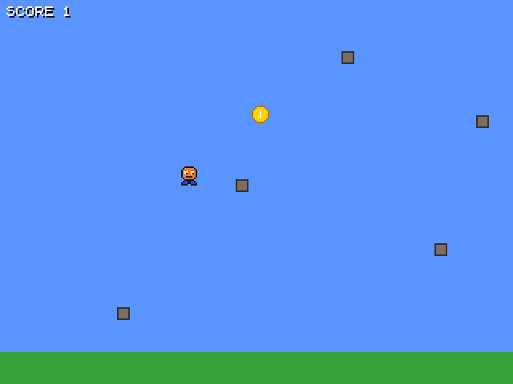

Trifft ein Stein die Figur, hält das Spiel an und zeigt den Game-Over-Text. Drücken Sie die Eingabetaste, um noch einmal zu spielen.

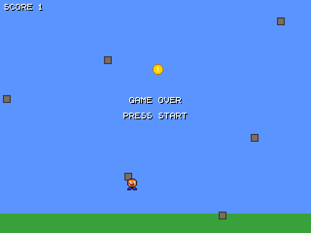

Sie können einen Schritt auch mit dem Eingabeskript starten und einen Screenshot speichern:

```powershell
build\examples\tutorial\pge_tutorial_step5.exe --auto --ticks 300 --shot step5.bmp
```

### Ideen zum Weitermachen

- **Sound.** Spielen Sie einen kurzen Ton, wenn die Figur eine Münze einsammelt. Legen Sie einmal einen `pge::Mixer` an, rufen Sie `init` und `start` auf und rufen Sie `play` in `onTick` auf. Siehe [Audio](#audio) und `examples/audiodemo/main.cpp`. Audio ist auf dem Host getestet. Das F429-Audio-Backend ist nur kompiliert.
- **Animation.** Geben Sie dem Sheet der Figur mehr Frames und wählen Sie das Frame mit `pge::animFrame`. Siehe [Farben und Sprites](#farben-und-sprites).
- **Ein Tile-Hintergrund.** Ersetzen Sie den einfarbigen Himmel durch eine Tile-Ebene und eine Kamera. Siehe [Tilemaps und Kamera](#tilemaps-und-kamera) und `examples/scroller/game.h`.
- **Debug-Overlay.** Binden Sie `pge/debug.h` ein, halten Sie aus `onCreate` einen Zeiger auf die `pge::Engine` und rufen Sie am Ende von `onRender` `pge::drawOverlay(c, style, eng_->stats(), pge::kOverlayAll)` auf. Es zeigt die Zeitmessung von Ticks und Frames und die Pool-Zähler.
- **Auf dem F429-Board laufen lassen.** Das Tutorial hat kein Firmware-Target. Der scroller zeigt das Muster: `examples/f429/scroller_main.cpp` ist ein kurzes `main`, das dasselbe `game.h` ausführt wie das Host-Programm, und `platform/stm32f429i_disco/CMakeLists.txt` deklariert sein Firmware-Target. Bilden Sie die Engine-Tasten auf die Board-Tasten und den Stick ab, wie es [hardware.md](../user/hardware.md) auflistet. Lesen Sie vorher [porting.md](../user/porting.md) und [examples.md](../user/examples.md). Beachten Sie, dass die `main.cpp` des Tutorials `pge_host_save_bmp` nutzt, das nur auf dem Host existiert.

### Eigenes Spiel starten

Am einfachsten starten Sie mit einer Kopie des fertigen Tutorials.

1. Legen Sie einen Ordner an, zum Beispiel `examples/mygame/`.
2. Kopieren Sie `examples/tutorial/main.cpp` und `examples/tutorial/step5/game.h` hinein.
3. Legen Sie `examples/mygame/CMakeLists.txt` an. Sie folgt `examples/tutorial/CMakeLists.txt`, aber mit nur einem Programm:

   ```cmake
   add_executable(pge_mygame main.cpp)
   target_link_libraries(pge_mygame PRIVATE pge_core pge_platform_host)
   add_custom_command(TARGET pge_mygame POST_BUILD
     COMMAND ${CMAKE_COMMAND} -E copy_if_different $<TARGET_FILE:SDL2::SDL2> $<TARGET_FILE_DIR:pge_mygame>)
   ```

   `main.cpp` findet `game.h`, weil beide Dateien im selben Ordner liegen.

4. Tragen Sie den Ordner in die `CMakeLists.txt` im Stammverzeichnis ein. Fügen Sie diese Zeile im Block `if(SDL2_FOUND)` neben `add_subdirectory(examples/tutorial)` ein:

   ```cmake
   add_subdirectory(examples/mygame)
   ```

5. Bauen und starten:

   ```powershell
   cmake --build build --target pge_mygame
   build\examples\mygame\pge_mygame.exe
   ```

6. Ändern Sie `game.h` Schritt für Schritt. Bauen Sie nach jeder Änderung neu.

Regeln für Spielcode:

- Binden Sie nur `pge/<name>.h`-Header aus `core/include/pge/` ein, dazu Ihre eigene `game.h` und einige C/C++-Standard-Header. Wie das für die sandbox geprüft wird, zeigt `examples/sandbox/check_includes.cmake`.
- Halten Sie den gesamten Zustand in Membern und Arrays fester Größe. Größere Puffer reservieren Sie in `onCreate` aus `e.initArena()`.
- Ändern Sie den Zustand nur in `onTick`. Zeichnen Sie in `onRender` nur.

Für ein headless Spiel ohne SDL starten Sie stattdessen mit `examples/empty` und linken `pge_platform_host_null`. Siehe „Starting your own game“ in [examples.md](../user/examples.md).

## 7. Fehlerbehebung

**`cmake` oder `ninja` wird nicht erkannt.**
Auf dem Entwicklungsrechner kommen sie mit CLion und stehen nicht im globalen `PATH`. Führen Sie in jeder neuen PowerShell-Sitzung die Zeile `$env:PATH = ...` aus [Abschnitt 2](#unter-windows-mit-der-clion-toolchain-bauen) aus.

**CMake meldet `SDL2 not found: host window demo skipped`, oder das Target `pge_tutorial_step1` ist unbekannt.**
Das Tutorial und die Fensterbeispiele werden nur hinzugefügt, wenn CMake SDL2 findet. Übergeben Sie das SDL2-Installationspräfix: `-DCMAKE_PREFIX_PATH=<SDL2 prefix>`. Konfigurieren Sie danach erneut.

**Das Programm startet nicht, und Windows meldet eine fehlende DLL.**
- Bei den MinGW-Laufzeit-DLLs: Setzen Sie `C:\Program Files\JetBrains\CLion\bin\mingw\bin` in den `PATH`, bevor Sie das Programm starten.
- Bei `SDL2.dll`: Der Post-Build-Schritt kopiert sie neben das Programm. Bauen Sie das Target erneut und prüfen Sie, ob der Konfigurationsschritt SDL2 gefunden hat.

**Die Tests starten nicht.**
`mingw\bin` muss im `PATH` stehen, während `ctest` läuft, wegen derselben Laufzeit-DLLs.

**Die Board-Konfiguration schlägt in PowerShell fehl.**
Setzen Sie das Toolchain-Argument in Anführungszeichen: `"-DCMAKE_TOOLCHAIN_FILE=cmake/arm-none-eabi.cmake"`. Ohne Anführungszeichen trennt PowerShell es am Punkt. Außerdem müssen `arm-none-eabi-gcc` und `arm-none-eabi-g++` im `PATH` stehen.

**Die Konfiguration schlägt fehl mit `PGE_CUBE_DIR does not point at STM32CubeF4`.**
Übergeben Sie den Pfad Ihres STM32CubeF4-Checkouts mit `-DPGE_CUBE_DIR=<path>`. Der Ordner muss `Drivers/STM32F4xx_HAL_Driver/Src/stm32f4xx_hal.c` enthalten.

**CMake gibt `Python3 with Pillow not found` aus.**
Nur die Tests der Asset-Werkzeuge werden übersprungen. Installieren Sie Pillow in das Python, das Sie verwenden, wenn Sie die Asset-Werkzeuge brauchen.

**Kein Fenster auf einem Rechner ohne Display.**
Setzen Sie `$env:SDL_VIDEODRIVER='dummy'` und `$env:SDL_RENDER_DRIVER='software'`, bevor Sie das Programm starten. Mit `--ticks` sorgen Sie dafür, dass es sich beendet, und mit `--shot` erhalten Sie ein Bild.

**SAVE und LOAD zeigen auf dem F429 NO STORAGE.**
Das ist erwartet. Das Board hat noch keinen Treiber für ein Speichermedium. Speichern funktioniert nur auf dem Host.

**Der Stick am F429 bewegt die Figur ohne Eingabe.**
Die Mittelstellung des Sticks wird einmal beim Start gemessen. Lassen Sie den Stick beim Start des Boards in der Mitte. Unbelegte Stick-Pins liefern Zufallswerte. Siehe [hardware.md](../user/hardware.md).

## 8. FAQ

**Warum wird `onRender` mehrmals pro Frame aufgerufen?**
Wegen des Band Rendering. Die Engine ruft es einmal pro Band auf. Siehe [Band Rendering](#band-rendering).

**Darf ich den Spielzustand in `onRender` ändern?**
Nein. Jedes Band zeigte dann einen anderen Zustand. Ändern Sie den Zustand nur in `onTick`.

**Darf ich `new`, `malloc` oder `std::vector` verwenden?**
Die Engine allokiert nach `pge::init()` nichts mehr, und Spielcode sollte dieselbe Regel in der Schleife einhalten. Nutzen Sie Member und Arrays fester Größe, oder reservieren Sie einmal in `onCreate` aus `e.initArena()`.

**Wie beende ich das Spiel aus dem Code?**
Rufen Sie `requestQuit()` an der `pge::Engine` auf, die `onCreate` erhalten hat. Halten Sie dafür einen Zeiger darauf. Auf dem Host beenden auch Esc und das Schließen des Fensters das Programm.

**Wie groß ist der Bildschirm?**
Die logische Größe kommt aus dem Profil: `PGE_LOGICAL_W` x `PGE_LOGICAL_H`, auf dem Host und auf dem F429 also 320 x 240. Das Host-Fenster zeigt sie in doppelter Größe.

**Wie schnell ist PGE?**
Dieses Handbuch nennt keine Zahlen. Gemessene Ergebnisse mit ihren Bedingungen stehen in [benchmarks.md](../user/benchmarks.md).

**Läuft PGE auf dem ESP32-S3?**
Noch nicht. Der ESP32-S3-Port ist zurückgestellt. `platform/esp32s3` ist ein Platzhalter.

**Was ist mit RP2040, RP2350, STM32H7 und anderen Boards?**
Sie haben Tier-B-Skelette: Der Kern und eine HAL-Attrappe lassen sich kompilieren, aber auf einem Board wird nichts gelinkt oder ausgeführt. Siehe [platform/tier_b/README.md](../../platform/tier_b/README.md) und [porting.md](../user/porting.md).

**Kann ich PlatformIO, STM32CubeIDE oder VS Code verwenden?**
Unterstützt wird der CMake-Build. PlatformIO hat eine verifizierte native Umgebung (Host). Die Hinweise zu STM32CubeIDE und die VS-Code-Tasks sind ungetestet. Siehe [wrappers.md](../user/wrappers.md).

**Kann ich frei drehen oder zoomen?**
Nein. Sprites drehen sich nur in 90-Grad-Schritten, und die Ausgabeskalierung ist ganzzahlig (1x, 2x oder 3x).

## 9. Glossar

| Begriff | Bedeutung |
|---|---|
| Band | Ein horizontaler Streifen des Bildschirms, `PGE_BAND_LINES` Zeilen hoch. Die Engine zeichnet jeweils ein Band. |
| Band-Puffer | Der kleine RGB565-Puffer, der ein Band hält, während es gezeichnet wird. |
| Auf dem Board geprüft | Vom Benutzer auf dem Board STM32F429I-DISCO bestätigt (board-checked). |
| Canvas | Das Zeichenobjekt, das `onRender` erhält. Es ist nur während dieses Aufrufs gültig. |
| Catch-up | Verpasste Ticks nacheinander nachholen, höchstens `PGE_MAX_CATCHUP` pro Schleifendurchlauf. |
| Chunk | Ein Stück einer `World` aus 32 x 32 Tiles. |
| Nur kompiliert | Der Code lässt sich bauen, gelaufen ist nichts (compile-only). |
| Fester Zeitschritt | Die Spiellogik läuft in Ticks gleicher Länge, `PGE_TICK_HZ` pro Sekunde. |
| Flush | Ein fertiges Band an das Display senden. |
| Frame-Arena | Temporärer Speicher, der zu Beginn jedes Ticks zurückgesetzt wird. |
| HAL | Hardware-Abstraktionsschicht: die C-Header in `hal/include/pge/hal/`, die jede Plattform implementiert. |
| Host | Der Desktop-PC. Die Host-Plattform nutzt SDL2 oder Null-Backends ohne Fenster. |
| Nur Host | Auf dem PC gebaut und getestet, auf einem Board lief nichts (host only). |
| Init-Arena | Speicher, der während `onCreate` genommen wird. Er wird nie freigegeben und beim Start der Schleife gesperrt. |
| Logischer Bildschirm | Die Bildschirmgröße in Pixeln, auf die das Spiel zeichnet. Das Display kann sie skaliert anzeigen. |
| Palette | Ein Array aus `pge::Color`-Werten. Sprite-Pixel sind Indizes darin. |
| Plattform | Eine Implementierung der HAL für ein Ziel, zum Beispiel `host` oder `stm32f429i_disco`. |
| Pool | Eine feste Zahl Slots für Objekte eines Typs. Er wächst nie. |
| Profil | SMALL, MEDIUM oder LARGE: ein Satz von Größen und Schaltern zur Compile-Zeit. |
| RGB565 | Eine 16-Bit-Farbe: 5 Bit Rot, 6 Bit Grün, 5 Bit Blau. |
| Sprite-Sheet | Ein Bild mit einem oder mehreren Frames, gespeichert als Palettenindizes. |
| Tick | Ein Schritt der Spiellogik: ein Aufruf von `onTick`. |
| Tier A | Ziele, die das Projekt misst: der Host und das Board STM32F429I-DISCO. |
| Tier B | Boards, die nur ein ungetestetes HAL-Skelett haben. |
| Tile, Tilemap | Ein kleines quadratisches Bild und ein Raster aus Tile-IDs, das einen Level bildet. |

## 10. Weitere Dokumentation

- [install.md](../user/install.md): Installation und Build
- [hardware.md](../user/hardware.md): unterstützte Boards und Verdrahtung
- [modules.md](../user/modules.md): Engine-Module und ihr Status
- [examples.md](../user/examples.md): Beispielprogramme
- [api-core.md](../user/api-core.md): Core-API
- [api-gfx.md](../user/api-gfx.md): Grafik-API
- [api-world.md](../user/api-world.md): API für Welt, Kollision und Entities
- [api-audio-storage.md](../user/api-audio-storage.md): API für Audio und Storage
- [api-hal.md](../user/api-hal.md): HAL-API
- [porting.md](../user/porting.md): Portierungsanleitung
- [wrappers.md](../user/wrappers.md): PlatformIO, STM32CubeIDE, VS Code
- [benchmarks.md](../user/benchmarks.md): Benchmark-Ergebnisse
- [01-overview.md](../architecture/01-overview.md): Architekturüberblick
- [CHANGELOG.md](../../CHANGELOG.md): Release Notes
- [STATUS.md](../../STATUS.md): Projektstatus und Feature-Tracker
