English | [Deutsch](de.md) | [Русский](ru.md)

# Pixel Game Engine (PGE): user help

This is the main user guide for Pixel Game Engine (PGE) version 0.1.1. It explains what the engine is, how to build and run it, how the engine works, and how to write a small game step by step. For the full API reference, follow the links to the files in `docs/user/`.

## Contents

1. [What PGE is](#1-what-pge-is)
2. [Install and build](#2-install-and-build)
3. [Run the examples](#3-run-the-examples)
4. [Core concepts](#4-core-concepts)
5. [API tour](#5-api-tour)
6. [Step by step: make a simple pixel game (Coin Catcher)](#6-step-by-step-make-a-simple-pixel-game-coin-catcher)
   - [Step 1: sky and ground](#step-1-sky-and-ground)
   - [Step 2: a player you can move](#step-2-a-player-you-can-move)
   - [Step 3: a coin to collect](#step-3-a-coin-to-collect)
   - [Step 4: the score](#step-4-the-score)
   - [Step 5: falling rocks and game over](#step-5-falling-rocks-and-game-over)
7. [Troubleshooting](#7-troubleshooting)
8. [FAQ](#8-faq)
9. [Glossary](#9-glossary)
10. [More documentation](#10-more-documentation)

## 1. What PGE is

PGE is a small 2D pixel-game engine for microcontrollers and the desktop. It is written in C++17. You write one game class, and the engine calls it to update the game and to draw the screen.

The same game code can run on the desktop (the "host") and on a microcontroller board. On the host, PGE opens a window with SDL2. On the STM32F429I-DISCO board, it draws to the board's display.

### Key ideas

- **Portable core.** The engine library `pge_core` contains no platform code. It does not include any vendor or operating system header.
- **HAL.** The core reaches the hardware only through a thin hardware abstraction layer (HAL). The HAL is a set of C headers in `hal/include/pge/hal/`: `display.h`, `input.h`, `time.h`, `audio.h` and `storage.h`. Each platform implements these headers. One platform is linked into each program.
- **Band rendering.** The engine does not keep a full frame in RAM. It draws the screen in small horizontal bands. Each band is drawn into a small buffer and then sent (flushed) to the display.
- **No heap after init.** After `pge::init()` returns, the engine makes no heap allocations. Memory comes from arenas and fixed pools. Their sizes are set at compile time.
- **Fixed timestep.** The game logic runs at a fixed rate: `PGE_TICK_HZ` ticks per second (60 by default). Drawing is separate from the logic.
- **Profiles.** Three compile-time profiles, SMALL, MEDIUM and LARGE, set the screen size, buffer sizes and which optional modules are compiled in.

### Status and limits

PGE 0.1.1 is a preview. These points come from `README.md` and the feature tracker in `STATUS.md`:

- Measured Tier A targets: the host (SDL2) and the STM32F429I-DISCO board.
- ESP32-S3 is deferred (session S4.5). Its I2S audio is deferred with it.
- Other boards (RP2040/RP2350, STM32H7, ESP32 classic, generic STM32F4) are untested HAL skeletons, planned in S7.2a. They are not verified.
- World, entity, audio and storage code is host-only in most parts. The F429 audio backend (SAI) is compile-only, with no board run.
- No save media on the F429: there is no SD, USB MSC or flash block-device driver yet, so SAVE and LOAD report no storage. FatFs and LittleFS backends are tested on fakes only (LittleFS also on the real `lfs.c` in scratch).
- Enemies and basic AI, lighting, band-skip and windowed flush are planned, not implemented.
- PWM and DAC audio are not scheduled.
- Out of scope: USB HID host input, free camera zoom (integer 1x, 2x, 3x scale only), free sprite rotation (90-degree steps only), 3D, networking.

This guide states no performance numbers. Measured numbers, with the board, build flags and conditions, are in [benchmarks.md](../user/benchmarks.md).

The status words used in the project documents mean:

| Word | Meaning |
|---|---|
| implemented | The feature exists in the code. Where it was tested is noted next to it. |
| planned | Not implemented yet. |
| host only | Built and tested on the development PC. Nothing was run on a board. |
| board-checked | The user confirmed it on the STM32F429I-DISCO. |
| compile-only | It builds. Nothing was run. |
| incomplete | Started, but parts are missing. |
| out of scope | Not planned for this version. |

## 2. Install and build

Full instructions are in [install.md](../user/install.md). This section gives the short path.

### Requirements

- CMake 3.20 or newer.
- Ninja.
- A C++17 compiler.
- SDL2 2.x development package. It is optional for the engine, but you need it for every program with a window, including the tutorial. Without SDL2, CMake prints `SDL2 not found: host window demo skipped` and skips the window examples.
- Optional: Python 3 with Pillow, for the asset tools in `tools/`.

### Build on Windows with the CLion toolchain

On the development machine, CMake, Ninja and the MinGW g++ come from the CLion install and are not on the global `PATH`. Add them for the current PowerShell session, then configure and build. Run these commands from the repository root:

```powershell
$env:PATH = "C:\Program Files\JetBrains\CLion\bin\cmake\win\x64\bin;C:\Program Files\JetBrains\CLion\bin\ninja\win\x64;C:\Program Files\JetBrains\CLion\bin\mingw\bin;$env:PATH"
cmake -S . -B build -G Ninja -DCMAKE_CXX_COMPILER="C:/Program Files/JetBrains/CLion/bin/mingw/bin/g++.exe"
cmake --build build --target pge_tutorial_step1
build\examples\tutorial\pge_tutorial_step1.exe
```

If CMake does not find SDL2, add the SDL2 install prefix to the configure command:

```powershell
cmake -S . -B build -G Ninja -DCMAKE_CXX_COMPILER="C:/Program Files/JetBrains/CLion/bin/mingw/bin/g++.exe" "-DCMAKE_PREFIX_PATH=<SDL2 prefix>"
```

Notes:

- `mingw\bin` must stay on `PATH` when you run the programs, because they need the MinGW runtime DLLs.
- After each build, a post-build step copies `SDL2.dll` next to the program.
- `cmake --build build` without `--target` builds everything, including the tests.

To run the host unit tests:

```powershell
ctest --test-dir build --output-on-failure
```

### Build on other systems

The generic host build is:

```bash
cmake -S . -B build -G Ninja
cmake --build build
ctest --test-dir build --output-on-failure
```

Use `-DCMAKE_CXX_COMPILER=<path>` if CMake picks the wrong compiler, and `-DCMAKE_PREFIX_PATH=<SDL2 prefix>` if it does not find SDL2.

### Build for the STM32F429I-DISCO board

The board build needs `arm-none-eabi-gcc` (version 10.3.1 was verified), OpenOCD with an ST-LINK probe for flashing, and your own checkout of STM32CubeF4. STM32CubeF4 is not included in this repository. Point `PGE_CUBE_DIR` at it.

```powershell
cmake -S . -B build-f429 -G Ninja -DPGE_PLATFORM=stm32f429i_disco "-DCMAKE_TOOLCHAIN_FILE=cmake/arm-none-eabi.cmake" -DCMAKE_BUILD_TYPE=Release -DPGE_CUBE_DIR="<path to STM32CubeF4>"
cmake --build build-f429 --target pge_f429_platformer
cmake --build build-f429 --target flash_f429_platformer
```

Flashing replaces the firmware that is on the board. The board has no serial port; debug text goes to a RAM ring buffer that you read with OpenOCD. Firmware targets, options, wiring and the debug log are described in [install.md](../user/install.md) (section 2) and [hardware.md](../user/hardware.md). The tutorial has no firmware target.

## 3. Run the examples

All host programs are written to `build\examples\<name>\`. Details for each example are in [examples.md](../user/examples.md).

| Example | Program | What it shows |
|---|---|---|
| empty | `build\examples\empty\pge_empty.exe` | The smallest engine loop. No window (headless). |
| proto | `build\examples\proto\pge_proto_demo.exe` | A box you move over a scene. Button indicators. |
| gfxdemo | `build\examples\gfxdemo\pge_gfxdemo.exe` | Drawing primitives, text and an animated sprite. |
| scroller | `build\examples\scroller\pge_scroller.exe` | Two parallax tile layers and a camera. |
| platformer | `build\examples\platformer\pge_platformer.exe` | Tile collision, jumping, HUD and debug overlay. |
| audiodemo | `build\examples\audiodemo\pge_audiodemo.exe` | Pattern music and sound effects. No window. |
| sandbox | `build\examples\sandbox\pge_sandbox.exe` | Generated world, digging, inventory, crafting, save and load. |
| tutorial | `build\examples\tutorial\pge_tutorial_step1.exe` to `pge_tutorial_step5.exe` | The Coin Catcher game from section 6. |

### Keyboard controls

On the host, the keyboard is mapped to the engine buttons:

| Engine button | Keys |
|---|---|
| `Up` | Up arrow or W |
| `Down` | Down arrow or S |
| `Left` | Left arrow or A |
| `Right` | Right arrow or D |
| `A` | Z or J |
| `B` | X or K |
| `Start` | Enter |
| `Select` | Backspace or Right Shift |
| quit | Esc, or close the window |

The sandbox example uses W, A, S and D to aim, not to move. See [examples.md](../user/examples.md) for the keys of each example.

### Command-line flags

The scroller, platformer, sandbox and tutorial programs accept these flags:

- `--ticks N`: quit after N ticks.
- `--shot out.bmp`: save the window contents to a BMP file after the loop.
- `--auto`: replace the keyboard with a fixed input script (platformer and tutorial).

To run a window program on a machine without a display, select the SDL dummy drivers first:

```powershell
$env:SDL_VIDEODRIVER='dummy'; $env:SDL_RENDER_DRIVER='software'
build\examples\platformer\pge_platformer.exe --auto --overlay --ticks 120 --shot out.bmp
```

### Gallery

The host window is twice the logical screen size: 640 x 480 pixels for the 320 x 240 logical screen.

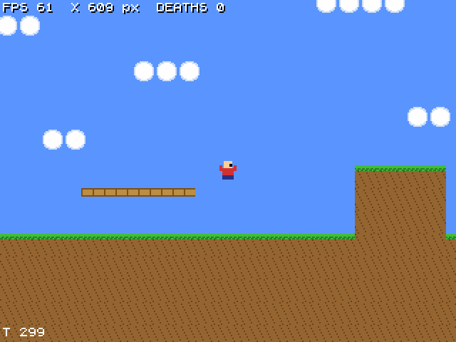

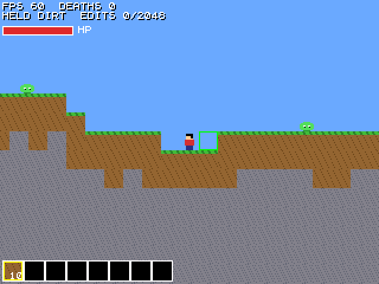

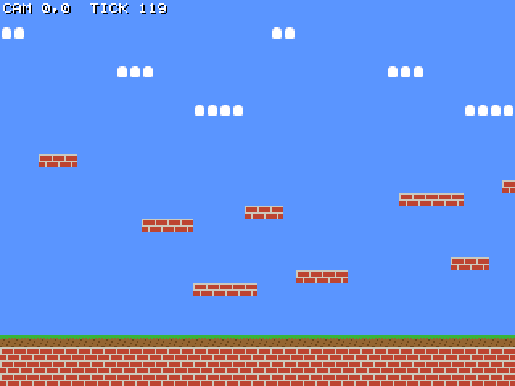

## 4. Core concepts

### The game class

A PGE game is a class with three methods. The engine calls them. You do not write the main loop yourself.

| Method | When the engine calls it | What it does |
|---|---|---|
| `pge::Error onCreate(pge::Engine& e)` | Once, before the loop starts | Set up the game. Allocate memory from `e.initArena()` here. Return `pge::Ok`, or an error code to stop. |
| `void onTick(const pge::Input& in)` | `PGE_TICK_HZ` times per second | Read input and change the game state. All game logic goes here. |
| `void onRender(pge::Canvas& c)` | Once per band of every frame | Draw the current state. Do not change the state here. |
| `void onDestroy()` | Once, after the loop ends | Optional. Clean up. |

The program's `main` function starts the engine and runs the game:

```cpp
#include "pge/engine.h"
#include "game.h"

static Game g_game;  // static: the game may keep pointers into itself

int main() {
  if (pge::init() != pge::Ok) return 1;          // display, input, arenas, band buffer
  return pge::run(g_game) == pge::Ok ? 0 : 1;    // onCreate, then the loop, then onDestroy
}
```

`pge::init()` sets up the display, the input, the memory arenas and the band buffer. `pge::run(game)` calls `onCreate`, runs the loop until the game calls `requestQuit()` on the engine (or the platform asks to quit), and then calls `onDestroy` if the game has it. The board firmware uses the same pattern; see `examples/f429/scroller_main.cpp`.

### The fixed-timestep loop

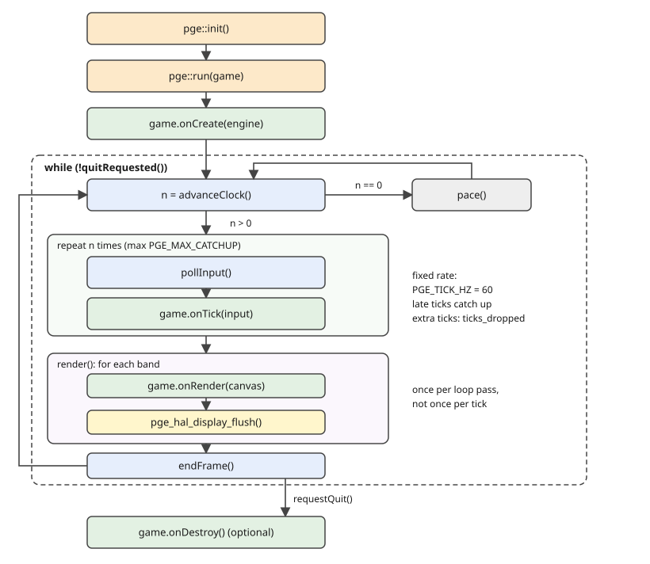

`pge::run` repeats these steps until a quit is requested:

1. `advanceClock()` returns the number of ticks that are due now.
2. If no tick is due, `pace()` sleeps until the next one. Nothing is drawn.
3. For each due tick: the frame arena is reset, the input is read (`pollInput()`), and `onTick` is called.
4. After the ticks, the frame is drawn once: `onRender` is called once per band, and each band is flushed to the display.
5. `endFrame()` ends the frame.

What this means for your game:

- The tick rate is fixed (`PGE_TICK_HZ`, 60 by default). Move objects by a number of pixels per tick. You do not need a time delta.
- If the program falls behind, it runs the missed ticks one after another (catch-up). At most `PGE_MAX_CATCHUP` ticks run per loop pass (5 by default). Ticks beyond that are dropped and counted in `Stats::ticks_dropped`.
- Drawing is decoupled from ticks: one frame can follow several ticks.
- `Input` is sampled once per tick. `held()` is the current state. `pressed()` and `released()` are edges against the previous tick.

### Band rendering

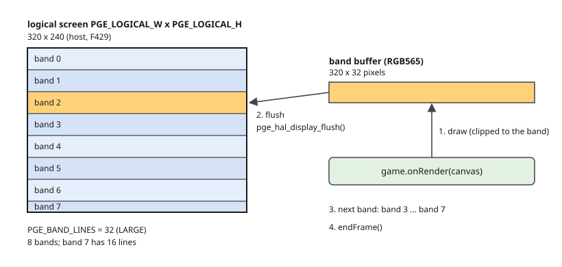

The engine never holds a whole frame. It splits the logical screen into horizontal bands of `PGE_BAND_LINES` lines. For each band it:

1. clears the small band buffer (RGB565),
2. calls your `onRender` with a `Canvas` for that band,
3. flushes the band to the display through the HAL (`pge_hal_display_flush`).

With the LARGE profile (host and F429) a band has 32 lines, so a 320 x 240 screen has 8 bands, and the last one has 16 lines. A full 320 x 240 RGB565 frame needs 153,600 bytes; one band of 32 lines needs 20,480 bytes (calculated: width x lines x 2 bytes).

What this means for your game:

- `onRender` runs several times per frame. Always draw the whole scene with full-screen coordinates. The canvas clips every drawing call to the current band for you.
- `onRender` must only draw. If it changed the game state, each band would show a different state.
- `Canvas::visible(rect)` tells you if a rectangle touches the current band. You can use it to skip work.

### Layers and modules

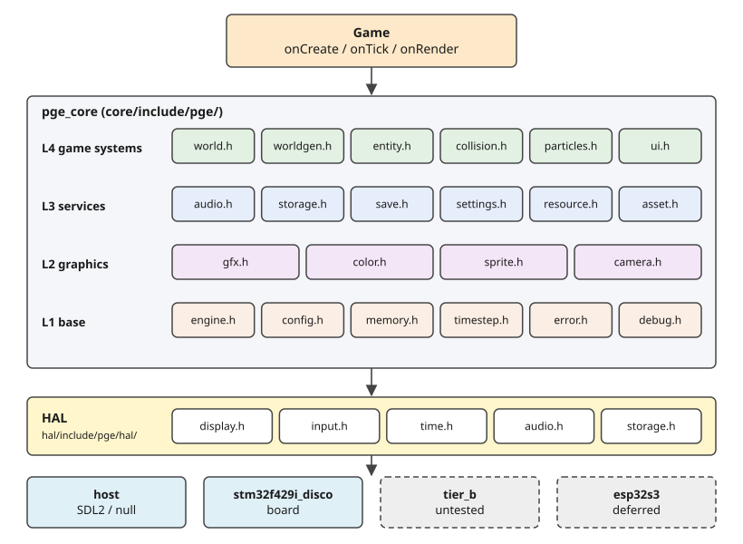

The engine is built in layers. A module may use modules in its own layer or in a lower one, never a higher one.

| Layer | Modules | Headers in `core/include/pge/` |
|---|---|---|
| L4 game systems (optional) | World, Entity, Physics, UI | `world.h`, `worldgen.h`, `entity.h`, `collision.h`, `particles.h`, `ui.h` |
| L3 services | Input, Audio (optional), Storage (optional), Resource Manager | `audio.h`, `storage.h`, `save.h`, `settings.h`, `resource.h`, `asset.h` |
| L2 graphics | Graphics, Renderer, Sprite, Tilemap, Camera | `gfx.h`, `color.h`, `sprite.h`, `camera.h` |
| L1 base | Core, Debug | `engine.h`, `config.h`, `memory.h`, `timestep.h`, `error.h`, `version.h`, `debug.h` |
| L0 hardware side | HAL, Platform, Display | `hal/include/pge/hal/*.h`, plus code in `platform/` and `drivers/` |

Rules:

- The platform is chosen at link time. There is one platform per program and no runtime switch.
- Optional modules can be compiled out by the profile.
- Game code uses only the public `pge/*.h` headers.

More: [modules.md](../user/modules.md) and [01-overview.md](../architecture/01-overview.md).

### Memory without a heap

The engine uses three kinds of memory. All sizes come from the profile.

- **Init arena.** Memory you take during `onCreate` with `e.initArena()`. It is never freed. When the loop starts, the init arena is locked; later allocations fail and are counted.
- **Frame arena.** Scratch memory from `e.frameArena()`. It is reset at the start of every tick.
- **Fixed pools.** `pge::Pool<T, N>` holds up to N objects. When it is full, `alloc()` returns `kInvalid`; it never allocates more.

Game code should follow the same rule. Use fixed-size arrays and members, as the tutorial does. Do not use `new`, `malloc` or growing containers in the game loop. The engine rules also exclude exceptions, RTTI, iostream and allocating STL containers from the core.

### Profiles

Each platform has a `pge_profile.h` that sets exactly one of `PGE_PROFILE_SMALL`, `PGE_PROFILE_MEDIUM` or `PGE_PROFILE_LARGE` to 1, and the logical screen size. `config.h` derives the other values. The host and the F429 use LARGE.

| Setting | SMALL | MEDIUM | LARGE |
|---|---|---|---|
| Logical screen | 160 x 128 | 320 x 240 | 320 x 240 |
| Band lines (`PGE_BAND_LINES`) | 8 | 16 | 32 |
| Integer scale max | 1 | 2 | 3 |
| Parallax layers | 1 | 2 | 4 |
| Audio channels | 0 (audio off) | 4 | 8 |
| Entities | 64 | 256 | 1,024 |
| Particles | 32 | 128 | 512 |

Every value can be overridden before `config.h` is included, for example in an optional `pge_user_config.h`. The full list is in [api-core.md](../user/api-core.md).

## 5. API tour

This section shows each part of the API with a short example. All names are in `namespace pge`. The full reference is in the `api-*.md` files.

### Drawing on the canvas

`Canvas` is the object that `onRender` receives. It draws pixels, lines, rectangles, circles and text. Coordinates are logical screen coordinates. Colors are RGB565 values; `pge::rgb(r, g, b)` makes one from 8-bit parts. `pge::kPalette16` is a built-in 16-color palette.

```cpp
void onRender(pge::Canvas& c) {
  c.clear(pge::rgb(0, 0, 0));
  c.fillRect({10, 10, 40, 20}, pge::rgb(255, 0, 0));
  c.rect({8, 8, 44, 24}, pge::rgb(255, 255, 255));
  c.line(0, 0, c.width() - 1, c.height() - 1, pge::kPalette16[5]);
  c.fillCircle(160, 120, 30, pge::kPalette16[3]);
}
```

Reference: [api-gfx.md](../user/api-gfx.md).

### Colors and sprites

A sprite sheet is an array of 8-bit palette indices plus a palette (`const pge::Color[]`). With `transparent` set, index 0 is not drawn. `Canvas::sprite` draws one frame. Flags flip the sprite (`FlipX`, `FlipY`) or rotate it in 90-degree steps (`Rot90`, `Rot180`, `Rot270`). `pge::Animation` and `pge::animFrame` pick the frame from the tick count.

```cpp
constexpr pge::Animation kWalk{0, 4, 8, true};  // frames 0..3, 8 ticks each, looping

void onRender(pge::Canvas& c) {
  c.sprite(kSheet, pge::animFrame(kWalk, ticks_), x_, y_, pge::FlipX);
}
```

`tools/pge_assets.py` converts PNG images into indexed sprite sheets with an RGB565 palette. See [install.md](../user/install.md), section 4.

### Input

`onTick` receives a `pge::Input`. It has eight buttons (`Button::Up`, `Down`, `Left`, `Right`, `A`, `B`, `Start`, `Select`), four analog axes and one touch point. The platform decides which keys, pins or sticks map to them.

```cpp
void onTick(const pge::Input& in) {
  if (in.held(pge::Button::Left)) x_ -= 2;       // true while the button is down
  if (in.pressed(pge::Button::A)) jumping_ = true;  // true only in the tick it went down
  if (in.touchPressed()) target_x_ = in.touchX();   // touch or mouse, in logical coordinates
}
```

Reference: [api-core.md](../user/api-core.md) (`Input`) and [api-hal.md](../user/api-hal.md) (the HAL side).

### Text and UI

`Canvas::text` draws a string with a bitmap font. `pge::kFont5x7` is the built-in font (ASCII 32 to 126, German umlauts and ß, Cyrillic; strings are UTF-8). `pge::textWidth` measures a string. The widgets in `pge::ui` (`label`, `bar`, `iconGrid`, `listMenu`) have no state; you call them from `onRender`. `ui::MenuNav` moves a selection with Up and Down. `pge::drawOverlay` shows timing and pool counters. The UI widgets are host only.

```cpp
const pge::ui::Style st{&pge::kFont5x7, 0xFFFF, 0x0000, 0xFFE0, 1};  // font, fg, bg, accent, padding
pge::ui::label(c, st, 2, 2, "HP");
pge::ui::bar(c, st, {20, 2, 60, 7}, hp_, 10, pge::rgb(255, 0, 0));
```

Reference: [api-gfx.md](../user/api-gfx.md) (`ui.h`) and [api-core.md](../user/api-core.md) (`debug.h`).

### Tilemaps and camera

A `Tileset` holds the tile images. A `TileLayer` holds a grid of tile ids. `Canvas::tilemap` draws one layer at a camera offset. `pge::Camera` keeps the view inside the world. `pge::drawLayers` draws several `MapLayer`s with parallax factors. Tilemaps, layers, camera and parallax are board-checked on the F429.

```cpp
// in onTick: follow the player
cam_.centerOn(player_x_, player_y_);
// in onRender: draw the back layer, then the front layer
pge::drawLayers(c, cam_, layers_, 2);
```

See `examples/scroller/game.h` and `examples/platformer/game.h`. Reference: [api-gfx.md](../user/api-gfx.md) (`camera.h`).

### World and entities

For large worlds, `pge::World` stores tiles in chunks of 32 x 32 tiles and keeps only some chunks in a cache. A generator function such as `pge::terrainGen` creates the chunks; edits are kept in a change log. `pge::Entities` is a fixed pool of moving bodies with gravity, tile collision, health and damage events. `pge::moveAndCollide` moves one box through a tile grid. These modules are host only.

```cpp
pge::WorldConfig wc = {};
wc.w_chunks = 32;
wc.h_chunks = 4;
wc.seed = 1234;
wc.gen = pge::terrainGen;
wc.props = props_;  // 256 TileProps entries, one per tile id
wc.tile_px = 16;
pge::Error err = world_.init(wc, e.initArena());   // in onCreate
if (err != pge::Ok) return err;
err = ent_.init(e.initArena(), 32);                // room for 32 entities
```

See `examples/sandbox/game.h`. Reference: [api-world.md](../user/api-world.md).

### Audio

`pge::Mixer` plays PCM8 and PCM16 sound effects and pattern music. The game thread sends commands; the platform audio side mixes. Audio is host tested; the F429 SAI backend is compile-only. The SMALL profile compiles audio out.

```cpp
static pge::Mixer mixer;
mixer.init(22050);
mixer.start();
const pge::Sound blip = {samples, 2000, 22050, pge::Pcm16, 0};  // data, frames, rate, format, loop
mixer.play(blip, 220);                                          // volume 0..255
```

See `examples/audiodemo/main.cpp`. Reference: [api-audio-storage.md](../user/api-audio-storage.md).

### Storage

`pge::Storage` reads and writes small files and writes save files safely (two slots with a CRC-32 check and a `.bak` fallback). `pge::saveGame` and `pge::loadGame` store a world's change log plus your own data. `pge::Settings` reads a `key = value` file. Storage is host only; the F429 has no save medium.

```cpp
err = storage_.init(e.initArena(), 512);           // in onCreate: I/O buffer of 512 bytes
storage_ok_ = storage_.mount() == pge::Ok;
// later, for example from a menu:
pge::saveGame(storage_, "game.sav", world_, ticks_, blob, sizeof blob);
```

Reference: [api-audio-storage.md](../user/api-audio-storage.md).

## 6. Step by step: make a simple pixel game (Coin Catcher)

In this tutorial you build a small game in five steps. You move a character, collect coins, count the score and avoid falling rocks. Each step is a complete program that you can build and run.

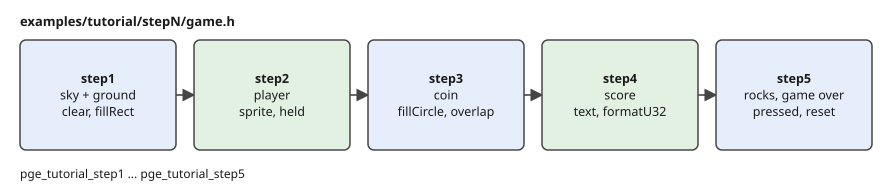

### Prerequisites

- A working host build with SDL2, as in [section 2](#2-install-and-build).
- The CLion tool paths on `PATH` in your PowerShell session.
- Basic C++: classes, member variables, arrays.

### Project layout

The tutorial lives in `examples/tutorial/`:

```text
examples/tutorial/
  CMakeLists.txt     one program per step: pge_tutorial_step1 .. pge_tutorial_step5
  main.cpp           shared main for all steps
  step1/game.h       game code of step 1
  step2/game.h
  step3/game.h
  step4/game.h
  step5/game.h
```

Each step folder has only one file, `game.h`, with the class `Game`. The shared `main.cpp` includes `game.h`; CMake builds it once per step, each time with that step's folder as the include path.

`main.cpp` wraps `Game` in a small `Runner` class that adds the command-line flags. Its `main` function starts the engine:

```cpp
int main(int argc, char** argv) {
  const char* shot = nullptr;
  for (int i = 1; i < argc; i++) {
    if (!std::strcmp(argv[i], "--auto")) g_runner.autoplay = true;
    else if (i + 1 < argc && !std::strcmp(argv[i], "--ticks")) g_runner.quit_after = (uint32_t)std::strtoul(argv[++i], nullptr, 10);
    else if (i + 1 < argc && !std::strcmp(argv[i], "--shot")) shot = argv[++i];
  }
  pge::Error err = pge::init();
  if (err != pge::Ok) { std::printf("init failed: %d\n", err); return 1; }
  err = pge::run(g_runner);
  if (err != pge::Ok) { std::printf("run failed: %d\n", err); return 1; }
  if (shot && pge_host_save_bmp(shot) != 0) { std::printf("save_bmp failed\n"); return 1; }
  return 0;
}
```

The flags are:

- `--auto`: a fixed input script replaces the keyboard. The tutorial screenshots in this guide were made with it.
- `--ticks N`: quit after N ticks.
- `--shot out.bmp`: save the window contents to a BMP file after the loop. This uses `pge_host_save_bmp`, which exists only on the host.

The tutorial uses only these headers: `pge/engine.h`, `pge/color.h` and, from step 4, `pge/ui.h`.

### Step 1: sky and ground

**Goal:** the smallest game that draws something: a blue sky and a strip of green ground.

**Code** (`examples/tutorial/step1/game.h`, the whole file):

```cpp
// Coin Catcher, step 1: the smallest game. The engine calls onCreate once, onTick 60 times a second and onRender
// to draw a frame. This one only paints the sky and the ground.
#pragma once
#include "pge/color.h"
#include "pge/engine.h"

class Game {
 public:
  pge::Error onCreate(pge::Engine&) { return pge::Ok; }

  void onTick(const pge::Input&) {}

  // The engine draws the screen in horizontal bands and calls onRender once per band, so onRender only draws;
  // all game state changes happen in onTick.
  void onRender(pge::Canvas& c) {
    c.clear(pge::rgb(92, 148, 252));
    c.fillRect({0, kGroundY, c.width(), c.height() - kGroundY}, pge::rgb(60, 160, 60));
  }

 private:
  static constexpr int kGroundY = 220;  // top row of the grass
};
```

**What is new:**

- `class Game` has the three methods the engine needs. `onCreate` and `onTick` do nothing yet.
- `pge::Error` is the error code type. `pge::Ok` means success.
- `c.clear(color)` fills the band with one color.
- `pge::rgb(r, g, b)` makes an RGB565 color from three values from 0 to 255.
- `c.fillRect({x, y, w, h}, color)` fills a rectangle. `{0, kGroundY, ...}` is a `pge::Rect`.
- `c.width()` and `c.height()` give the logical screen size: 320 x 240 on the host.
- The ground starts at row `kGroundY = 220`, so it is 20 pixels high.

**Build and run:**

```powershell
cmake --build build --target pge_tutorial_step1
build\examples\tutorial\pge_tutorial_step1.exe
```

Press Esc or close the window to quit.


### Step 2: a player you can move

**Goal:** a 12 x 12 pixel character that the arrow keys move. It stays inside the play field and looks in the direction it moves.

**Code:** first the sprite data, at the top of `examples/tutorial/step2/game.h`:

```cpp
// 12x12 player, one palette index per pixel; index 0 is transparent. The eyes look right.
constexpr uint8_t kPlayerPx[] = {
    0, 0, 0, 1, 1, 1, 1, 1, 1, 0, 0, 0,
    0, 0, 1, 2, 2, 2, 2, 2, 2, 1, 0, 0,
    0, 1, 2, 2, 2, 2, 2, 2, 2, 2, 1, 0,
    0, 1, 2, 3, 3, 2, 2, 3, 3, 2, 1, 0,
    0, 1, 2, 3, 1, 2, 2, 3, 1, 2, 1, 0,
    0, 1, 2, 2, 2, 2, 2, 2, 2, 2, 1, 0,
    0, 1, 2, 2, 1, 1, 1, 1, 2, 2, 1, 0,
    0, 0, 1, 2, 2, 2, 2, 2, 2, 1, 0, 0,
    0, 0, 0, 1, 1, 1, 1, 1, 1, 0, 0, 0,
    0, 0, 1, 4, 4, 1, 1, 4, 4, 1, 0, 0,
    0, 1, 4, 4, 4, 1, 1, 4, 4, 4, 1, 0,
    0, 1, 1, 1, 1, 0, 0, 1, 1, 1, 1, 0,
};
constexpr pge::Color kPlayerPal[] = {0, pge::rgb(20, 20, 40), pge::rgb(240, 120, 40), pge::rgb(255, 255, 255),
                                     pge::rgb(60, 60, 200)};
constexpr pge::SpriteSheet kPlayer{kPlayerPx, kPlayerPal, 12, 12, 1, true};
```

Then the new `Game` class:

```cpp
class Game {
 public:
  pge::Error onCreate(pge::Engine&) {
    x_ = (PGE_LOGICAL_W - kSize) / 2;
    y_ = (kGroundY - kSize) / 2;
    return pge::Ok;
  }

  void onTick(const pge::Input& in) {
    using pge::Button;
    const int dx = in.held(Button::Right) - in.held(Button::Left);
    const int dy = in.held(Button::Down) - in.held(Button::Up);
    if (dx != 0) left_ = dx < 0;
    x_ = std::clamp(x_ + dx * kSpeed, 0, PGE_LOGICAL_W - kSize);
    y_ = std::clamp(y_ + dy * kSpeed, 0, kGroundY - kSize);
  }

  void onRender(pge::Canvas& c) {
    c.clear(pge::rgb(92, 148, 252));
    c.fillRect({0, kGroundY, c.width(), c.height() - kGroundY}, pge::rgb(60, 160, 60));
    c.sprite(kPlayer, 0, x_, y_, left_ ? pge::FlipX : pge::None);
  }

 private:
  static constexpr int kGroundY = 220, kSize = 12, kSpeed = 2;  // kSpeed: pixels per tick
  int x_ = 0, y_ = 0;
  bool left_ = false;  // facing left: draw the sprite mirrored
};
```

**What is new:**

- `kPlayerPx` is the image: one palette index per pixel, 12 x 12 values, row by row.
- `kPlayerPal` is the palette: `pge::Color` values. Entry 0 is not used, because index 0 is transparent.
- `pge::SpriteSheet{kPlayerPx, kPlayerPal, 12, 12, 1, true}` describes the image: pixels, palette, width, height, number of frames (1), and `true` for "index 0 is transparent".
- `PGE_LOGICAL_W` is the logical screen width from the profile (320 on the host).
- `in.held(Button::Right)` is `true` while the button is down. `true - false` gives 1 and `false - true` gives -1, so `dx` and `dy` are -1, 0 or 1.
- The player moves `kSpeed = 2` pixels per tick. Because the tick rate is fixed, this is a fixed speed.
- `std::clamp` keeps the player inside the screen and above the ground.
- `c.sprite(kPlayer, 0, x_, y_, flags)` draws frame 0 of the sheet at (x, y). `pge::FlipX` mirrors the image when the player looks left; `pge::None` draws it as stored.
- The state changes only in `onTick`. `onRender` only reads it.

**Build and run:**

```powershell
cmake --build build --target pge_tutorial_step2
build\examples\tutorial\pge_tutorial_step2.exe
```

Use the arrow keys or W, A, S, D to move.

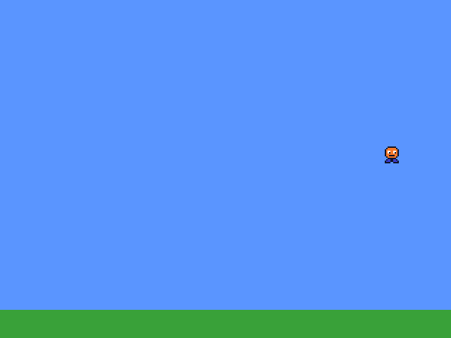

### Step 3: a coin to collect

**Goal:** a coin. When the player touches it, the coin moves to a new place.

**Code:** a helper function that tests if two rectangles overlap (`examples/tutorial/step3/game.h`):

```cpp
// Axis-aligned boxes overlap when they overlap on both axes; touching edges do not count.
inline bool overlap(pge::Rect a, pge::Rect b) {
  return a.x < b.x + b.w && b.x < a.x + a.w && a.y < b.y + b.h && b.y < a.y + a.h;
}
```

`onCreate` places the first coin:

```cpp
  pge::Error onCreate(pge::Engine&) {
    x_ = (PGE_LOGICAL_W - kSize) / 2;
    y_ = (kGroundY - kSize) / 2;
    coin_x_ = 240;  // the first coin sits right of the player; later ones are random
    coin_y_ = y_;
    return pge::Ok;
  }
```

`onTick` now also checks the coin:

```cpp
  void onTick(const pge::Input& in) {
    using pge::Button;
    const int dx = in.held(Button::Right) - in.held(Button::Left);
    const int dy = in.held(Button::Down) - in.held(Button::Up);
    if (dx != 0) left_ = dx < 0;
    x_ = std::clamp(x_ + dx * kSpeed, 0, PGE_LOGICAL_W - kSize);
    y_ = std::clamp(y_ + dy * kSpeed, 0, kGroundY - kSize);

    if (overlap({x_, y_, kSize, kSize}, {coin_x_, coin_y_, kCoin, kCoin})) {
      coin_x_ = random(PGE_LOGICAL_W - kCoin);
      coin_y_ = random(kGroundY - kCoin);
    }
  }
```

`onRender` draws the coin before the player, so the player is drawn on top:

```cpp
  void onRender(pge::Canvas& c) {
    using pge::rgb;
    c.clear(rgb(92, 148, 252));
    c.fillRect({0, kGroundY, c.width(), c.height() - kGroundY}, rgb(60, 160, 60));
    const int r = kCoin / 2, cx = coin_x_ + r, cy = coin_y_ + r;
    c.fillCircle(cx, cy, r, rgb(255, 210, 0));
    c.circle(cx, cy, r, rgb(180, 120, 0));
    c.line(cx, cy - 2, cx, cy + 2, rgb(255, 250, 200));
    c.sprite(kPlayer, 0, x_, y_, left_ ? pge::FlipX : pge::None);
  }
```

The new private part with the random number generator:

```cpp
 private:
  static constexpr int kGroundY = 220, kSize = 12, kSpeed = 2, kCoin = 11;

  // 0 .. n-1 from a linear congruential generator: same sequence every run, which keeps --auto repeatable.
  int random(int n) {
    rng_ = rng_ * 1664525u + 1013904223u;
    return static_cast<int>((rng_ >> 16) % static_cast<uint32_t>(n));
  }

  int x_ = 0, y_ = 0, coin_x_ = 0, coin_y_ = 0;
  bool left_ = false;
  uint32_t rng_ = 12345;
};
```

**What is new:**

- `overlap` is plain game code. Two boxes overlap when they overlap on both axes.
- `c.fillCircle(cx, cy, r, color)` draws a filled circle; `c.circle` draws its outline.
- `c.line(x0, y0, x1, y1, color)` draws a line. Here it is the shine on the coin.
- Things drawn later cover things drawn earlier.
- `random(n)` is a small linear congruential generator. It gives the same numbers on every run. This keeps the `--auto` run repeatable.

**Build and run:**

```powershell
cmake --build build --target pge_tutorial_step3
build\examples\tutorial\pge_tutorial_step3.exe
```

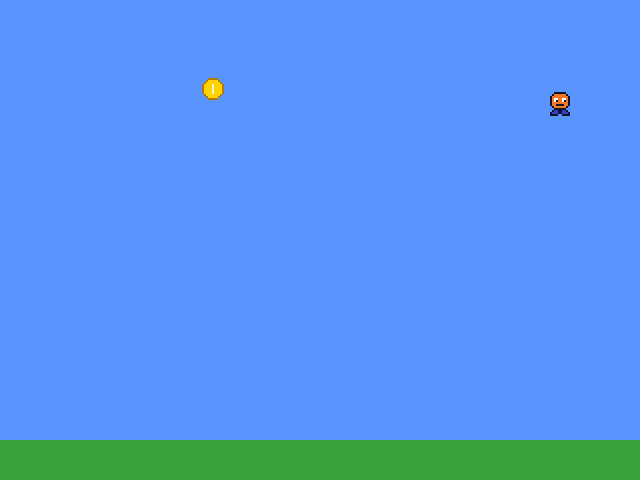

### Step 4: the score

**Goal:** count the collected coins and show the score in the top-left corner.

**Code:** step 4 includes one more header (`examples/tutorial/step4/game.h`):

```cpp
#include "pge/color.h"
#include "pge/engine.h"
#include "pge/ui.h"
```

A helper that draws text with a shadow:

```cpp
// White text with a black shadow, readable on any background.
inline void shadowText(pge::Canvas& c, int x, int y, const char* s) {
  c.text(pge::kFont5x7, x + 1, y + 1, s, pge::rgb(0, 0, 0));
  c.text(pge::kFont5x7, x, y, s, pge::rgb(255, 255, 255));
}
```

`onTick` counts the coin:

```cpp
    if (overlap({x_, y_, kSize, kSize}, {coin_x_, coin_y_, kCoin, kCoin})) {
      score_++;
      coin_x_ = random(PGE_LOGICAL_W - kCoin);
      coin_y_ = random(kGroundY - kCoin);
    }
```

At the end of `onRender`, the score is drawn:

```cpp
    char num[11];
    pge::ui::formatU32(num, sizeof num, score_);
    shadowText(c, 4, 4, "SCORE");
    shadowText(c, 4 + pge::textWidth(pge::kFont5x7, "SCORE "), 4, num);
```

**What is new:**

- `pge/ui.h` provides the UI helpers, including `pge::ui::formatU32`.
- `c.text(font, x, y, text, color)` draws a string with a transparent background.
- `pge::kFont5x7` is the built-in 5 x 7 pixel font. It has ASCII, German umlauts and ß, and Cyrillic; strings are UTF-8.
- Drawing the text twice, first in black and 1 pixel offset, then in white, gives a shadow that is readable on any background.
- `pge::ui::formatU32(buffer, size, value)` writes a number as decimal text. It needs no `printf`. A `uint32_t` has at most 10 digits, so 11 characters are enough, including the end mark.
- `pge::textWidth(font, text)` gives the width of a string in pixels. Here it places the number after `"SCORE "`.
- The text is formatted in `onRender`, once per band. You can also format it in `onTick` and keep it in a member, as `examples/platformer/game.h` does.

**Build and run:**

```powershell
cmake --build build --target pge_tutorial_step4
build\examples\tutorial\pge_tutorial_step4.exe
```

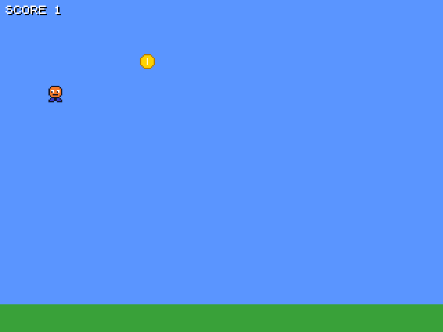

### Step 5: falling rocks and game over

**Goal:** rocks fall from the sky. They fall faster as the score grows. A rock that hits the player ends the game. Start (Enter) begins a new game.

**Code:** a helper for centered text (`examples/tutorial/step5/game.h`):

```cpp
inline void centeredText(pge::Canvas& c, int y, const char* s) {
  shadowText(c, (c.width() - pge::textWidth(pge::kFont5x7, s)) / 2, y, s);
}
```

`onCreate` now calls `reset()`:

```cpp
  pge::Error onCreate(pge::Engine&) {
    reset();
    return pge::Ok;
  }
```

The complete `onTick`:

```cpp
  void onTick(const pge::Input& in) {
    using pge::Button;
    if (over_) {
      if (in.pressed(Button::Start)) reset();
      return;
    }
    const int dx = in.held(Button::Right) - in.held(Button::Left);
    const int dy = in.held(Button::Down) - in.held(Button::Up);
    if (dx != 0) left_ = dx < 0;
    x_ = std::clamp(x_ + dx * kSpeed, 0, PGE_LOGICAL_W - kSize);
    y_ = std::clamp(y_ + dy * kSpeed, 0, kGroundY - kSize);

    const pge::Rect player{x_, y_, kSize, kSize};
    if (overlap(player, {coin_x_, coin_y_, kCoin, kCoin})) {
      score_++;
      coin_x_ = random(PGE_LOGICAL_W - kCoin);
      coin_y_ = random(kGroundY - kCoin);
    }

    if (--spawn_in_ == 0) {
      spawn_in_ = kSpawnTicks;
      for (Rock& r : rocks_)
        if (!r.live) {  // take the first free slot; with none free this rock is skipped
          r = Rock{random(PGE_LOGICAL_W - kRock), -kRock, true};
          break;
        }
    }
    const int fall = 2 + static_cast<int>(score_ / 4);
    for (Rock& r : rocks_) {
      if (!r.live) continue;
      r.y += fall;
      if (r.y >= kGroundY) r.live = false;
      else if (overlap(player, {r.x, r.y, kRock, kRock})) over_ = true;
    }
  }
```

In `onRender`, the rocks are drawn before the player:

```cpp
    for (const Rock& k : rocks_)
      if (k.live) {
        c.fillRect({k.x, k.y, kRock, kRock}, rgb(120, 110, 100));
        c.rect({k.x, k.y, kRock, kRock}, rgb(60, 50, 45));
      }
```

At the end of `onRender`, the game over text:

```cpp
    if (over_) {
      centeredText(c, 100, "GAME OVER");
      centeredText(c, 116, "PRESS START");
    }
```

The private part: constants, the rock record and `reset()`:

```cpp
  static constexpr int kGroundY = 220, kSize = 12, kSpeed = 2, kCoin = 11;
  static constexpr int kRock = 8, kRocks = 16, kSpawnTicks = 20;  // a new rock every 20 ticks (1/3 s)
  struct Rock { int x, y; bool live; };

  // Puts everything back to the start; used for the first game and for every restart.
  void reset() {
    x_ = (PGE_LOGICAL_W - kSize) / 2;
    y_ = (kGroundY - kSize) / 2;
    coin_x_ = 240;  // the first coin sits right of the player; later ones are random
    coin_y_ = y_;
    score_ = 0;
    spawn_in_ = kSpawnTicks;
    for (Rock& r : rocks_) r.live = false;
    over_ = false;
  }
```

**What is new:**

- `in.pressed(Button::Start)` is `true` only in the tick in which the button went down. A held button does not restart the game again and again.
- While `over_` is `true`, `onTick` returns early, so the game stands still.
- The rocks live in a fixed array `rocks_[kRocks]` of 16 slots. No memory is allocated during the game. A new rock takes the first free slot; if all slots are in use, no rock is added.
- A new rock appears every `kSpawnTicks = 20` ticks. At 60 ticks per second, that is three rocks per second.
- The fall speed is `2 + score_ / 4` pixels per tick, so the game gets harder.
- `c.rect(rect, color)` draws a 1-pixel outline inside the rectangle.
- `reset()` puts all state back to the start. `onCreate` and the restart both use it.

**Build and run:**

```powershell
cmake --build build --target pge_tutorial_step5
build\examples\tutorial\pge_tutorial_step5.exe
```

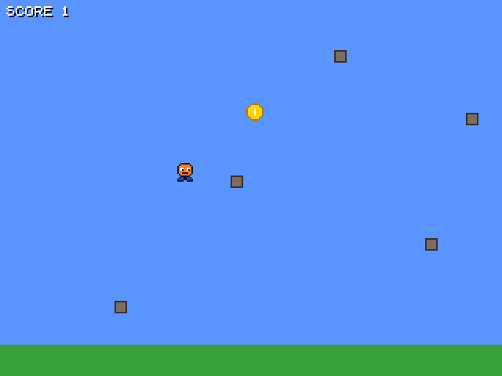

When a rock hits the player, the game stops and shows the game over text. Press Enter to play again.

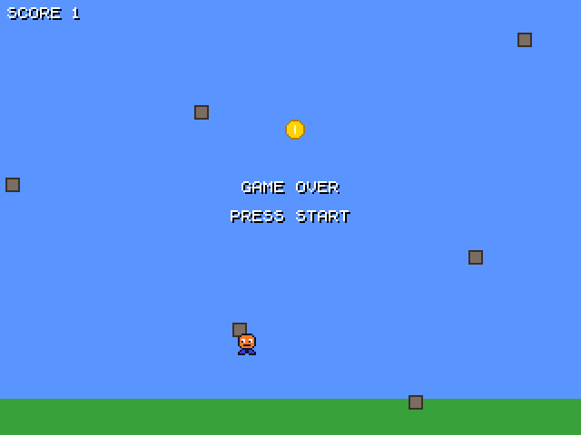

You can also run a step with the input script and save a screenshot:

```powershell
build\examples\tutorial\pge_tutorial_step5.exe --auto --ticks 300 --shot step5.bmp
```

### Ideas to go further

- **Sound.** Play a short sound when the player collects a coin. Create a `pge::Mixer` once, call `init` and `start`, and call `play` in `onTick`. See [Audio](#audio) and `examples/audiodemo/main.cpp`. Audio is host tested; the F429 audio backend is compile-only.
- **Animation.** Give the player sheet more frames and pick the frame with `pge::animFrame`. See [Colors and sprites](#colors-and-sprites).
- **A tile background.** Replace the plain sky with a tile layer and a camera. See [Tilemaps and camera](#tilemaps-and-camera) and `examples/scroller/game.h`.
- **Debug overlay.** Include `pge/debug.h`, keep a pointer to the `pge::Engine` from `onCreate`, and call `pge::drawOverlay(c, style, eng_->stats(), pge::kOverlayAll)` at the end of `onRender`. It shows the tick and frame timing and the pool counters.
- **Run it on the F429 board.** The tutorial has no firmware target. The scroller shows the pattern: `examples/f429/scroller_main.cpp` is a short `main` that runs the same `game.h` as the host program, and `platform/stm32f429i_disco/CMakeLists.txt` declares its firmware target. Map the engine buttons to the board buttons and the stick as listed in [hardware.md](../user/hardware.md). Read [porting.md](../user/porting.md) and [examples.md](../user/examples.md) first. Note that `main.cpp` of the tutorial uses `pge_host_save_bmp`, which exists only on the host.

### Start your own game

The easiest start is a copy of the finished tutorial.

1. Create a folder, for example `examples/mygame/`.
2. Copy `examples/tutorial/main.cpp` and `examples/tutorial/step5/game.h` into it.
3. Create `examples/mygame/CMakeLists.txt`. It follows `examples/tutorial/CMakeLists.txt`, with one program only:

   ```cmake
   add_executable(pge_mygame main.cpp)
   target_link_libraries(pge_mygame PRIVATE pge_core pge_platform_host)
   add_custom_command(TARGET pge_mygame POST_BUILD
     COMMAND ${CMAKE_COMMAND} -E copy_if_different $<TARGET_FILE:SDL2::SDL2> $<TARGET_FILE_DIR:pge_mygame>)
   ```

   `main.cpp` finds `game.h` because both files are in the same folder.

4. Register the folder in the root `CMakeLists.txt`. Add this line inside the `if(SDL2_FOUND)` block, next to `add_subdirectory(examples/tutorial)`:

   ```cmake
   add_subdirectory(examples/mygame)
   ```

5. Build and run:

   ```powershell
   cmake --build build --target pge_mygame
   build\examples\mygame\pge_mygame.exe
   ```

6. Change `game.h` step by step. Rebuild after each change.

Rules for game code:

- Include only `pge/<name>.h` headers from `core/include/pge/`, your own `game.h`, and a few C/C++ standard headers. `examples/sandbox/check_includes.cmake` shows how this is checked for the sandbox.
- Keep all state in members and fixed-size arrays. Allocate larger buffers in `onCreate` from `e.initArena()`.
- Change state only in `onTick`. Only draw in `onRender`.

For a headless game without SDL, start from `examples/empty` instead and link `pge_platform_host_null`. See "Starting your own game" in [examples.md](../user/examples.md).

## 7. Troubleshooting

**`cmake` or `ninja` is not recognized.**
On the development machine they come with CLion and are not on the global `PATH`. Run the `$env:PATH = ...` line from [section 2](#build-on-windows-with-the-clion-toolchain) in every new PowerShell session.

**CMake says `SDL2 not found: host window demo skipped`, or the target `pge_tutorial_step1` is unknown.**
The tutorial and the window examples are added only when CMake finds SDL2. Pass the SDL2 install prefix: `-DCMAKE_PREFIX_PATH=<SDL2 prefix>`. Then configure again.

**The program does not start, and Windows reports a missing DLL.**
- For the MinGW runtime DLLs: put `C:\Program Files\JetBrains\CLion\bin\mingw\bin` on `PATH` before you run the program.
- For `SDL2.dll`: the post-build step copies it next to the program. Build the target again, and check that the configure step found SDL2.

**The tests fail to start.**
`mingw\bin` must be on `PATH` while `ctest` runs, for the same runtime DLLs.

**The board configure fails in PowerShell.**
Quote the toolchain argument: `"-DCMAKE_TOOLCHAIN_FILE=cmake/arm-none-eabi.cmake"`. Unquoted, PowerShell splits it at the dot. `arm-none-eabi-gcc` and `arm-none-eabi-g++` must also be on `PATH`.

**Configure fails with `PGE_CUBE_DIR does not point at STM32CubeF4`.**
Pass the path of your STM32CubeF4 checkout with `-DPGE_CUBE_DIR=<path>`. The folder must contain `Drivers/STM32F4xx_HAL_Driver/Src/stm32f4xx_hal.c`.

**CMake prints `Python3 with Pillow not found`.**
Only the asset tool tests are skipped. Install Pillow into the Python you use if you need the asset tools.

**No window on a machine without a display.**
Set `$env:SDL_VIDEODRIVER='dummy'` and `$env:SDL_RENDER_DRIVER='software'` before you run the program. Use `--ticks` so that it quits, and `--shot` to get an image.

**SAVE and LOAD show NO STORAGE on the F429.**
This is expected. The board has no save medium driver yet. Saving works on the host only.

**The stick on the F429 moves the player without input.**
The stick centre is measured once at start-up. Keep the stick centred while the board starts. Unconnected stick pins give random values. See [hardware.md](../user/hardware.md).

## 8. FAQ

**Why is `onRender` called many times per frame?**
Because of band rendering. The engine calls it once per band. See [Band rendering](#band-rendering).

**Can I change the game state in `onRender`?**
No. Each band would then show a different state. Change state only in `onTick`.

**Can I use `new`, `malloc` or `std::vector`?**
The engine does not allocate after `pge::init()`, and game code should follow the same rule in the loop. Use members and fixed-size arrays, or allocate once in `onCreate` from `e.initArena()`.

**How do I end the game from code?**
Call `requestQuit()` on the `pge::Engine` that `onCreate` received. Keep a pointer to it. On the host, Esc and closing the window also quit.

**How large is the screen?**
The logical size comes from the profile: `PGE_LOGICAL_W` x `PGE_LOGICAL_H`, which is 320 x 240 on the host and on the F429. The host window shows it at twice the size.

**How fast is PGE?**
This guide gives no numbers. Measured results, with their conditions, are in [benchmarks.md](../user/benchmarks.md).

**Does PGE run on the ESP32-S3?**
Not yet. The ESP32-S3 port is deferred. `platform/esp32s3` is a placeholder.

**What about the RP2040, RP2350, STM32H7 or other boards?**
They have Tier B skeletons: the core and a stub HAL compile, but nothing is linked or run on a board. See [platform/tier_b/README.md](../../platform/tier_b/README.md) and [porting.md](../user/porting.md).

**Can I use PlatformIO, STM32CubeIDE or VS Code?**
CMake is the supported build. PlatformIO has a verified native (host) environment; the STM32CubeIDE notes and the VS Code tasks are untested. See [wrappers.md](../user/wrappers.md).

**Can I rotate or zoom freely?**
No. Sprites rotate in 90-degree steps only, and the output scale is an integer (1x, 2x or 3x).

## 9. Glossary

| Term | Meaning |
|---|---|
| Band | A horizontal strip of the screen, `PGE_BAND_LINES` lines high. The engine draws one band at a time. |
| Band buffer | The small RGB565 buffer that holds one band while it is drawn. |
| Board-checked | Confirmed by the user on the STM32F429I-DISCO board. |
| Canvas | The drawing object that `onRender` receives. It is valid only during that call. |
| Catch-up | Running missed ticks one after another, up to `PGE_MAX_CATCHUP` per loop pass. |
| Chunk | A 32 x 32 tile piece of a `World`. |
| Compile-only | The code builds, but nothing was run. |
| Fixed timestep | Game logic runs in ticks of equal length, `PGE_TICK_HZ` per second. |
| Flush | Sending a finished band to the display. |
| Frame arena | Scratch memory that is reset at the start of every tick. |
| HAL | Hardware abstraction layer: the C headers in `hal/include/pge/hal/` that each platform implements. |
| Host | The desktop PC. The host platform uses SDL2, or null backends without a window. |
| Host only | Built and tested on the PC; nothing was run on a board. |
| Init arena | Memory taken during `onCreate`. It is never freed and is locked when the loop starts. |
| Logical screen | The screen size the game draws to, in pixels. The display may show it scaled. |
| Palette | An array of `pge::Color` values. Sprite pixels are indices into it. |
| Platform | One implementation of the HAL for one target, for example `host` or `stm32f429i_disco`. |
| Pool | A fixed number of slots for objects of one type. It never grows. |
| Profile | SMALL, MEDIUM or LARGE: a compile-time set of sizes and switches. |
| RGB565 | A 16-bit color: 5 bits red, 6 bits green, 5 bits blue. |
| Sprite sheet | An image with one or more frames, stored as palette indices. |
| Tick | One step of game logic: one call of `onTick`. |
| Tier A | Targets the project measures: the host and the STM32F429I-DISCO. |
| Tier B | Boards with an untested HAL skeleton only. |
| Tile, tilemap | A small square image, and a grid of tile ids that forms a level. |

## 10. More documentation

- [install.md](../user/install.md): installing and building
- [hardware.md](../user/hardware.md): supported boards and wiring
- [modules.md](../user/modules.md): engine modules and their status
- [examples.md](../user/examples.md): example programs
- [api-core.md](../user/api-core.md): core API
- [api-gfx.md](../user/api-gfx.md): graphics API
- [api-world.md](../user/api-world.md): world, collision and entity API
- [api-audio-storage.md](../user/api-audio-storage.md): audio and storage API
- [api-hal.md](../user/api-hal.md): HAL API
- [porting.md](../user/porting.md): porting guide
- [wrappers.md](../user/wrappers.md): PlatformIO, STM32CubeIDE, VS Code
- [benchmarks.md](../user/benchmarks.md): benchmark results
- [01-overview.md](../architecture/01-overview.md): architecture overview
- [CHANGELOG.md](../../CHANGELOG.md): release notes
- [STATUS.md](../../STATUS.md): project status and feature tracker
