[English](en.md) | [Deutsch](de.md) | Русский

# Pixel Game Engine (PGE): руководство пользователя

Это основное руководство по Pixel Game Engine (PGE) версии 0.1.1. Оно объясняет, что такое движок, как его собрать и запустить, как он устроен и как шаг за шагом написать небольшую игру. Полный справочник по API лежит в файлах `docs/user/`, ссылки на них есть ниже.

## Содержание

1. [Что такое PGE](#1-что-такое-pge)
2. [Установка и сборка](#2-установка-и-сборка)
3. [Запуск примеров](#3-запуск-примеров)
4. [Основные понятия](#4-основные-понятия)
5. [Обзор API](#5-обзор-api)
6. [Пошагово: простая пиксельная игра (Coin Catcher)](#6-пошагово-простая-пиксельная-игра-coin-catcher)
   - [Шаг 1: небо и земля](#шаг-1-небо-и-земля)
   - [Шаг 2: игрок, которого можно двигать](#шаг-2-игрок-которого-можно-двигать)
   - [Шаг 3: монета для сбора](#шаг-3-монета-для-сбора)
   - [Шаг 4: счёт](#шаг-4-счёт)
   - [Шаг 5: падающие камни и конец игры](#шаг-5-падающие-камни-и-конец-игры)
7. [Решение проблем](#7-решение-проблем)
8. [FAQ](#8-faq)
9. [Глоссарий](#9-глоссарий)
10. [Дополнительная документация](#10-дополнительная-документация)

## 1. Что такое PGE

PGE — небольшой 2D-движок для пиксельных игр на микроконтроллерах и на ПК. Он написан на C++17. Вы пишете один класс игры, а движок сам вызывает его: обновить игру и нарисовать экран.

Один и тот же код игры работает на ПК («хосте») и на плате с микроконтроллером. На хосте PGE открывает окно через SDL2. На плате STM32F429I-DISCO он рисует на её дисплее.

### Ключевые идеи

- **Переносимое ядро.** Библиотека движка `pge_core` не содержит кода платформы. Она не подключает заголовки вендоров и операционной системы.
- **HAL.** Ядро работает с железом только через тонкий слой абстракции (HAL). HAL — это набор C-заголовков в `hal/include/pge/hal/`: `display.h`, `input.h`, `time.h`, `audio.h` и `storage.h`. Каждая платформа реализует эти заголовки. В каждую программу линкуется одна платформа.
- **Отрисовка полосами.** Движок не хранит кадр целиком в RAM. Он рисует экран небольшими горизонтальными полосами. Каждая полоса рисуется в маленький буфер, а потом отправляется (flush) на дисплей.
- **Без кучи после инициализации.** После возврата из `pge::init()` движок не выделяет память в куче. Память берётся из арен и фиксированных пулов. Их размеры задаются при компиляции.
- **Фиксированный шаг.** Логика игры идёт с постоянной частотой: `PGE_TICK_HZ` тиков в секунду (по умолчанию 60). Отрисовка не зависит от логики.
- **Профили.** Три профиля времени компиляции — SMALL, MEDIUM и LARGE — задают размер экрана, размеры буферов и набор необязательных модулей в сборке.

### Статус и ограничения

PGE 0.1.1 — предварительная версия. Пункты ниже взяты из `README.md` и из трекера возможностей в `STATUS.md`:

- Измеренные цели Tier A: хост (SDL2) и плата STM32F429I-DISCO.
- ESP32-S3 отложена (сессия S4.5). Звук I2S отложен вместе с ней.
- Остальные платы (RP2040/RP2350, STM32H7, ESP32 classic, обычный STM32F4) — это непроверенные заготовки HAL, запланированные в S7.2a. Их работа не подтверждена.
- Код мира, сущностей, звука и хранилища в основном работает только на хосте. Звуковой бэкенд F429 (SAI) только компилируется, на плате его не запускали.
- На F429 нет носителя для сохранений: драйверов SD, USB MSC и блочного устройства во флеше пока нет, поэтому SAVE и LOAD сообщают, что хранилища нет. Бэкенды FatFs и LittleFS проверены только на заглушках (LittleFS ещё и на настоящем `lfs.c` во временной сборке).
- Враги и базовый ИИ, освещение, пропуск полос и оконный flush запланированы, но не реализованы.
- Звук через PWM и DAC не запланирован.
- Вне плана: ввод USB HID host, свободный зум камеры (только масштаб 1x, 2x, 3x), свободный поворот спрайтов (только шаги по 90 градусов), 3D, сеть.

В этом руководстве нет цифр производительности. Измеренные значения с указанием платы, флагов сборки и условий лежат в [benchmarks.md](../user/benchmarks.md).

Статусы в документах проекта означают следующее:

| Слово | Значение |
|---|---|
| реализовано | Возможность есть в коде. Где её проверяли, указано рядом. |
| запланировано | Пока не реализовано. |
| только хост | Собрано и проверено на ПК разработчика. На плате ничего не запускали. |
| проверено на плате | Пользователь подтвердил на STM32F429I-DISCO. |
| только компиляция | Код собирается. Ничего не запускали. |
| не завершено | Начато, но части не хватает. |
| вне плана | Для этой версии не планируется. |

## 2. Установка и сборка

Полная инструкция лежит в [install.md](../user/install.md). Здесь только короткий путь.

### Требования

- CMake 3.20 или новее.
- Ninja.
- Компилятор C++17.
- Пакет разработки SDL2 2.x. Для движка он необязателен, но нужен для каждой программы с окном, включая туториал. Без SDL2 CMake пишет `SDL2 not found: host window demo skipped` и пропускает примеры с окном.
- По желанию: Python 3 с Pillow для инструментов работы с ресурсами в `tools/`.

### Сборка на Windows с набором инструментов CLion

На машине разработки CMake, Ninja и MinGW g++ идут вместе с CLion и не прописаны в глобальный `PATH`. Добавьте их в текущую сессию PowerShell, затем настройте и соберите проект. Запускайте команды из корня репозитория:

```powershell
$env:PATH = "C:\Program Files\JetBrains\CLion\bin\cmake\win\x64\bin;C:\Program Files\JetBrains\CLion\bin\ninja\win\x64;C:\Program Files\JetBrains\CLion\bin\mingw\bin;$env:PATH"
cmake -S . -B build -G Ninja -DCMAKE_CXX_COMPILER="C:/Program Files/JetBrains/CLion/bin/mingw/bin/g++.exe"
cmake --build build --target pge_tutorial_step1
build\examples\tutorial\pge_tutorial_step1.exe
```

Если CMake не находит SDL2, добавьте в команду настройки префикс установки SDL2:

```powershell
cmake -S . -B build -G Ninja -DCMAKE_CXX_COMPILER="C:/Program Files/JetBrains/CLion/bin/mingw/bin/g++.exe" "-DCMAKE_PREFIX_PATH=<SDL2 prefix>"
```

Заметки:

- `mingw\bin` должен оставаться в `PATH` и при запуске программ: им нужны DLL среды выполнения MinGW.
- После каждой сборки шаг post-build копирует `SDL2.dll` рядом с программой.
- `cmake --build build` без `--target` собирает всё, включая тесты.

Запуск юнит-тестов на хосте:

```powershell
ctest --test-dir build --output-on-failure
```

### Сборка на других системах

Общая сборка для хоста:

```bash
cmake -S . -B build -G Ninja
cmake --build build
ctest --test-dir build --output-on-failure
```

Если CMake выбрал не тот компилятор, используйте `-DCMAKE_CXX_COMPILER=<path>`. Если он не нашёл SDL2, используйте `-DCMAKE_PREFIX_PATH=<SDL2 prefix>`.

### Сборка для платы STM32F429I-DISCO

Для сборки под плату нужны `arm-none-eabi-gcc` (проверена версия 10.3.1), OpenOCD с программатором ST-LINK для прошивки и ваша собственная копия STM32CubeF4. В этот репозиторий STM32CubeF4 не входит. Укажите путь к ней в `PGE_CUBE_DIR`.

```powershell
cmake -S . -B build-f429 -G Ninja -DPGE_PLATFORM=stm32f429i_disco "-DCMAKE_TOOLCHAIN_FILE=cmake/arm-none-eabi.cmake" -DCMAKE_BUILD_TYPE=Release -DPGE_CUBE_DIR="<path to STM32CubeF4>"
cmake --build build-f429 --target pge_f429_platformer
cmake --build build-f429 --target flash_f429_platformer
```

Прошивка заменяет микропрограмму, которая уже есть на плате. Последовательного порта у платы нет: отладочный текст идёт в кольцевой буфер в RAM, и его читают через OpenOCD. Цели прошивки, опции, подключение и отладочный журнал описаны в [install.md](../user/install.md) (раздел 2) и в [hardware.md](../user/hardware.md). У туториала цели для прошивки нет.

## 3. Запуск примеров

Все программы для хоста собираются в `build\examples\<name>\`. Подробности о каждом примере — в [examples.md](../user/examples.md).

| Пример | Программа | Что показывает |
|---|---|---|
| empty | `build\examples\empty\pge_empty.exe` | Самый маленький цикл движка. Без окна (headless). |
| proto | `build\examples\proto\pge_proto_demo.exe` | Квадрат, который вы двигаете по сцене. Индикаторы кнопок. |
| gfxdemo | `build\examples\gfxdemo\pge_gfxdemo.exe` | Примитивы, текст и анимированный спрайт. |
| scroller | `build\examples\scroller\pge_scroller.exe` | Два тайловых слоя с параллаксом и камера. |
| platformer | `build\examples\platformer\pge_platformer.exe` | Столкновения с тайлами, прыжки, HUD и отладочный оверлей. |
| audiodemo | `build\examples\audiodemo\pge_audiodemo.exe` | Паттерновая музыка и звуковые эффекты. Без окна. |
| sandbox | `build\examples\sandbox\pge_sandbox.exe` | Генерируемый мир, копание, инвентарь, крафт, сохранение и загрузка. |
| tutorial | `build\examples\tutorial\pge_tutorial_step1.exe` to `pge_tutorial_step5.exe` | Игра Coin Catcher из раздела 6. |

### Управление с клавиатуры

На хосте клавиатура привязана к кнопкам движка:

| Кнопка движка | Клавиши |
|---|---|
| `Up` | Стрелка вверх или W |
| `Down` | Стрелка вниз или S |
| `Left` | Стрелка влево или A |
| `Right` | Стрелка вправо или D |
| `A` | Z или J |
| `B` | X или K |
| `Start` | Enter |
| `Select` | Backspace или правый Shift |
| выход | Esc или закрытие окна |

В примере sandbox клавиши W, A, S и D служат для прицеливания, а не для движения. Клавиши каждого примера перечислены в [examples.md](../user/examples.md).

### Флаги командной строки

Программы scroller, platformer, sandbox и tutorial принимают такие флаги:

- `--ticks N`: выйти через N тиков.
- `--shot out.bmp`: после цикла сохранить содержимое окна в файл BMP.
- `--auto`: заменить клавиатуру фиксированным сценарием ввода (platformer и tutorial).

Чтобы запустить программу с окном на машине без дисплея, сначала выберите «пустые» драйверы SDL:

```powershell
$env:SDL_VIDEODRIVER='dummy'; $env:SDL_RENDER_DRIVER='software'
build\examples\platformer\pge_platformer.exe --auto --overlay --ticks 120 --shot out.bmp
```

### Галерея

Окно на хосте вдвое больше логического экрана: 640 x 480 пикселей для логического экрана 320 x 240.

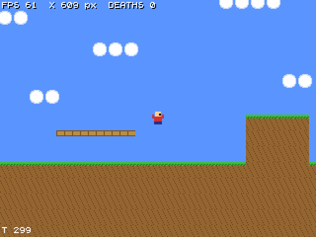

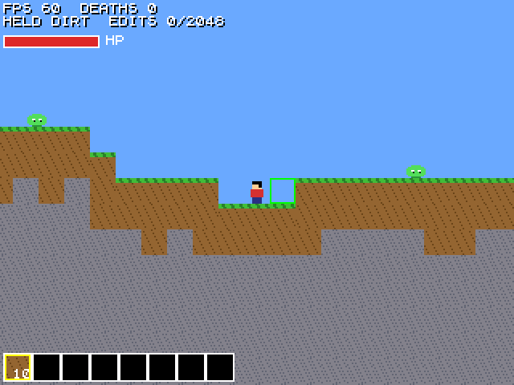

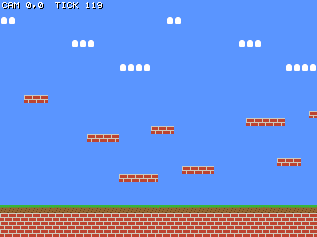

## 4. Основные понятия

### Класс игры

Игра на PGE — это класс с тремя методами. Их вызывает движок. Главный цикл вы не пишете.

| Метод | Когда его вызывает движок | Что он делает |
|---|---|---|
| `pge::Error onCreate(pge::Engine& e)` | Один раз, до начала цикла | Настраивает игру. Здесь выделяйте память из `e.initArena()`. Верните `pge::Ok` или код ошибки, чтобы остановиться. |
| `void onTick(const pge::Input& in)` | `PGE_TICK_HZ` раз в секунду | Читает ввод и меняет состояние игры. Вся логика игры живёт здесь. |
| `void onRender(pge::Canvas& c)` | Один раз на каждую полосу каждого кадра | Рисует текущее состояние. Состояние здесь не меняйте. |
| `void onDestroy()` | Один раз, после конца цикла | Необязательный. Освобождает ресурсы. |

Функция `main` программы запускает движок и игру:

```cpp
#include "pge/engine.h"
#include "game.h"

static Game g_game;  // static: the game may keep pointers into itself

int main() {
  if (pge::init() != pge::Ok) return 1;          // display, input, arenas, band buffer
  return pge::run(g_game) == pge::Ok ? 0 : 1;    // onCreate, then the loop, then onDestroy
}
```

`pge::init()` настраивает дисплей, ввод, арены памяти и буфер полосы. `pge::run(game)` вызывает `onCreate`, гоняет цикл, пока игра не вызовет `requestQuit()` у движка (или платформа не попросит выйти), и затем вызывает `onDestroy`, если он есть в игре. Прошивка для платы использует тот же шаблон; смотрите `examples/f429/scroller_main.cpp`.

### Цикл с фиксированным шагом

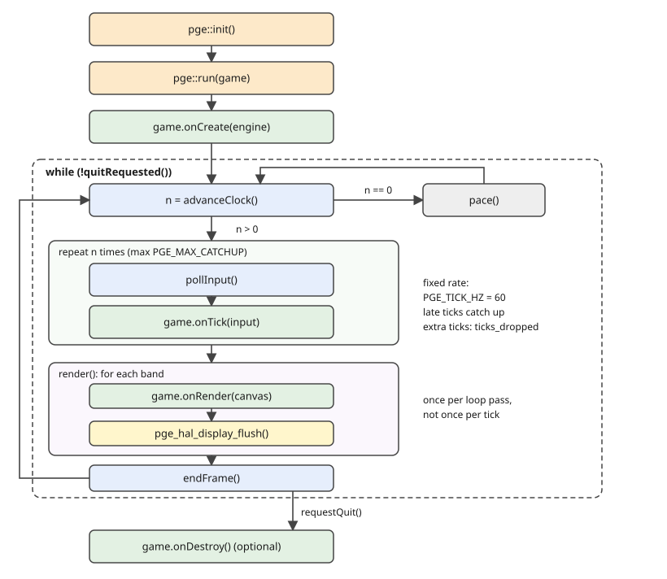

`pge::run` повторяет эти шаги, пока не придёт запрос на выход:

1. `advanceClock()` возвращает число тиков, которые пора выполнить сейчас.
2. Если тиков нет, `pace()` спит до следующего. Ничего не рисуется.
3. Для каждого положенного тика: сбрасывается арена кадра, читается ввод (`pollInput()`) и вызывается `onTick`.
4. После тиков кадр рисуется один раз: `onRender` вызывается по разу на полосу, и каждая полоса уходит на дисплей.
5. `endFrame()` завершает кадр.

Что это значит для вашей игры:

- Частота тиков фиксирована (`PGE_TICK_HZ`, по умолчанию 60). Двигайте объекты на заданное число пикселей за тик. Дельта времени не нужна.
- Если программа отстаёт, она выполняет пропущенные тики один за другим (catch-up). За один проход цикла выполняется не больше `PGE_MAX_CATCHUP` тиков (по умолчанию 5). Остальные тики отбрасываются и считаются в `Stats::ticks_dropped`.
- Отрисовка не привязана к тикам: после нескольких тиков может идти один кадр.
- `Input` снимается один раз за тик. `held()` — текущее состояние. `pressed()` и `released()` — переходы относительно предыдущего тика.

### Отрисовка полосами

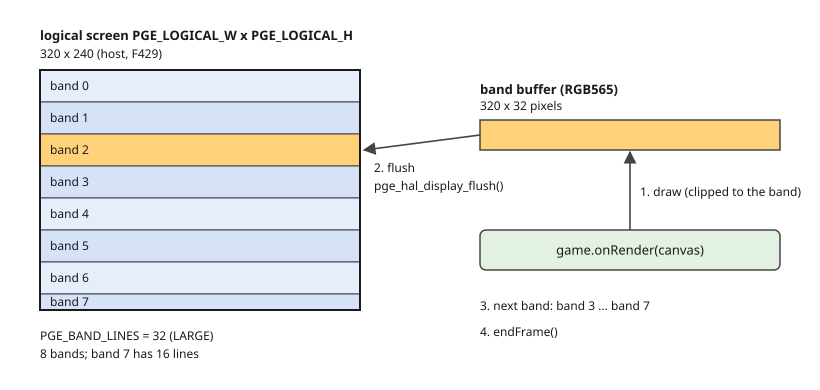

Движок никогда не держит кадр целиком. Он делит логический экран на горизонтальные полосы по `PGE_BAND_LINES` строк. Для каждой полосы он:

1. очищает маленький буфер полосы (RGB565),
2. вызывает ваш `onRender` с `Canvas` для этой полосы,
3. отправляет полосу на дисплей через HAL (`pge_hal_display_flush`).

В профиле LARGE (хост и F429) полоса состоит из 32 строк, поэтому экран 320 x 240 делится на 8 полос, и последняя содержит 16 строк. Полный кадр 320 x 240 в RGB565 занимает 153 600 байт; одна полоса из 32 строк — 20 480 байт (расчёт: ширина x строки x 2 байта).

Что это значит для вашей игры:

- `onRender` выполняется несколько раз за кадр. Всегда рисуйте всю сцену в координатах полного экрана. Canvas сам обрежет каждый вызов рисования по текущей полосе.
- `onRender` должен только рисовать. Если он изменит состояние игры, каждая полоса покажет своё состояние.
- `Canvas::visible(rect)` сообщает, пересекает ли прямоугольник текущую полосу. С его помощью можно пропускать лишнюю работу.

### Слои и модули

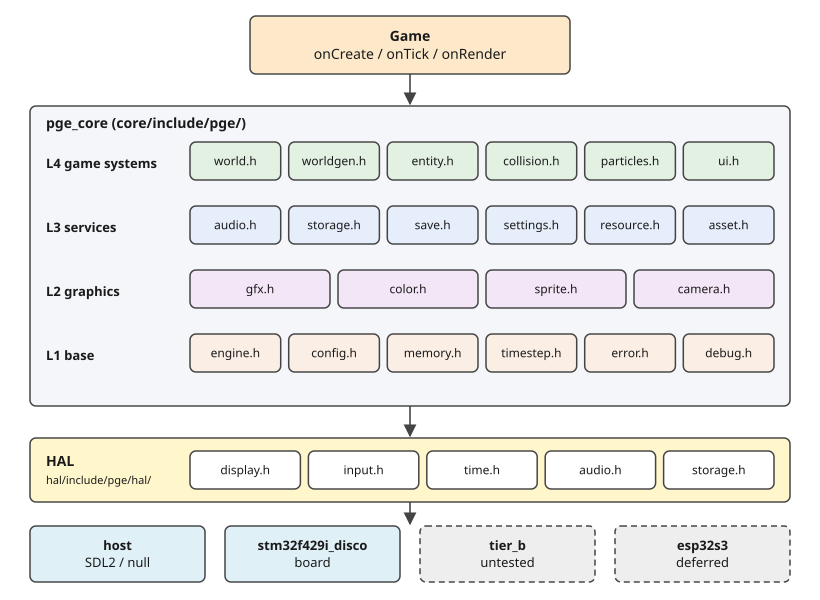

Движок собран из слоёв. Модуль может использовать модули своего слоя или нижележащих, но не вышележащих.

| Слой | Модули | Заголовки в `core/include/pge/` |
|---|---|---|
| L4 игровые системы (необязательно) | World, Entity, Physics, UI | `world.h`, `worldgen.h`, `entity.h`, `collision.h`, `particles.h`, `ui.h` |
| L3 сервисы | Input, Audio (необязательно), Storage (необязательно), Resource Manager | `audio.h`, `storage.h`, `save.h`, `settings.h`, `resource.h`, `asset.h` |
| L2 графика | Graphics, Renderer, Sprite, Tilemap, Camera | `gfx.h`, `color.h`, `sprite.h`, `camera.h` |
| L1 база | Core, Debug | `engine.h`, `config.h`, `memory.h`, `timestep.h`, `error.h`, `version.h`, `debug.h` |
| L0 сторона железа | HAL, Platform, Display | `hal/include/pge/hal/*.h`, а также код в `platform/` и `drivers/` |

Правила:

- Платформа выбирается при линковке. В программе одна платформа, переключения во время работы нет.
- Профиль может исключить необязательные модули из сборки.
- Код игры использует только публичные заголовки `pge/*.h`.

Подробнее: [modules.md](../user/modules.md) и [01-overview.md](../architecture/01-overview.md).

### Память без кучи

Движок использует три вида памяти. Все размеры берутся из профиля.

- **Арена инициализации.** Память, которую вы берёте в `onCreate` через `e.initArena()`. Она никогда не освобождается. Когда цикл стартует, арена инициализации блокируется; поздние выделения не проходят и учитываются в счётчике.
- **Арена кадра.** Временная память из `e.frameArena()`. Она сбрасывается в начале каждого тика.
- **Фиксированные пулы.** `pge::Pool<T, N>` хранит до N объектов. Когда пул полон, `alloc()` возвращает `kInvalid` и ничего не добавляет.

Код игры должен следовать тому же правилу. Используйте массивы фиксированного размера и поля класса, как в туториале. Не используйте `new`, `malloc` и растущие контейнеры в игровом цикле. Правила движка также исключают из ядра исключения, RTTI, iostream и STL-контейнеры с выделением памяти.

### Профили

У каждой платформы есть `pge_profile.h`. Он ставит ровно один из `PGE_PROFILE_SMALL`, `PGE_PROFILE_MEDIUM` или `PGE_PROFILE_LARGE` в 1 и задаёт размер логического экрана. Остальные значения `config.h` выводит сам. Хост и F429 используют LARGE.

| Параметр | SMALL | MEDIUM | LARGE |
|---|---|---|---|
| Логический экран | 160 x 128 | 320 x 240 | 320 x 240 |
| Строк в полосе (`PGE_BAND_LINES`) | 8 | 16 | 32 |
| Максимальный целый масштаб | 1 | 2 | 3 |
| Слои параллакса | 1 | 2 | 4 |
| Каналы звука | 0 (звук выключен) | 4 | 8 |
| Сущности | 64 | 256 | 1 024 |
| Частицы | 32 | 128 | 512 |

Любое значение можно переопределить до подключения `config.h`, например в необязательном `pge_user_config.h`. Полный список — в [api-core.md](../user/api-core.md).

## 5. Обзор API

Здесь каждая часть API показана на коротком примере. Все имена лежат в `namespace pge`. Полный справочник — в файлах `api-*.md`.

### Рисование на Canvas

`Canvas` — объект, который получает `onRender`. Он рисует пиксели, линии, прямоугольники, окружности и текст. Координаты — координаты логического экрана. Цвета — значения RGB565; `pge::rgb(r, g, b)` собирает цвет из 8-битных компонент. `pge::kPalette16` — встроенная палитра из 16 цветов.

```cpp
void onRender(pge::Canvas& c) {
  c.clear(pge::rgb(0, 0, 0));
  c.fillRect({10, 10, 40, 20}, pge::rgb(255, 0, 0));
  c.rect({8, 8, 44, 24}, pge::rgb(255, 255, 255));
  c.line(0, 0, c.width() - 1, c.height() - 1, pge::kPalette16[5]);
  c.fillCircle(160, 120, 30, pge::kPalette16[3]);
}
```

Справочник: [api-gfx.md](../user/api-gfx.md).

### Цвета и спрайты

Лист спрайтов — это массив 8-битных индексов палитры плюс сама палитра (`const pge::Color[]`). Если включён `transparent`, индекс 0 не рисуется. `Canvas::sprite` рисует один кадр. Флаги отражают спрайт (`FlipX`, `FlipY`) или поворачивают его шагами по 90 градусов (`Rot90`, `Rot180`, `Rot270`). `pge::Animation` и `pge::animFrame` выбирают кадр по числу тиков.

```cpp
constexpr pge::Animation kWalk{0, 4, 8, true};  // frames 0..3, 8 ticks each, looping

void onRender(pge::Canvas& c) {
  c.sprite(kSheet, pge::animFrame(kWalk, ticks_), x_, y_, pge::FlipX);
}
```

`tools/pge_assets.py` превращает PNG-картинки в индексированные листы спрайтов с палитрой RGB565. Смотрите [install.md](../user/install.md), раздел 4.

### Ввод

`onTick` получает `pge::Input`. В нём восемь кнопок (`Button::Up`, `Down`, `Left`, `Right`, `A`, `B`, `Start`, `Select`), четыре аналоговые оси и одна точка касания. Платформа решает, какие клавиши, выводы или стики им соответствуют.

```cpp
void onTick(const pge::Input& in) {
  if (in.held(pge::Button::Left)) x_ -= 2;       // true while the button is down
  if (in.pressed(pge::Button::A)) jumping_ = true;  // true only in the tick it went down
  if (in.touchPressed()) target_x_ = in.touchX();   // touch or mouse, in logical coordinates
}
```

Справочник: [api-core.md](../user/api-core.md) (`Input`) и [api-hal.md](../user/api-hal.md) (сторона HAL).

### Текст и UI

`Canvas::text` рисует строку растровым шрифтом. `pge::kFont5x7` — встроенный шрифт (ASCII с 32 по 126). `pge::textWidth` измеряет строку. Виджеты в `pge::ui` (`label`, `bar`, `iconGrid`, `listMenu`) не хранят состояние; вы вызываете их из `onRender`. `ui::MenuNav` двигает выбор клавишами Up и Down. `pge::drawOverlay` показывает время выполнения и счётчики пулов. UI-виджеты работают только на хосте.

```cpp
const pge::ui::Style st{&pge::kFont5x7, 0xFFFF, 0x0000, 0xFFE0, 1};  // font, fg, bg, accent, padding
pge::ui::label(c, st, 2, 2, "HP");
pge::ui::bar(c, st, {20, 2, 60, 7}, hp_, 10, pge::rgb(255, 0, 0));
```

Справочник: [api-gfx.md](../user/api-gfx.md) (`ui.h`) и [api-core.md](../user/api-core.md) (`debug.h`).

### Тайловые карты и камера

`Tileset` хранит картинки тайлов. `TileLayer` хранит сетку идентификаторов тайлов. `Canvas::tilemap` рисует один слой со смещением камеры. `pge::Camera` удерживает вид внутри мира. `pge::drawLayers` рисует несколько `MapLayer` с коэффициентами параллакса. Тайловые карты, слои, камера и параллакс проверены на плате F429.

```cpp
// in onTick: follow the player
cam_.centerOn(player_x_, player_y_);
// in onRender: draw the back layer, then the front layer
pge::drawLayers(c, cam_, layers_, 2);
```

Смотрите `examples/scroller/game.h` и `examples/platformer/game.h`. Справочник: [api-gfx.md](../user/api-gfx.md) (`camera.h`).

### Мир и сущности

Для больших миров `pge::World` хранит тайлы чанками по 32 x 32 тайла и держит в кэше лишь часть чанков. Функция-генератор, например `pge::terrainGen`, создаёт чанки; правки хранятся в журнале изменений. `pge::Entities` — фиксированный пул движущихся тел с гравитацией, столкновениями с тайлами, здоровьем и событиями урона. `pge::moveAndCollide` двигает один прямоугольник по сетке тайлов. Эти модули работают только на хосте.

```cpp
pge::WorldConfig wc = {};
wc.w_chunks = 32;
wc.h_chunks = 4;
wc.seed = 1234;
wc.gen = pge::terrainGen;
wc.props = props_;  // 256 TileProps entries, one per tile id
wc.tile_px = 16;
pge::Error err = world_.init(wc, e.initArena());   // in onCreate
if (err != pge::Ok) return err;
err = ent_.init(e.initArena(), 32);                // room for 32 entities
```

Смотрите `examples/sandbox/game.h`. Справочник: [api-world.md](../user/api-world.md).

### Звук

`pge::Mixer` играет звуковые эффекты PCM8 и PCM16 и паттерновую музыку. Игровой поток шлёт команды, а звуковая сторона платформы микширует. Звук проверен на хосте; бэкенд SAI для F429 только компилируется. Профиль SMALL исключает звук из сборки.

```cpp
static pge::Mixer mixer;
mixer.init(22050);
mixer.start();
const pge::Sound blip = {samples, 2000, 22050, pge::Pcm16, 0};  // data, frames, rate, format, loop
mixer.play(blip, 220);                                          // volume 0..255
```

Смотрите `examples/audiodemo/main.cpp`. Справочник: [api-audio-storage.md](../user/api-audio-storage.md).

### Хранилище

`pge::Storage` читает и пишет небольшие файлы и надёжно записывает файлы сохранений (два слота с проверкой CRC-32 и запасной копией `.bak`). `pge::saveGame` и `pge::loadGame` сохраняют журнал изменений мира вместе с вашими данными. `pge::Settings` читает файл вида `key = value`. Хранилище работает только на хосте; у F429 нет носителя для сохранений.

```cpp
err = storage_.init(e.initArena(), 512);           // in onCreate: I/O buffer of 512 bytes
storage_ok_ = storage_.mount() == pge::Ok;
// later, for example from a menu:
pge::saveGame(storage_, "game.sav", world_, ticks_, blob, sizeof blob);
```

Справочник: [api-audio-storage.md](../user/api-audio-storage.md).

## 6. Пошагово: простая пиксельная игра (Coin Catcher)

В этом туториале вы соберёте небольшую игру за пять шагов. Персонаж двигается, собирает монеты, считает очки и уворачивается от падающих камней. Каждый шаг — полная программа, которую можно собрать и запустить.

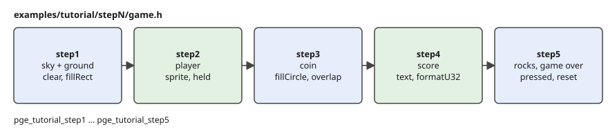

### Предварительные условия

- Рабочая сборка для хоста с SDL2, как в [разделе 2](#2-установка-и-сборка).
- Пути к инструментам CLion в `PATH` вашей сессии PowerShell.
- Базовый C++: классы, поля, массивы.

### Структура проекта

Туториал лежит в `examples/tutorial/`:

```text
examples/tutorial/
  CMakeLists.txt     one program per step: pge_tutorial_step1 .. pge_tutorial_step5
  main.cpp           shared main for all steps
  step1/game.h       game code of step 1
  step2/game.h
  step3/game.h
  step4/game.h
  step5/game.h
```

В каждой папке шага лежит один файл, `game.h`, с классом `Game`. Общий `main.cpp` подключает `game.h`; CMake собирает его по разу для каждого шага, каждый раз с папкой этого шага в путях включения.

`main.cpp` оборачивает `Game` в небольшой класс `Runner`, который добавляет флаги командной строки. Его функция `main` запускает движок:

```cpp
int main(int argc, char** argv) {
  const char* shot = nullptr;
  for (int i = 1; i < argc; i++) {
    if (!std::strcmp(argv[i], "--auto")) g_runner.autoplay = true;
    else if (i + 1 < argc && !std::strcmp(argv[i], "--ticks")) g_runner.quit_after = (uint32_t)std::strtoul(argv[++i], nullptr, 10);
    else if (i + 1 < argc && !std::strcmp(argv[i], "--shot")) shot = argv[++i];
  }
  pge::Error err = pge::init();
  if (err != pge::Ok) { std::printf("init failed: %d\n", err); return 1; }
  err = pge::run(g_runner);
  if (err != pge::Ok) { std::printf("run failed: %d\n", err); return 1; }
  if (shot && pge_host_save_bmp(shot) != 0) { std::printf("save_bmp failed\n"); return 1; }
  return 0;
}
```

Флаги:

- `--auto`: фиксированный сценарий ввода заменяет клавиатуру. Скриншоты туториала в этом руководстве сделаны с ним.
- `--ticks N`: выйти через N тиков.
- `--shot out.bmp`: после цикла сохранить содержимое окна в файл BMP. Для этого используется `pge_host_save_bmp`, который есть только на хосте.

Туториал использует только эти заголовки: `pge/engine.h`, `pge/color.h` и, начиная с шага 4, `pge/ui.h`.

### Шаг 1: небо и земля

**Цель:** самая маленькая игра, которая что-то рисует: синее небо и полоса зелёной земли.

**Код** (`examples/tutorial/step1/game.h`, файл целиком):

```cpp
// Coin Catcher, step 1: the smallest game. The engine calls onCreate once, onTick 60 times a second and onRender
// to draw a frame. This one only paints the sky and the ground.
#pragma once
#include "pge/color.h"
#include "pge/engine.h"

class Game {
 public:
  pge::Error onCreate(pge::Engine&) { return pge::Ok; }

  void onTick(const pge::Input&) {}

  // The engine draws the screen in horizontal bands and calls onRender once per band, so onRender only draws;
  // all game state changes happen in onTick.
  void onRender(pge::Canvas& c) {
    c.clear(pge::rgb(92, 148, 252));
    c.fillRect({0, kGroundY, c.width(), c.height() - kGroundY}, pge::rgb(60, 160, 60));
  }

 private:
  static constexpr int kGroundY = 220;  // top row of the grass
};
```

**Что нового:**

- У `class Game` есть три метода, которые нужны движку. `onCreate` и `onTick` пока ничего не делают.
- `pge::Error` — тип кода ошибки. `pge::Ok` означает успех.
- `c.clear(color)` заливает полосу одним цветом.
- `pge::rgb(r, g, b)` собирает цвет RGB565 из трёх значений от 0 до 255.
- `c.fillRect({x, y, w, h}, color)` заливает прямоугольник. `{0, kGroundY, ...}` — это `pge::Rect`.
- `c.width()` и `c.height()` возвращают размер логического экрана: на хосте это 320 x 240.
- Земля начинается со строки `kGroundY = 220`, так что её высота 20 пикселей.

**Сборка и запуск:**

```powershell
cmake --build build --target pge_tutorial_step1
build\examples\tutorial\pge_tutorial_step1.exe
```

Чтобы выйти, нажмите Esc или закройте окно.


### Шаг 2: игрок, которого можно двигать

**Цель:** персонаж 12 x 12 пикселей, которого двигают стрелки. Он остаётся внутри игрового поля и смотрит в сторону движения.

**Код:** сначала данные спрайта, в начале `examples/tutorial/step2/game.h`:

```cpp
// 12x12 player, one palette index per pixel; index 0 is transparent. The eyes look right.
constexpr uint8_t kPlayerPx[] = {
    0, 0, 0, 1, 1, 1, 1, 1, 1, 0, 0, 0,
    0, 0, 1, 2, 2, 2, 2, 2, 2, 1, 0, 0,
    0, 1, 2, 2, 2, 2, 2, 2, 2, 2, 1, 0,
    0, 1, 2, 3, 3, 2, 2, 3, 3, 2, 1, 0,
    0, 1, 2, 3, 1, 2, 2, 3, 1, 2, 1, 0,
    0, 1, 2, 2, 2, 2, 2, 2, 2, 2, 1, 0,
    0, 1, 2, 2, 1, 1, 1, 1, 2, 2, 1, 0,
    0, 0, 1, 2, 2, 2, 2, 2, 2, 1, 0, 0,
    0, 0, 0, 1, 1, 1, 1, 1, 1, 0, 0, 0,
    0, 0, 1, 4, 4, 1, 1, 4, 4, 1, 0, 0,
    0, 1, 4, 4, 4, 1, 1, 4, 4, 4, 1, 0,
    0, 1, 1, 1, 1, 0, 0, 1, 1, 1, 1, 0,
};
constexpr pge::Color kPlayerPal[] = {0, pge::rgb(20, 20, 40), pge::rgb(240, 120, 40), pge::rgb(255, 255, 255),
                                     pge::rgb(60, 60, 200)};
constexpr pge::SpriteSheet kPlayer{kPlayerPx, kPlayerPal, 12, 12, 1, true};
```

Затем новый класс `Game`:

```cpp
class Game {
 public:
  pge::Error onCreate(pge::Engine&) {
    x_ = (PGE_LOGICAL_W - kSize) / 2;
    y_ = (kGroundY - kSize) / 2;
    return pge::Ok;
  }

  void onTick(const pge::Input& in) {
    using pge::Button;
    const int dx = in.held(Button::Right) - in.held(Button::Left);
    const int dy = in.held(Button::Down) - in.held(Button::Up);
    if (dx != 0) left_ = dx < 0;
    x_ = std::clamp(x_ + dx * kSpeed, 0, PGE_LOGICAL_W - kSize);
    y_ = std::clamp(y_ + dy * kSpeed, 0, kGroundY - kSize);
  }

  void onRender(pge::Canvas& c) {
    c.clear(pge::rgb(92, 148, 252));
    c.fillRect({0, kGroundY, c.width(), c.height() - kGroundY}, pge::rgb(60, 160, 60));
    c.sprite(kPlayer, 0, x_, y_, left_ ? pge::FlipX : pge::None);
  }

 private:
  static constexpr int kGroundY = 220, kSize = 12, kSpeed = 2;  // kSpeed: pixels per tick
  int x_ = 0, y_ = 0;
  bool left_ = false;  // facing left: draw the sprite mirrored
};
```

**Что нового:**

- `kPlayerPx` — это картинка: один индекс палитры на пиксель, 12 x 12 значений, строка за строкой.
- `kPlayerPal` — палитра из значений `pge::Color`. Запись 0 не используется, потому что индекс 0 прозрачный.
- `pge::SpriteSheet{kPlayerPx, kPlayerPal, 12, 12, 1, true}` описывает картинку: пиксели, палитру, ширину, высоту, число кадров (1) и `true`, если «индекс 0 прозрачный».
- `PGE_LOGICAL_W` — ширина логического экрана из профиля (на хосте 320).
- `in.held(Button::Right)` равно `true`, пока кнопка нажата. `true - false` даёт 1, а `false - true` даёт -1, поэтому `dx` и `dy` равны -1, 0 или 1.
- Игрок движется на `kSpeed = 2` пикселя за тик. Частота тиков фиксирована, значит, скорость постоянна.
- `std::clamp` держит игрока внутри экрана и над землёй.
- `c.sprite(kPlayer, 0, x_, y_, flags)` рисует кадр 0 листа в точке (x, y). `pge::FlipX` отражает картинку, когда игрок смотрит влево; `pge::None` рисует её как есть.
- Состояние меняется только в `onTick`. `onRender` его только читает.

**Сборка и запуск:**

```powershell
cmake --build build --target pge_tutorial_step2
build\examples\tutorial\pge_tutorial_step2.exe
```

Для движения используйте стрелки или W, A, S, D.

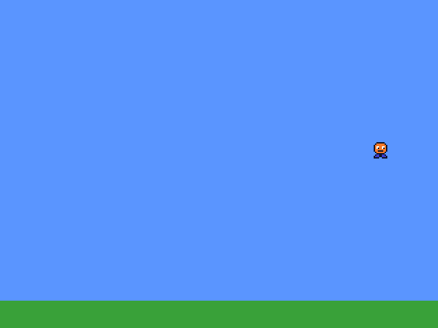

### Шаг 3: монета для сбора

**Цель:** монета. Когда игрок её касается, она перемещается на новое место.

**Код:** вспомогательная функция, которая проверяет, пересекаются ли два прямоугольника (`examples/tutorial/step3/game.h`):

```cpp
// Axis-aligned boxes overlap when they overlap on both axes; touching edges do not count.
inline bool overlap(pge::Rect a, pge::Rect b) {
  return a.x < b.x + b.w && b.x < a.x + a.w && a.y < b.y + b.h && b.y < a.y + a.h;
}
```

`onCreate` ставит первую монету:

```cpp
  pge::Error onCreate(pge::Engine&) {
    x_ = (PGE_LOGICAL_W - kSize) / 2;
    y_ = (kGroundY - kSize) / 2;
    coin_x_ = 240;  // the first coin sits right of the player; later ones are random
    coin_y_ = y_;
    return pge::Ok;
  }
```

Теперь `onTick` ещё и проверяет монету:

```cpp
  void onTick(const pge::Input& in) {
    using pge::Button;
    const int dx = in.held(Button::Right) - in.held(Button::Left);
    const int dy = in.held(Button::Down) - in.held(Button::Up);
    if (dx != 0) left_ = dx < 0;
    x_ = std::clamp(x_ + dx * kSpeed, 0, PGE_LOGICAL_W - kSize);
    y_ = std::clamp(y_ + dy * kSpeed, 0, kGroundY - kSize);

    if (overlap({x_, y_, kSize, kSize}, {coin_x_, coin_y_, kCoin, kCoin})) {
      coin_x_ = random(PGE_LOGICAL_W - kCoin);
      coin_y_ = random(kGroundY - kCoin);
    }
  }
```

`onRender` рисует монету раньше игрока, поэтому игрок оказывается сверху:

```cpp
  void onRender(pge::Canvas& c) {
    using pge::rgb;
    c.clear(rgb(92, 148, 252));
    c.fillRect({0, kGroundY, c.width(), c.height() - kGroundY}, rgb(60, 160, 60));
    const int r = kCoin / 2, cx = coin_x_ + r, cy = coin_y_ + r;
    c.fillCircle(cx, cy, r, rgb(255, 210, 0));
    c.circle(cx, cy, r, rgb(180, 120, 0));
    c.line(cx, cy - 2, cx, cy + 2, rgb(255, 250, 200));
    c.sprite(kPlayer, 0, x_, y_, left_ ? pge::FlipX : pge::None);
  }
```

Новая закрытая часть с генератором случайных чисел:

```cpp
 private:
  static constexpr int kGroundY = 220, kSize = 12, kSpeed = 2, kCoin = 11;

  // 0 .. n-1 from a linear congruential generator: same sequence every run, which keeps --auto repeatable.
  int random(int n) {
    rng_ = rng_ * 1664525u + 1013904223u;
    return static_cast<int>((rng_ >> 16) % static_cast<uint32_t>(n));
  }

  int x_ = 0, y_ = 0, coin_x_ = 0, coin_y_ = 0;
  bool left_ = false;
  uint32_t rng_ = 12345;
};
```

**Что нового:**

- `overlap` — обычный игровой код. Два прямоугольника пересекаются, когда пересекаются по обеим осям.
- `c.fillCircle(cx, cy, r, color)` рисует закрашенную окружность; `c.circle` рисует только контур.
- `c.line(x0, y0, x1, y1, color)` рисует линию. Здесь это блик на монете.
- Что нарисовано позже, то закрывает нарисованное раньше.
- `random(n)` — небольшой линейный конгруэнтный генератор. Он выдаёт одни и те же числа при каждом запуске. Поэтому прогон с `--auto` повторяется точно.

**Сборка и запуск:**

```powershell
cmake --build build --target pge_tutorial_step3
build\examples\tutorial\pge_tutorial_step3.exe
```

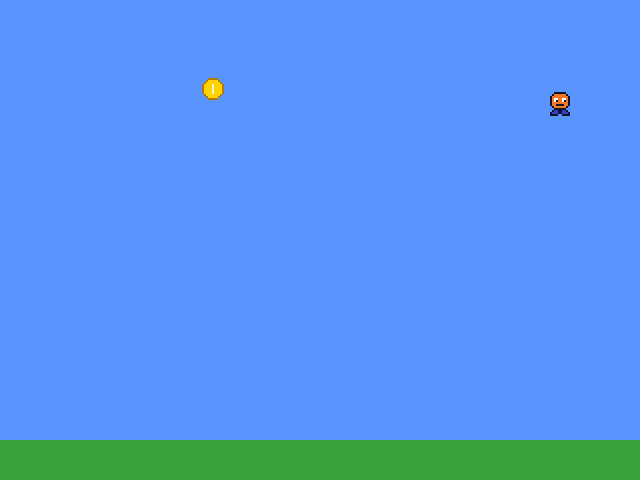

### Шаг 4: счёт

**Цель:** считать собранные монеты и показывать счёт в левом верхнем углу.

**Код:** на шаге 4 подключается ещё один заголовок (`examples/tutorial/step4/game.h`):

```cpp
#include "pge/color.h"
#include "pge/engine.h"
#include "pge/ui.h"
```

Вспомогательная функция, которая рисует текст с тенью:

```cpp
// White text with a black shadow, readable on any background.
inline void shadowText(pge::Canvas& c, int x, int y, const char* s) {
  c.text(pge::kFont5x7, x + 1, y + 1, s, pge::rgb(0, 0, 0));
  c.text(pge::kFont5x7, x, y, s, pge::rgb(255, 255, 255));
}
```

`onTick` считает монету:

```cpp
    if (overlap({x_, y_, kSize, kSize}, {coin_x_, coin_y_, kCoin, kCoin})) {
      score_++;
      coin_x_ = random(PGE_LOGICAL_W - kCoin);
      coin_y_ = random(kGroundY - kCoin);
    }
```

В конце `onRender` рисуется счёт:

```cpp
    char num[11];
    pge::ui::formatU32(num, sizeof num, score_);
    shadowText(c, 4, 4, "SCORE");
    shadowText(c, 4 + pge::textWidth(pge::kFont5x7, "SCORE "), 4, num);
```

**Что нового:**

- `pge/ui.h` даёт вспомогательные функции UI, в том числе `pge::ui::formatU32`.
- `c.text(font, x, y, text, color)` рисует строку на прозрачном фоне.
- `pge::kFont5x7` — встроенный шрифт 5 x 7 пикселей.
- Если нарисовать текст дважды, сначала чёрным со смещением на 1 пиксель, потом белым, получится тень, и текст читается на любом фоне.
- `pge::ui::formatU32(buffer, size, value)` записывает число десятичным текстом. `printf` для этого не нужен. В `uint32_t` не больше 10 цифр, так что хватает 11 символов вместе с завершающим нулём.
- `pge::textWidth(font, text)` возвращает ширину строки в пикселях. Здесь она ставит число после `"SCORE "`.
- Текст форматируется в `onRender`, один раз на полосу. Его можно отформатировать и в `onTick` и хранить в поле класса, как это делает `examples/platformer/game.h`.

**Сборка и запуск:**

```powershell
cmake --build build --target pge_tutorial_step4
build\examples\tutorial\pge_tutorial_step4.exe
```

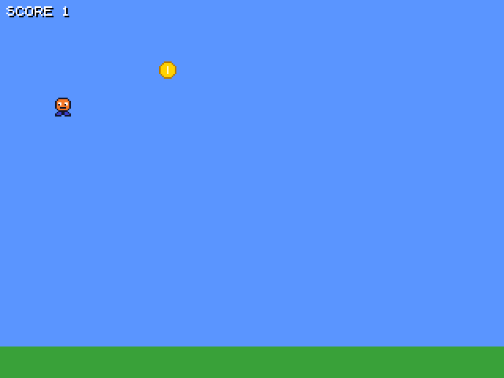

### Шаг 5: падающие камни и конец игры

**Цель:** с неба падают камни. Чем больше счёт, тем быстрее они летят. Камень, попавший в игрока, заканчивает игру. Start (Enter) начинает новую игру.

**Код:** вспомогательная функция для текста по центру (`examples/tutorial/step5/game.h`):

```cpp
inline void centeredText(pge::Canvas& c, int y, const char* s) {
  shadowText(c, (c.width() - pge::textWidth(pge::kFont5x7, s)) / 2, y, s);
}
```

Теперь `onCreate` вызывает `reset()`:

```cpp
  pge::Error onCreate(pge::Engine&) {
    reset();
    return pge::Ok;
  }
```

Полный `onTick`:

```cpp
  void onTick(const pge::Input& in) {
    using pge::Button;
    if (over_) {
      if (in.pressed(Button::Start)) reset();
      return;
    }
    const int dx = in.held(Button::Right) - in.held(Button::Left);
    const int dy = in.held(Button::Down) - in.held(Button::Up);
    if (dx != 0) left_ = dx < 0;
    x_ = std::clamp(x_ + dx * kSpeed, 0, PGE_LOGICAL_W - kSize);
    y_ = std::clamp(y_ + dy * kSpeed, 0, kGroundY - kSize);

    const pge::Rect player{x_, y_, kSize, kSize};
    if (overlap(player, {coin_x_, coin_y_, kCoin, kCoin})) {
      score_++;
      coin_x_ = random(PGE_LOGICAL_W - kCoin);
      coin_y_ = random(kGroundY - kCoin);
    }

    if (--spawn_in_ == 0) {
      spawn_in_ = kSpawnTicks;
      for (Rock& r : rocks_)
        if (!r.live) {  // take the first free slot; with none free this rock is skipped
          r = Rock{random(PGE_LOGICAL_W - kRock), -kRock, true};
          break;
        }
    }
    const int fall = 2 + static_cast<int>(score_ / 4);
    for (Rock& r : rocks_) {
      if (!r.live) continue;
      r.y += fall;
      if (r.y >= kGroundY) r.live = false;
      else if (overlap(player, {r.x, r.y, kRock, kRock})) over_ = true;
    }
  }
```

В `onRender` камни рисуются раньше игрока:

```cpp
    for (const Rock& k : rocks_)
      if (k.live) {
        c.fillRect({k.x, k.y, kRock, kRock}, rgb(120, 110, 100));
        c.rect({k.x, k.y, kRock, kRock}, rgb(60, 50, 45));
      }
```

В конце `onRender` выводится текст конца игры:

```cpp
    if (over_) {
      centeredText(c, 100, "GAME OVER");
      centeredText(c, 116, "PRESS START");
    }
```

Закрытая часть: константы, запись о камне и `reset()`:

```cpp
  static constexpr int kGroundY = 220, kSize = 12, kSpeed = 2, kCoin = 11;
  static constexpr int kRock = 8, kRocks = 16, kSpawnTicks = 20;  // a new rock every 20 ticks (1/3 s)
  struct Rock { int x, y; bool live; };

  // Puts everything back to the start; used for the first game and for every restart.
  void reset() {
    x_ = (PGE_LOGICAL_W - kSize) / 2;
    y_ = (kGroundY - kSize) / 2;
    coin_x_ = 240;  // the first coin sits right of the player; later ones are random
    coin_y_ = y_;
    score_ = 0;
    spawn_in_ = kSpawnTicks;
    for (Rock& r : rocks_) r.live = false;
    over_ = false;
  }
```

**Что нового:**

- `in.pressed(Button::Start)` равно `true` только в том тике, когда кнопку нажали. Удержание кнопки не перезапускает игру снова и снова.
- Пока `over_` равно `true`, `onTick` возвращается раньше, и игра стоит на месте.
- Камни живут в фиксированном массиве `rocks_[kRocks]` из 16 слотов. Во время игры память не выделяется. Новый камень занимает первый свободный слот; если все слоты заняты, камень не добавляется.
- Новый камень появляется каждые `kSpawnTicks = 20` тиков. При 60 тиках в секунду это три камня в секунду.
- Скорость падения — `2 + score_ / 4` пикселей за тик, так что игра усложняется.
- `c.rect(rect, color)` рисует контур в 1 пиксель внутри прямоугольника.
- `reset()` возвращает всё состояние к началу. Его вызывают и `onCreate`, и перезапуск.

**Сборка и запуск:**

```powershell
cmake --build build --target pge_tutorial_step5
build\examples\tutorial\pge_tutorial_step5.exe
```

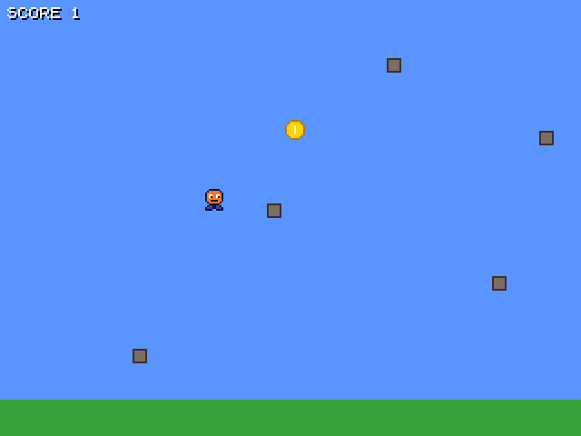

Когда камень попадает в игрока, игра останавливается и показывает текст конца игры. Нажмите Enter, чтобы сыграть снова.

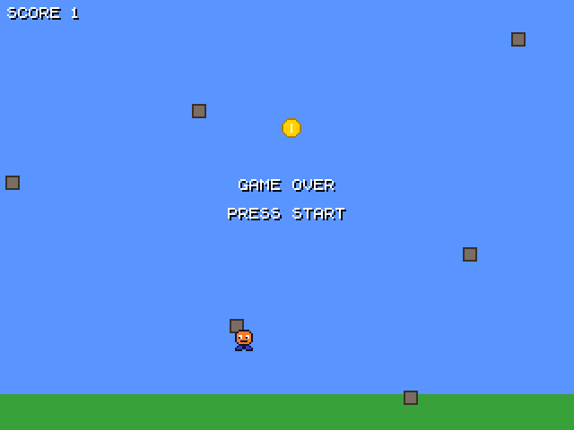

Шаг можно запустить и со сценарием ввода и сохранить скриншот:

```powershell
build\examples\tutorial\pge_tutorial_step5.exe --auto --ticks 300 --shot step5.bmp
```

### Идеи для развития

- **Звук.** Проиграйте короткий звук, когда игрок берёт монету. Создайте один `pge::Mixer`, вызовите `init` и `start`, а `play` вызывайте в `onTick`. Смотрите раздел [Звук](#звук) и `examples/audiodemo/main.cpp`. Звук проверен на хосте; бэкенд звука F429 только компилируется.
- **Анимация.** Добавьте листу игрока больше кадров и выбирайте кадр через `pge::animFrame`. Смотрите [Цвета и спрайты](#цвета-и-спрайты).
- **Тайловый фон.** Замените простое небо тайловым слоем и камерой. Смотрите [Тайловые карты и камера](#тайловые-карты-и-камера) и `examples/scroller/game.h`.
- **Отладочный оверлей.** Подключите `pge/debug.h`, сохраните указатель на `pge::Engine` из `onCreate` и в конце `onRender` вызовите `pge::drawOverlay(c, style, eng_->stats(), pge::kOverlayAll)`. Оверлей показывает время тиков и кадров и счётчики пулов.
- **Запуск на плате F429.** У туториала нет цели для прошивки. Образец показывает scroller: `examples/f429/scroller_main.cpp` — короткий `main`, который запускает тот же `game.h`, что и программа для хоста, а `platform/stm32f429i_disco/CMakeLists.txt` объявляет его цель прошивки. Привяжите кнопки движка к кнопкам и стику платы, как в [hardware.md](../user/hardware.md). Сначала прочитайте [porting.md](../user/porting.md) и [examples.md](../user/examples.md). Учтите: `main.cpp` туториала использует `pge_host_save_bmp`, а он есть только на хосте.

### Своя игра

Проще всего начать с копии готового туториала.

1. Создайте папку, например `examples/mygame/`.
2. Скопируйте в неё `examples/tutorial/main.cpp` и `examples/tutorial/step5/game.h`.
3. Создайте `examples/mygame/CMakeLists.txt`. Он строится по образцу `examples/tutorial/CMakeLists.txt`, но с одной программой:

   ```cmake
   add_executable(pge_mygame main.cpp)
   target_link_libraries(pge_mygame PRIVATE pge_core pge_platform_host)
   add_custom_command(TARGET pge_mygame POST_BUILD
     COMMAND ${CMAKE_COMMAND} -E copy_if_different $<TARGET_FILE:SDL2::SDL2> $<TARGET_FILE_DIR:pge_mygame>)
   ```

   `main.cpp` находит `game.h`, потому что оба файла лежат в одной папке.

4. Зарегистрируйте папку в корневом `CMakeLists.txt`. Добавьте эту строку внутри блока `if(SDL2_FOUND)`, рядом с `add_subdirectory(examples/tutorial)`:

   ```cmake
   add_subdirectory(examples/mygame)
   ```

5. Соберите и запустите:

   ```powershell
   cmake --build build --target pge_mygame
   build\examples\mygame\pge_mygame.exe
   ```

6. Меняйте `game.h` шаг за шагом. После каждой правки пересобирайте.

Правила для кода игры:

- Подключайте только заголовки `pge/<name>.h` из `core/include/pge/`, свой `game.h` и несколько стандартных заголовков C/C++. Как это проверяется для sandbox, показывает `examples/sandbox/check_includes.cmake`.
- Храните всё состояние в полях класса и в массивах фиксированного размера. Большие буферы выделяйте в `onCreate` из `e.initArena()`.
- Меняйте состояние только в `onTick`. В `onRender` только рисуйте.

Для игры без окна и без SDL начните с `examples/empty` и слинкуйте `pge_platform_host_null`. Смотрите "Starting your own game" в [examples.md](../user/examples.md).

## 7. Решение проблем

**`cmake` или `ninja` не распознаётся.**
На машине разработки они идут с CLion и не прописаны в глобальный `PATH`. В каждой новой сессии PowerShell выполняйте строку `$env:PATH = ...` из [раздела 2](#сборка-на-windows-с-набором-инструментов-clion).

**CMake пишет `SDL2 not found: host window demo skipped`, или цель `pge_tutorial_step1` неизвестна.**
Туториал и примеры с окном добавляются, только если CMake находит SDL2. Передайте префикс установки SDL2: `-DCMAKE_PREFIX_PATH=<SDL2 prefix>`. Затем настройте проект заново.

**Программа не запускается, Windows сообщает об отсутствующей DLL.**
- Для DLL среды выполнения MinGW: перед запуском добавьте `C:\Program Files\JetBrains\CLion\bin\mingw\bin` в `PATH`.
- Для `SDL2.dll`: шаг post-build копирует её рядом с программой. Соберите цель ещё раз и проверьте, что при настройке SDL2 найден.

**Тесты не запускаются.**
Пока работает `ctest`, `mingw\bin` должен быть в `PATH`: нужны те же DLL среды выполнения.

**Настройка проекта под плату в PowerShell завершается ошибкой.**
Возьмите аргумент с toolchain в кавычки: `"-DCMAKE_TOOLCHAIN_FILE=cmake/arm-none-eabi.cmake"`. Без кавычек PowerShell разрезает его по точке. Также `arm-none-eabi-gcc` и `arm-none-eabi-g++` должны быть в `PATH`.

**Настройка завершается ошибкой `PGE_CUBE_DIR does not point at STM32CubeF4`.**
Передайте путь к вашей копии STM32CubeF4 через `-DPGE_CUBE_DIR=<path>`. В папке должен лежать файл `Drivers/STM32F4xx_HAL_Driver/Src/stm32f4xx_hal.c`.

**CMake пишет `Python3 with Pillow not found`.**
Пропускаются только тесты инструментов для ресурсов. Если эти инструменты нужны, установите Pillow в тот Python, которым пользуетесь.

**На машине без дисплея нет окна.**
Перед запуском программы задайте `$env:SDL_VIDEODRIVER='dummy'` и `$env:SDL_RENDER_DRIVER='software'`. Флаг `--ticks` заставит программу выйти, а `--shot` даст изображение.

**SAVE и LOAD показывают NO STORAGE на F429.**
Так и должно быть. Драйвера носителя для сохранений у платы пока нет. Сохранение работает только на хосте.

**Стик на F429 двигает игрока без нажатий.**
Центр стика измеряется один раз при старте. Держите стик в центре, пока плата запускается. Неподключённые выводы стика дают случайные значения. Смотрите [hardware.md](../user/hardware.md).

## 8. FAQ

**Почему `onRender` вызывается много раз за кадр?**
Из-за отрисовки полосами. Движок вызывает его по разу на каждую полосу. Смотрите [Отрисовка полосами](#отрисовка-полосами).

**Можно ли менять состояние игры в `onRender`?**
Нет. Тогда каждая полоса покажет своё состояние. Меняйте состояние только в `onTick`.

**Можно ли использовать `new`, `malloc` или `std::vector`?**
Движок не выделяет память после `pge::init()`, и код игры в цикле должен следовать тому же правилу. Используйте поля класса и массивы фиксированного размера или выделите память один раз в `onCreate` из `e.initArena()`.

**Как завершить игру из кода?**
Вызовите `requestQuit()` у `pge::Engine`, который получил `onCreate`. Сохраните на него указатель. На хосте выйти можно и клавишей Esc, и закрытием окна.

**Какого размера экран?**
Логический размер задаёт профиль: `PGE_LOGICAL_W` x `PGE_LOGICAL_H`, на хосте и на F429 это 320 x 240. Окно на хосте показывает его в двойном размере.

**Как быстро работает PGE?**
Цифр в этом руководстве нет. Измеренные результаты с условиями лежат в [benchmarks.md](../user/benchmarks.md).

**Работает ли PGE на ESP32-S3?**
Пока нет. Порт на ESP32-S3 отложен. `platform/esp32s3` — заглушка.

**А как насчёт RP2040, RP2350, STM32H7 и других плат?**
Для них есть заготовки Tier B: ядро и заглушка HAL компилируются, но на плате ничего не линкуется и не запускается. Смотрите [platform/tier_b/README.md](../../platform/tier_b/README.md) и [porting.md](../user/porting.md).

**Можно ли пользоваться PlatformIO, STM32CubeIDE или VS Code?**
Поддерживаемая сборка — CMake. У PlatformIO есть проверенная среда native (для хоста); заметки по STM32CubeIDE и задачи VS Code не проверены. Смотрите [wrappers.md](../user/wrappers.md).

**Можно ли свободно поворачивать картинку или менять масштаб?**
Нет. Спрайты поворачиваются только шагами по 90 градусов, а масштаб вывода целый (1x, 2x или 3x).

## 9. Глоссарий

| Термин | Значение |
|---|---|
| Полоса (band) | Горизонтальная полоса экрана высотой `PGE_BAND_LINES` строк. Движок рисует по одной полосе за раз. |
| Буфер полосы | Маленький буфер RGB565, в котором лежит одна полоса, пока её рисуют. |
| Проверено на плате | Подтверждено пользователем на плате STM32F429I-DISCO. |
| Canvas | Объект рисования, который получает `onRender`. Он действует только во время этого вызова. |
| Catch-up | Выполнение пропущенных тиков один за другим, до `PGE_MAX_CATCHUP` за проход цикла. |
| Чанк | Кусок `World` размером 32 x 32 тайла. |
| Только компиляция | Код собирается, но ничего не запускали. |
| Фиксированный шаг | Логика игры идёт тиками одинаковой длины, `PGE_TICK_HZ` в секунду. |
| Flush | Отправка готовой полосы на дисплей. |
| Арена кадра | Временная память, которая сбрасывается в начале каждого тика. |
| HAL | Слой абстракции железа: C-заголовки в `hal/include/pge/hal/`, которые реализует каждая платформа. |
| Хост | Настольный ПК. Платформа host использует SDL2 или null-бэкенды без окна. |
| Только хост | Собрано и проверено на ПК; на плате ничего не запускали. |
| Арена инициализации | Память, взятая в `onCreate`. Она никогда не освобождается и блокируется при старте цикла. |
| Логический экран | Размер экрана в пикселях, на который рисует игра. Дисплей может показывать его с масштабом. |
| Палитра | Массив значений `pge::Color`. Пиксели спрайта — индексы в нём. |
| Платформа | Одна реализация HAL для одной цели, например `host` или `stm32f429i_disco`. |
| Пул | Фиксированное число слотов для объектов одного типа. Он никогда не растёт. |
| Профиль | SMALL, MEDIUM или LARGE: набор размеров и переключателей времени компиляции. |
| RGB565 | 16-битный цвет: 5 бит красного, 6 бит зелёного, 5 бит синего. |
| Лист спрайтов | Картинка с одним или несколькими кадрами, хранится как индексы палитры. |
| Тик | Один шаг логики игры: один вызов `onTick`. |
| Tier A | Цели, которые проект измеряет: хост и STM32F429I-DISCO. |
| Tier B | Платы только с непроверенной заготовкой HAL. |
| Тайл, тайловая карта | Маленькая квадратная картинка и сетка идентификаторов тайлов, из которой строится уровень. |

## 10. Дополнительная документация

- [install.md](../user/install.md): установка и сборка
- [hardware.md](../user/hardware.md): поддерживаемые платы и подключение
- [modules.md](../user/modules.md): модули движка и их статус
- [examples.md](../user/examples.md): примеры программ
- [api-core.md](../user/api-core.md): API ядра
- [api-gfx.md](../user/api-gfx.md): графический API
- [api-world.md](../user/api-world.md): API мира, столкновений и сущностей
- [api-audio-storage.md](../user/api-audio-storage.md): API звука и хранилища
- [api-hal.md](../user/api-hal.md): API HAL
- [porting.md](../user/porting.md): руководство по портированию
- [wrappers.md](../user/wrappers.md): PlatformIO, STM32CubeIDE, VS Code
- [benchmarks.md](../user/benchmarks.md): результаты замеров
- [01-overview.md](../architecture/01-overview.md): обзор архитектуры
- [CHANGELOG.md](../../CHANGELOG.md): заметки о выпусках
- [STATUS.md](../../STATUS.md): статус проекта и трекер возможностей
